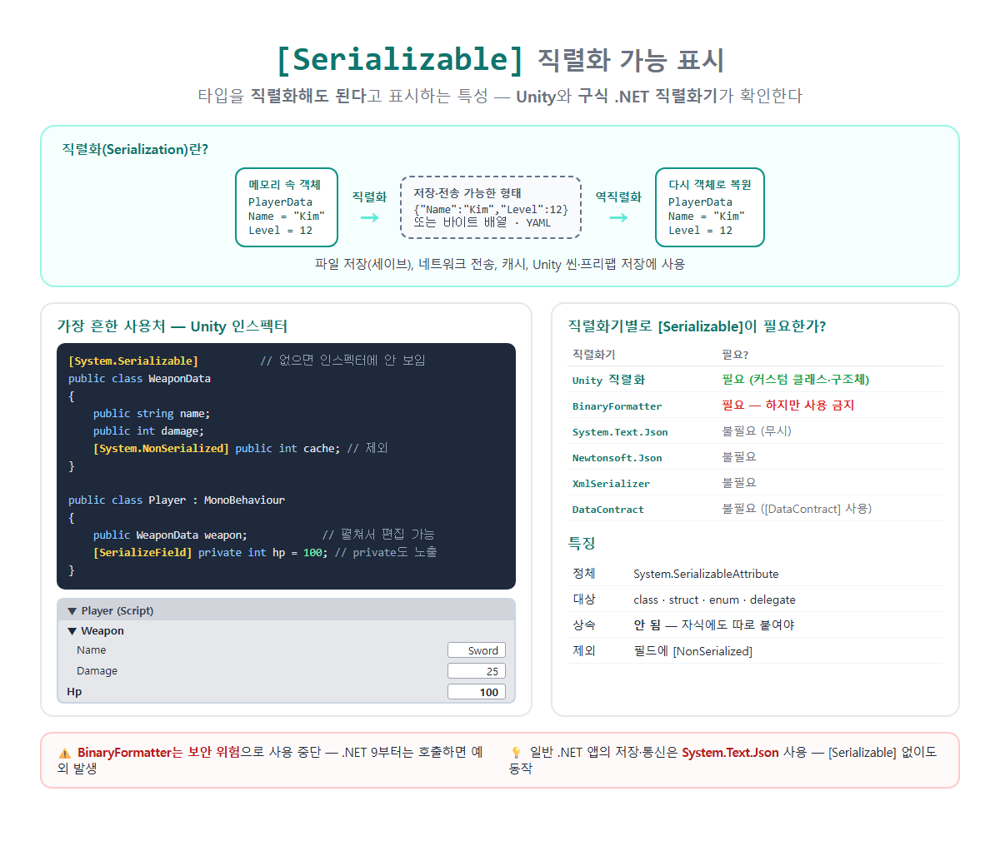

# [[Serializable]](../KeywordsList.md)

</img>

| 항목 | 내용 |
| --- | --- |
| 정체 | `System.SerializableAttribute` (의사 특성, IL 플래그로 기록) |
| 의미 | 이 타입은 직렬화해도 된다는 표시 |
| 대상 | class, struct, enum, delegate |
| 상속 | ❌ 자식 클래스에 따로 붙여야 함 |
| 제외 방법 | 필드에 `[NonSerialized]` |
| 필요한 곳 | Unity 직렬화, `JsonUtility`, `BinaryFormatter`(사용 금지) |
| 불필요한 곳 | System.Text.Json, Newtonsoft.Json, XmlSerializer, DataContract |
| 커스텀 제어 | `ISerializable` 인터페이스 (구식) |
| 현대 .NET 권장 | System.Text.Json (+ `[JsonPropertyName]`, `[JsonIgnore]`) |

## 정의

- 클래스나 구조체에 붙여서 "이 타입은 직렬화해도 된다"고 표시하는 특성(Attribute)
- 직렬화(Serialization) : 메모리에 있는 객체를 저장하거나 전송할 수 있는 형태로 바꾸는 것

```csharp
[Serializable]
public class PlayerData
{
    public string Name = "";
    public int Level;

    [NonSerialized]                 // 이 필드는 직렬화에서 제외
    public int TempCache;
}
```

## 특징

- 표시(마커)만 함. `[Serializable]` 자체가 직렬화를 해 주지는 않음. 직렬화기(Serializer)가 이 표시를 확인하고 처리 여부를 결정.
- 모든 직렬화기가 이 특성을 보는 것은 아님.
- 상속되지 않음. 부모 클래스에 붙어 있어도 자식 클래스에는 따로 붙여야 함.
- 필드 단위로 직렬화. 구식 .NET 직렬화기와 Unity는 필드를 저장. private 필드도 포함됨(Unity는 규칙이 다름).
- `[NonSerialized]`를 필드에 붙이면 그 필드는 직렬화에서 제외됨.
- 붙일 수 있는 대상은 class, struct, enum, delegate.
- 의사(pseudo) 특성. 일반 특성처럼 메타데이터에 저장되는 대신, IL의 타입 플래그(`serializable`)로 기록됨.

## [Serializable] 필요 여부

| 직렬화기 | `[Serializable]` 필요? | 비고 |
| --- | --- | --- |
| Unity 직렬화 | ✅ 필요 | 커스텀 클래스·구조체를 인스펙터·씬·프리팹에 저장하려면 필수 |
| `BinaryFormatter` | ✅ 필요 | ⚠️ 보안 위험으로 사용 금지, .NET 9부터 실행 시 예외 |
| `SoapFormatter` | ✅ 필요 | 구식, .NET Core 미지원 |
| `System.Text.Json` | ❌ 불필요 | 특성을 무시함. public 속성을 기준으로 처리 |
| `Newtonsoft.Json` | ❌ 불필요 | public 멤버를 기준으로 처리 |
| `XmlSerializer` | ❌ 불필요 | public 속성·필드 + 매개변수 없는 생성자 필요 |
| `DataContractSerializer` | ❌ 불필요 | `[DataContract]` / `[DataMember]` 사용 |

## 기능

#### Unity: 커스텀 데이터를 인스펙터에 노출

```csharp
using UnityEngine;

[System.Serializable]                          // 없으면 인스펙터에 표시되지 않음
public class WeaponData
{
    public string name;
    public int damage;
    public float cooldown;
    [System.NonSerialized] public int runtimeCache;   // 저장·표시 제외
}

public class Player : MonoBehaviour
{
    public WeaponData weapon;                   // 인스펙터에서 펼쳐서 편집 가능
    public WeaponData[] inventory;              // 배열·리스트도 가능
    [SerializeField] private int hp = 100;      // private 필드도 인스펙터에 노출
    [HideInInspector] public int score;         // 저장은 하지만 인스펙터에서 숨김
}
```

- Unity 직렬화 규칙 요약

| 대상 | 직렬화되나? |
| --- | --- |
| `public` 필드 | ✅ |
| `private` 필드 + `[SerializeField]` | ✅ |
| `[System.NonSerialized]`가 붙은 필드 | ❌ |
| 속성(Property) | ❌ (`[field: SerializeField]`로 자동 속성의 숨은 필드는 가능) |
| `static`, `const`, `readonly` 필드 | ❌ |
| `[Serializable]`이 없는 커스텀 클래스 타입 필드 | ❌ |
| `Dictionary<K,V>` | ❌ (기본 미지원) |

#### JsonUtility (Unity)

- Unity의 `JsonUtility`도 같은 규칙을 따르므로 `[Serializable]`이 필요.

```csharp
[System.Serializable]
public class SaveData { public int level; public string playerName; }

string json = JsonUtility.ToJson(new SaveData { level = 5, playerName = "Kim" });
SaveData loaded = JsonUtility.FromJson<SaveData>(json);
```

#### 레거시 .NET 코드

- 옛날 .NET Framework 코드에서 `BinaryFormatter`로 객체를 저장하거나, AppDomain 간에 객체를 전달하거나, `Exception` 클래스를 직렬화하던 곳에서 볼 수 있음.