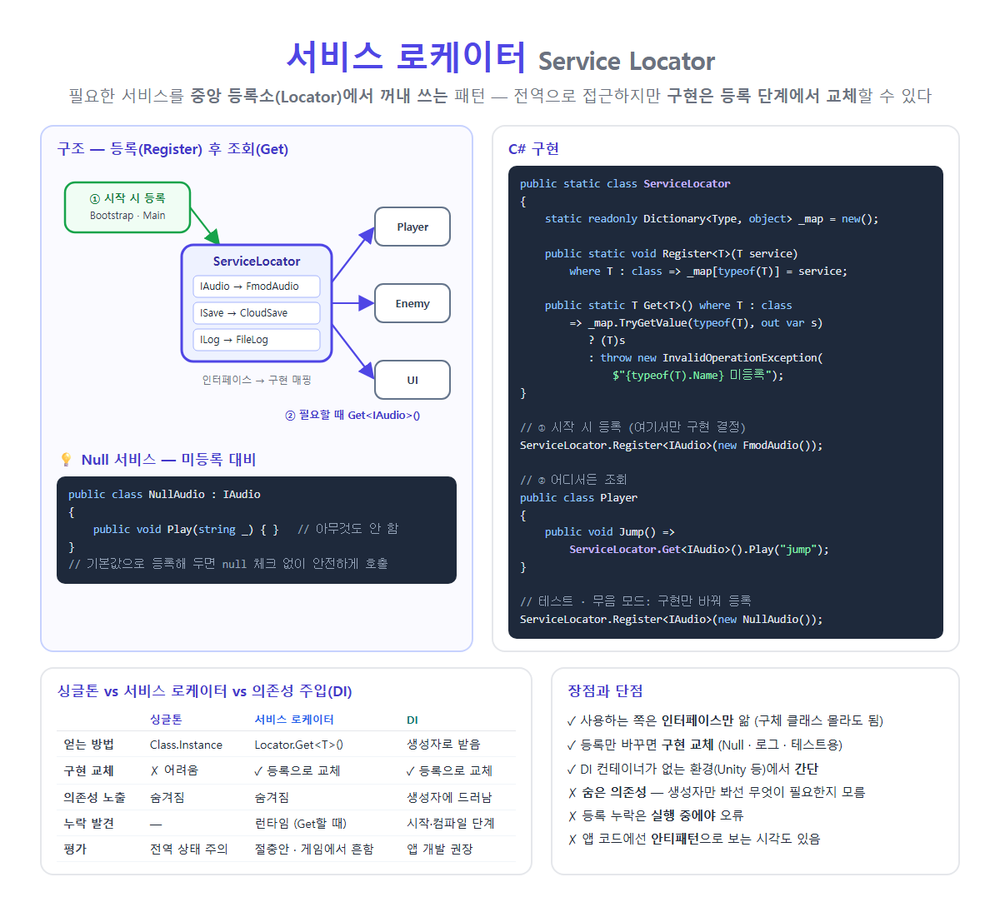

# [서비스 로케이터](../KeywordsList.md)

</img>

| 항목 | 내용 |
| --- | --- |
| 분류 | 디커플링 패턴 (게임 프로그래밍 패턴) |
| 정의 | 서비스를 중앙 등록소에 등록하고, 필요한 곳에서 꺼내 쓰는 패턴 |
| 핵심 API | `Register<T>(impl)`, `Get<T>()`, `TryGet<T>()` |
| 접근 방식 | 인터페이스로 요청 (구체 클래스를 모름) |
| 의존성 방향 | 클래스가 스스로 요청 (pull) |
| 장점 | 구현 교체 쉬움, 구체 클래스와 분리, DI 없이도 간단, Null·로그 서비스 활용 |
| 단점 | 숨은 의존성, 등록 누락이 런타임 오류, 전역 상태, 테스트 간 상태 공유 |
| 보완 기법 | Null 서비스, 데코레이터, 등록 검증, 시작 시 일괄 등록 |
| 대안 | 의존성 주입(DI) |

## 정의

- 오디오, 저장, 로그, 네트워크처럼 여러 곳에서 공통으로 쓰는 기능(서비스)을 중앙 등록소(Locator)에 등록해 두고, 필요한 곳에서 꺼내 쓰는 패턴
- 사용하는 쪽은 인터페이스(IAudio)로 요청하고, 실제 구현이 무엇인지는 모름
- 어떤 구현을 쓸지는 시작할 때 등록하는 코드 한 곳에서 정함.
- 로버트 나이스트롬의 『게임 프로그래밍 패턴』에서 디커플링 패턴으로 소개되며, 싱글톤의 단점을 보완한 절충안으로 자주 쓰임.

## 구현

```csharp
// 1. 서비스 인터페이스
public interface IAudio
{
    void Play(string soundId);
}

// 2. 실제 구현들
public class FmodAudio : IAudio
{
    public void Play(string id) => Console.WriteLine($"[FMOD] {id} 재생");
}

public class NullAudio : IAudio                     // 아무것도 하지 않는 구현 (Null Object)
{
    public void Play(string id) { }
}

public class LoggedAudio(IAudio inner) : IAudio     // 기존 구현을 감싸서 로그 추가 (데코레이터)
{
    public void Play(string id)
    {
        Console.WriteLine($"[LOG] Play({id})");
        inner.Play(id);
    }
}

// 3. 서비스 로케이터
public static class ServiceLocator
{
    private static readonly Dictionary<Type, object> _services = new();

    public static void Register<T>(T service) where T : class
        => _services[typeof(T)] = service;

    public static T Get<T>() where T : class
        => _services.TryGetValue(typeof(T), out var s)
            ? (T)s
            : throw new InvalidOperationException($"{typeof(T).Name}이(가) 등록되지 않았습니다.");

    public static bool TryGet<T>(out T? service) where T : class
    {
        bool ok = _services.TryGetValue(typeof(T), out var s);
        service = s as T;
        return ok;
    }
}

// 4. 시작할 때 한 번 등록 (구현 결정은 여기서만)
ServiceLocator.Register<IAudio>(new FmodAudio());

// 5. 어디서든 사용
public class Player
{
    public void Jump() => ServiceLocator.Get<IAudio>().Play("jump");
}

// 상황에 따라 구현 교체
ServiceLocator.Register<IAudio>(new NullAudio());                    // 무음 모드, 테스트
ServiceLocator.Register<IAudio>(new LoggedAudio(new FmodAudio()));   // 디버깅용 로그
```

## 구성요소

| 구성 요소 | 역할 | 예 |
| --- | --- | --- |
| **Service (인터페이스)** | 제공할 기능의 약속 | `IAudio`, `ISaveSystem`, `ILogger` |
| **Service Provider (구현)** | 실제 기능 | `FmodAudio`, `CloudSave`, `FileLogger` |
| **Service Locator** | 서비스를 등록하고 찾아 주는 중앙 등록소 | `ServiceLocator.Register/Get` |
| **Client** | 서비스를 꺼내 쓰는 쪽 | `Player`, `Enemy`, `UI` |
| **Null Service (선택)** | 등록 전이나 비활성화 상태를 위한 "아무것도 안 하는" 구현 | `NullAudio` |

## 특징

- 전역 접근점을 제공. 싱글톤처럼 어디서든 서비스를 얻을 수 있음.
- 하지만 싱글톤과 달리 구체 클래스가 아니라 인터페이스로 접근. 그래서 등록만 바꾸면 구현을 교체할 수 있음.
- 실행 중에도 교체할 수 있음. 예: 설정에서 소리를 끄면 `NullAudio`로 교체
- 의존성이 "끌어오는(pull)" 방식. 클래스가 스스로 로케이터에 요청. 반대로 DI는 외부에서 밀어 넣는(push) 방식.
- 등록 누락은 실행 중에야 발견됨(`Get` 할 때 예외).

## 기능

| 활용 | 설명 |
| --- | --- |
| **게임 공통 서비스** | 오디오, 입력, 저장, 분석(Analytics), 로그 |
| **구현 교체** | 플랫폼별 구현 (PC / 모바일 / 콘솔 저장 방식) |
| **기능 끄기** | Null 서비스로 교체해서 소리 끄기, 로그 끄기 |
| **디버깅** | 로그를 남기는 데코레이터로 감싸서 등록 |
| **테스트** | 가짜(Fake) 서비스를 등록해서 단위 테스트 |
| **DI가 없는 환경** | Unity처럼 생성자 주입이 어려운 곳에서 간단한 대안 |