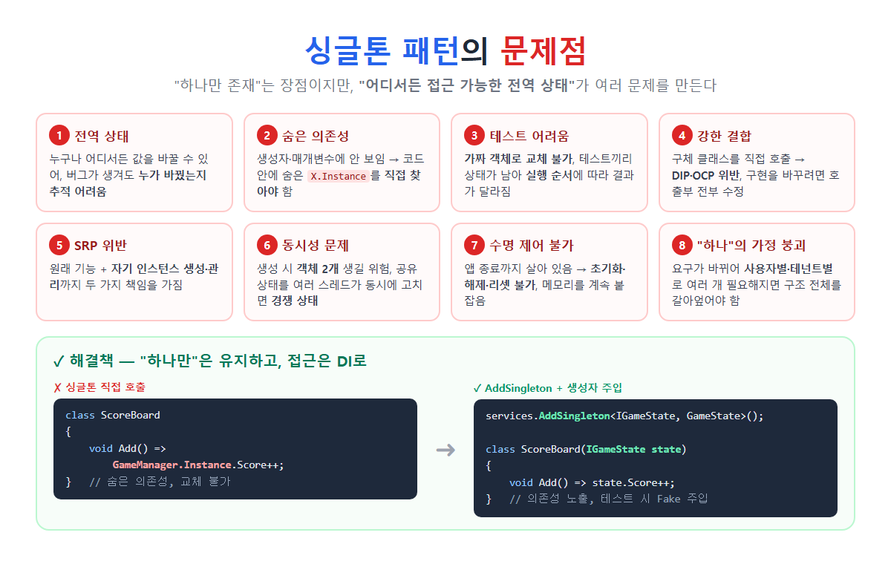

# [싱글톤 패턴의 문제점](../KeywordsList.md)

</img>

| 문제점 | 원인 | 결과 |
| --- | --- | --- |
| **전역 상태** | 어디서든 수정 가능 | 버그 추적 어려움 |
| **숨은 의존성** | `X.Instance`가 코드 속에 숨어 있음 | 의존 관계 파악 어려움 |
| **테스트 어려움** | 교체 불가, 상태 공유 | Mock 불가, 불안정한 테스트, 병렬 실행 불가 |
| **강한 결합** | 구체 클래스 직접 호출 | DIP·OCP 위반, 변경 범위가 넓음 |
| **SRP 위반** | 기능 + 인스턴스 관리 | 책임이 두 개 |
| **동시성 문제** | 모든 스레드가 공유 | 중복 생성, 경쟁 상태, lock 병목 |
| **수명 제어 불가** | static이 계속 참조 | 리셋·해제 불가, 메모리 점유, 초기화 실패가 영구적 |
| **확장성 부족** | "딱 하나" 가정 | 사용자별·서버별로 바뀌면 대규모 수정 |

## 문제점

- 싱글톤 패턴은 인스턴스를 하나만 만들고 어디서든 접근하게 해 줌.
- 문제는 대부분 두 번째 특징인 전역 접근에서 생김(전역 변수와 같아지기 때문)
- 싱글톤은 안티패턴(Anti-pattern)으로 분류되기도 함.

```csharp
public sealed class GameManager
{
    private static readonly Lazy<GameManager> _lazy = new(() => new GameManager());
    public static GameManager Instance => _lazy.Value;
    private GameManager() { }

    public int Score { get; set; }
    public int Stage { get; set; }
}
```

## 문제점 상태

1. 전역 상태(Global State)
    - 어디서든 누구나 값을 바꿀 수 있음. 그래서 값이 이상해져도 어느 코드가 바꿨는지 찾기 어려움.
    
    ```csharp
    // PlayerUI.cs
    GameManager.Instance.Score = 0;     // 누군가 리셋
    // Enemy.cs
    GameManager.Instance.Score += 10;
    // SaveSystem.cs
    GameManager.Instance.Score = loaded;
    // → 점수가 이상할 때 수십 개 파일을 다 뒤져야 함
    ```
    
    - 멀리 떨어진 코드가 서로 영향을 주는 현상을 원격 작용(Spooky action at  a distance)
2. 숨은 의존성(Hidden Dependency)
    - 클래스가 싱글톤을 쓰는지 생성자나 메서드 시그니처를 봐서는 알 수 없음.
    - 코드 내부를 한 줄씩 읽어야 의존 관계가 드러남.
    
    ```csharp
    public class ScoreBoard          // 생성자만 보면 의존성이 없어 보임
    {
        public void Add() => GameManager.Instance.Score++;   // 하지만 실제로는 의존 중
    }
    ```
    
3. 테스트하기 어려움
    - 가짜 객체(Mock/Fake)로 바꿀 수 없음. `GameManager.Instance` 는 항상 진짜 객체를 돌려줌.
    - 테스트끼리 상태가 공유됨. 앞 테스트에서 바꾼 `Score`가 다음 테스트에 남아 있음.
        - 그래서 실행 순서에 따라 결과가 달라지는 불안정한 테스트(Flakey Test)가 생김
        - 테스트를 병렬로 실행할 수도 없음.
    - 싱글톤 안에서 DB, 파일, 네트워크를 쓰면 단위 테스트가 통합 테스트가 되어 버림.
    
    ```csharp
    [Fact] public void Test1() { GameManager.Instance.Score = 100; ... }
    [Fact] public void Test2() { Assert.Equal(0, GameManager.Instance.Score); }  // Test1이 먼저 돌면 실패!
    ```
    
4. 강한 결합(Tight Coupling) : DIP, OCP 위반
    - 사용하는 쪽이 구체 클래스 `GameManager`를 직접 호출함. 추상화(인터페이스)에 의존하지 않으니 DIP 위반
    - 구현을 바꾸거나 확장하려면 `GameManager.Instance`를 쓰는 모든 코드를 고쳐야 하니 OCP 위반.
    - `private` 생성자와 `sealed` 때문에 상속으로 확장하기도 어려움
5. 단일 책임 원칙(SRP) 위반
    - 싱글톤 클래스는 책임을 두 가지 가짐.
        - 원래 맡은 일: 게임 상태 관리
        - 자기 자신의 생성과 수명 관리: 인스턴스를 하나만 유지하는 일
6. 동시성 (멀티스레드) 문제
    - 생성 시점: 구현을 잘못하면 두 스레드가 동시에 접근해서 객체가 2개 생길 수 있음
    - 사용 시점: 인스턴스가 하나라는 것은 모든 스레드가 같은 객체를 공유한다는 뜻. 그래서 값을 바꾸는 상태는 경쟁 상태(Race Condition)를 만듦.
    
    ```csharp
    // 두 스레드가 동시에 실행하면 → 100번 더해도 100이 안 될 수 있음
    GameManager.Instance.Score++;   // 읽기 → 더하기 → 쓰기가 원자적이지 않음
    ```
    
    - 이를 막으려고 `lock`을 걸면 병목(Lock Contention)이 생겨 성능이 떨어짐
7. 수명을 제어할 수 없음
    - static 필드가 참조를 쥐고 있어서 앱이 끝날 때까지 살아 있음.
    - 리셋, 재생성, 해제(Dispose)가 어렵고, 큰 데이터를 들고 있으면 메모리를 계속 차지.
    - 초기화 실패가 영구적. static 초기화 중에 예외가 나면 `TypeInitializationException`이 발생하고, 그 타입은 프로세스가 끝날 때까지 다시 쓸 수 없음.
    - 싱글톤끼리 서로 참조하면 초기화 순서 문제가 생길 수 있음.
8. “하나만”이라는 가정이 깨질 때
    - 처음엔 하나면 충분했지만 요구사항이 바뀌면 구조 전체를 바꿔야 함.
        - "사용자마다 설정이 달라야 해요" → 사용자별 인스턴스 필요
        - "멀티플레이어에서 플레이어마다 상태가..." → 여러 개 필요
        - "고객사(테넌트)별로 DB가 달라요" → 테넌트별 인스턴스 필요
        - 웹 서버를 여러 대로 늘렸어요 → 싱글톤은 프로세스마다 하나일 뿐이라, 서버마다 별도 인스턴스가 생겨 상태가 어긋
9. (Unity) 게임 엔진에서의 문제
    - 씬을 다시 불러오면 중복되어 생성될 수 있음.
    - `Awake` 실행 순서에 따라 아직 생성되지 않은 Instance에 접근하는 문제가 생김.
    - 파괴된 뒤 접근하면 `MissingReferenceException`이 발생.

## 해결책

#### 방법 1: DI 컨테이너의 `AddSingleton` (가장 권장)

"하나만 존재"는 컨테이너가 보장하고, 접근은 생성자 주입으로 함.

```csharp
// 1. 인터페이스 + 일반 클래스 (private 생성자, static Instance 없음)
public interface IGameState { int Score { get; set; } }
public class GameState : IGameState { public int Score { get; set; } }

// 2. 등록: 컨테이너가 하나만 만들어 관리
builder.Services.AddSingleton<IGameState, GameState>();

// 3. 사용: 생성자로 주입
public class ScoreBoard(IGameState state)
{
    public void Add() => state.Score++;
}

// 4. 테스트: 원하는 가짜 객체를 넣음
var board = new ScoreBoard(new FakeGameState());
```

| 문제점 | 싱글톤 패턴 | DI `AddSingleton` |
| --- | --- | --- |
| 숨은 의존성 | ❌ 숨겨짐 | ✅ 생성자에 드러남 |
| 테스트 교체 | ❌ 불가 | ✅ Fake/Mock 주입 |
| 결합도 | ❌ 구체 클래스 | ✅ 인터페이스 |
| SRP | ❌ 자기 관리 | ✅ 수명은 컨테이너가 관리 |
| 수명 변경 | ❌ 구조 수정 | ✅ `AddScoped`로 한 줄만 변경 |
| Dispose | ❌ 어려움 | ✅ 컨테이너가 자동 처리 |

#### 방법 2: 상태를 불변으로

값이 바뀌지 않으면 전역 상태 문제와 동시성 문제가 대부분 사라짐**.** 설정값처럼 읽기만 하는 데이터라면 싱글톤이어도 비교적 안전함.

```csharp
public sealed class AppConfig
{
    public static AppConfig Instance { get; } = new();
    public string ApiUrl { get; } = "https://api.example.com";   // 읽기 전용
    private AppConfig() { }
}
```

#### 방법 3: 바뀌는 상태는 스레드 안전하게

꼭 써야 한다면 `Interlocked`, `ConcurrentDictionary`, `lock`으로 상태를 보호

```csharp
private int _score;
public int AddScore(int v) => Interlocked.Add(ref _score, v);
```

#### 피해야 할 임시방편

- `Reset()` 메서드 추가: 테스트를 위해 상태를 초기화하는 메서드. 테스트 전용 코드가 실제 코드에 섞이는 것이라 좋지 않음.
- `Instance`에 setter 추가: 테스트에서 가짜 객체를 넣으려고 `public static IGameState Instance { get; set; }`처럼 만드는 방식. 전역 상태 문제는 그대로 남음.