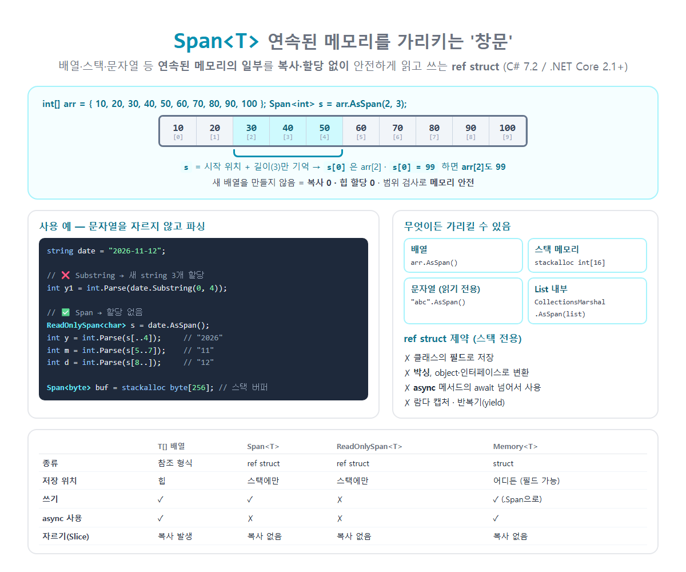

# [Span\<T>](../KeywordsList.md)

</img>

| 항목 | 내용 |
| --- | --- |
| 정의 | 연속된 메모리의 일부를 복사 없이 가리키는 타입 |
| 도입 | C# 7.2 / .NET Core 2.1 |
| 종류 | `ref struct` (스택 전용) |
| 내부 구성 | 시작 참조 + 길이 |
| 가리킬 수 있는 것 | 배열, `stackalloc`, 문자열, 네이티브 메모리, `List<T>` 내부 |
| 핵심 장점 | 복사 0, 힙 할당 0, 메모리 안전(범위 검사) |
| 읽기 전용 버전 | `ReadOnlySpan<T>` (문자열은 이것만) |
| 힙 저장·async용 | `Memory<T>` / `ReadOnlyMemory<T>` |
| 제약 | 필드 저장, 박싱, async/await, 람다 캡처, yield 불가 |
| 주 용도 | 파싱, 버퍼 처리, 직렬화, 네트워크·파일 I/O, 고성능 코드 |

## 정의

- 연속된 메모리 영역의 일부를 가리키는 "창문(view)" 역할을 하는 타입
- 가리킬 수 있는 메모리는 배열, 스택, 문자열, 네이티브 메모리 등
- 데이터를 복사하지 않고, 새 메모리를 할당하지 않고, 원본 메모리의 특정 구간을 안전하게 읽고 쓸 수 있게 해줌.
- 내부적으로는 "시작 위치(참조) + 길이" 두 가지만 가지고 있음

```csharp
int[] arr = { 10, 20, 30, 40, 50, 60, 70 };

Span<int> s = arr.AsSpan(2, 3);   // arr[2]부터 3개를 가리킴 → { 30, 40, 50 }
Console.WriteLine(s[0]);          // 30
Console.WriteLine(s.Length);      // 3

s[0] = 99;                        // Span을 통해 수정하면
Console.WriteLine(arr[2]);        // 99 ← 원본 배열이 바뀜 (같은 메모리)
```

## 특징

- 복사 없음, 할당 없음 : 자르기(Slice)를 해도 새 배열을 만들지 않음(GC 부담이 0).
- 다양한 메모리를 하나의 타입으로 : 관리 배열, `stackalloc` 스택 메모리, 문자열, 네이티브 포인터를 모두 같은 API로 다룸.
- 메모리 안전 : 포인터와 달리 범위 검사. 범위를 넘으면 `IndexOutOfRangeException`이 발생. `unsafe` 코드 없이 고성능 처리가 가능.
- `ref struct` : 스택에만 존재할 수 있는 구조체라서 아래 제약이 있음.
- ref struct 제약 (스택 전용)

| 불가능한 것 | 이유 |
| --- | --- |
| 클래스의 **필드**로 저장 | 힙에 올라가면 가리키던 스택 메모리가 사라질 수 있음 |
| **박싱**, `object`나 인터페이스로 변환 | 박싱하면 힙으로 이동 |
| **`async` 메서드에서 `await`를 넘어서** 사용 | 상태 머신이 힙에 저장됨 |
| **람다 캡처**, 반복기(`yield`) 안에서 사용 | 힙의 클래스로 옮겨짐 |
| 제네릭 인수로 사용 | C# 13부터 `where T : allows ref struct` 제약으로 일부 가능 |
- 이 제약 덕분에 Span이 가리키는 메모리가 먼저 사라지는 일(댕글링)을 컴파일러가 막아줌.
- 배열처럼 사용 : 인덱서, `Length`, `foreach`, 범위 연산자(`[1..3]`)를 모두 지원.

## 관련 타입

| 타입 | 설명 |
| --- | --- |
| **`Span<T>`** | 읽기 + 쓰기 |
| **`ReadOnlySpan<T>`** | 읽기 전용. 문자열(`string`)은 불변이라 `ReadOnlySpan<char>`로만 가리킬 수 있음 |
| **`Memory<T>`** | Span과 비슷하지만 일반 struct라서 필드에 저장하거나 async에서 사용 가능. 실제 작업할 때는 `.Span`으로 꺼내 씀 |
| **`ReadOnlyMemory<T>`** | `Memory<T>`의 읽기 전용 버전 |

## 기능

#### **만들기: 무엇이든 가리킬 수 있음**

```csharp
Span<int> a =newint[10];// 배열 (암시적 변환)
Span<int> b = arr.AsSpan(2,3);// 배열의 일부
Span<byte> c =stackallocbyte[256];// 스택 메모리 (힙 할당 없음!)
ReadOnlySpan<char> d ="Hello".AsSpan();// 문자열
Span<int> e = CollectionsMarshal.AsSpan(list);// List<T>의 내부 배열 (리스트 크기를 바꾸지 말 것)
```

#### **자르기 (Slice): 복사 없음**

```csharp
Span<int> all = arr;
Span<int> mid = all.Slice(2,3);// 2번부터 3개
Span<int> tail = all[4..];// 범위 연산자
```

- 배열에 `arr[2..5]`를 쓰면 새 배열이 복사되지만, Span에 쓰면 복사 없이 같은 메모리를 가리킴.

#### **문자열 파싱: Substring 없이**

```csharp
string date ="2026-11-12";

// ❌ Substring: 매번 새 string을 할당
int y1 =int.Parse(date.Substring(0,4));

// ✅ ReadOnlySpan<char>: 할당 없음
ReadOnlySpan<char> s = date.AsSpan();
int y =int.Parse(s[..4]);// 2026
int m =int.Parse(s[5..7]);// 11
int d =int.Parse(s[8..]);// 12
```

- `int.Parse`, `double.TryParse`, `Guid.Parse`, `DateTime.Parse` 등 대부분의 파싱 메서드가 `ReadOnlySpan<char>`를 직접 받는 오버로드를 제공.

#### **유용한 메서드 (`MemoryExtensions`)**

```csharp
Span<int> span =stackallocint[]{5,3,8,1};

span.Sort();// 정렬 → {1, 3, 5, 8}
span.Reverse();// 뒤집기
span.Fill(0);// 모두 0으로
span.Clear();// 기본값으로
int idx = span.IndexOf(8);// 검색
bool same = span.SequenceEqual(other);
span.CopyTo(destination);// 다른 Span으로 복사

ReadOnlySpan<char> text ="  hello  ".AsSpan().Trim();// 할당 없는 Trim
bool starts = text.StartsWith("he");
```

#### **스택 버퍼로 할당 없는 처리**

```csharp
Span<char> buffer =stackallocchar[32];
if(12345.TryFormat(buffer,outint written))
    Console.WriteLine(buffer[..written].ToString());// "12345"
```