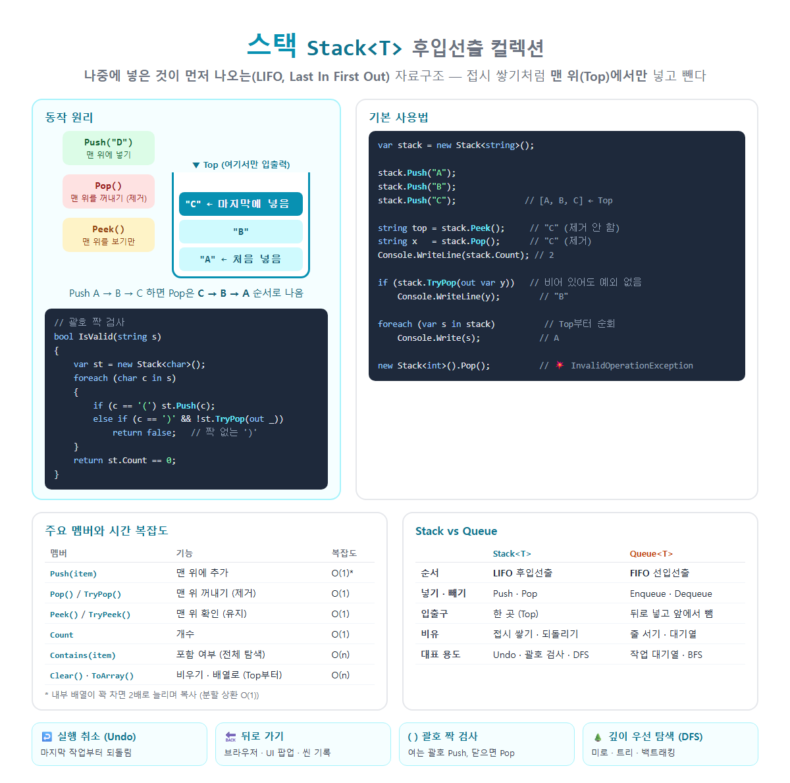

# [Stack](../KeywordsList.md)

</img>

| 항목 | 내용 |
| --- | --- |
| 정의 | 나중에 넣은 것이 먼저 나오는 자료구조 |
| 원칙 | LIFO (Last In First Out, 후입선출) |
| C# 타입 | `Stack<T>` (System.Collections.Generic) |
| 핵심 연산 | `Push`(넣기), `Pop`(꺼내기), `Peek`(확인) |
| 안전한 연산 | `TryPop`, `TryPeek` |
| 복잡도 | Push · Pop · Peek 모두 **O(1)** |
| 내부 구현 | 동적 배열 (꽉 차면 2배로 확장) |
| 순회 순서 | Top부터 (넣은 순서의 역순) |
| 빈 스택에서 Pop | `InvalidOperationException` |
| 스레드 안전 버전 | `ConcurrentStack<T>` |
| 대표 용도 | Undo, 뒤로 가기, 괄호 검사, DFS, 수식 계산 |

## 정의

- 나중에 넣은 데이터가 먼저 나오는(LIFO, Last In First Out, 후입선출) 자료구조
- 데이터를 넣고 빼는 곳이 맨 위(Top) 한 곳뿐

```csharp
var stack = new Stack<string>();

stack.Push("A");
stack.Push("B");
stack.Push("C");               // [A, B, C] ← Top

Console.WriteLine(stack.Peek());   // "C"  (확인만, 제거 안 함)
Console.WriteLine(stack.Pop());    // "C"  (꺼내면서 제거)
Console.WriteLine(stack.Pop());    // "B"
Console.WriteLine(stack.Count);    // 1
```

```csharp
Push A → Push B → Push C          Pop → C, Pop → B, Pop → A

   │ C │ ← Top                    넣은 순서의 반대로 나옴
   │ B │
   │ A │
   └───┘
```

## 특징

- IFO(후입선출) 순서를 따름.
- Top에서만 넣고 뺄 수 있음. 중간 요소에 인덱스로 접근할 수 없음(`stack[1]` ❌).
- 넣기, 빼기, 확인이 모두 O(1)로 빠름.
- 내부는 배열로 구현되어 있음. 꽉 차면 2배 크기로 늘려 복사함. 평균적으로는 여전히 O(1).
- 제네릭이라 박싱 없이 타입 안전하게 쓸 수 있음.
- `foreach`와 `ToArray()`는 Top부터 순회. 즉 넣은 순서의 역순.
- 비어 있을 때 `Pop()`이나 `Peek()`를 호출하면 `InvalidOperationException`이 발생. 예외 없이 처리하려면 `TryPop`, `TryPeek`를 사용.
- 스레드 안전하지 않음. 멀티스레드 환경에서는 `ConcurrentStack<T>`를 사용 권장

## 주요 멤버

| 멤버 | 기능 | 시간 복잡도 |
| --- | --- | --- |
| `Push(item)` | 맨 위에 추가 | O(1)* |
| `Pop()` | 맨 위를 꺼내고 제거 (비어 있으면 예외) | O(1) |
| `TryPop(out item)` | 꺼내기 시도, 성공 여부 반환 | O(1) |
| `Peek()` | 맨 위를 확인만 (비어 있으면 예외) | O(1) |
| `TryPeek(out item)` | 확인 시도 | O(1) |
| `Count` | 요소 개수 | O(1) |
| `Contains(item)` | 포함 여부 (전체 탐색) | O(n) |
| `Clear()` | 모두 제거 | O(n) |
| `ToArray()` | 배열로 복사 (Top부터) | O(n) |
| `TrimExcess()` | 남는 내부 용량 줄이기 | O(n) |
| `new Stack<T>(capacity)` | 초기 용량 지정 (재할당 줄이기) | — |
- * 내부 배열이 꽉 찼을 때만 O(n). 평균적으로는 O(1)입니다(분할 상환).

## 기능

#### 1. 실행 취소 (Undo)

```csharp
var history = new Stack<ICommand>();

void Run(ICommand cmd) { cmd.Execute(); history.Push(cmd); }
void Undo()            { if (history.TryPop(out var cmd)) cmd.Undo(); }   // 마지막 작업부터 되돌림
```

#### 2. 괄호 짝 검사

```csharp
bool IsValid(string s)
{
    var st = new Stack<char>();
    var pairs = new Dictionary<char, char> { [')'] = '(', [']'] = '[', ['}'] = '{' };

    foreach (char c in s)
    {
        if (c is '(' or '[' or '{') st.Push(c);                       // 여는 괄호는 쌓기
        else if (pairs.TryGetValue(c, out char open))                 // 닫는 괄호면
        {
            if (!st.TryPop(out char top) || top != open) return false; // 가장 최근 여는 괄호와 짝 확인
        }
    }
    return st.Count == 0;                                             // 남은 여는 괄호가 없어야 함
}

IsValid("{[()]}");   // True
IsValid("([)]");     // False
```

#### 3. 뒤로 가기 (화면, UI 팝업 스택)

```csharp
public class PopupManager
{
    private readonly Stack<Popup> _opened = new();

    public void Open(Popup p) { _opened.Push(p); p.Show(); }
    public void Back()        { if (_opened.TryPop(out var p)) p.Hide(); }   // ESC: 가장 위 팝업부터 닫기
}
```

#### 4. 깊이 우선 탐색 (DFS): 재귀 대신 스택

```csharp
void Dfs(Node start)
{
    var stack = new Stack<Node>();
    var visited = new HashSet<Node>();
    stack.Push(start);

    while (stack.TryPop(out var node))
    {
        if (!visited.Add(node)) continue;
        Visit(node);
        foreach (var next in node.Neighbors) stack.Push(next);
    }
}
```

- 재귀로 짜면 깊이가 깊을 때 StackOverflowException이 날 수 있는데, `Stack<T>`를 쓰면 힙에 저장되므로 안전.

#### 5. 그 밖의 활용

- 후위 표기식 계산: `3 4 + 2 *` 같은 수식을 계산.
- 문자열 뒤집기
- 미로 찾기와 백트래킹: 막다른 길이면 되돌아감.
- 브라우저 뒤로 가기 / 앞으로 가기: 스택 두 개로 구현.