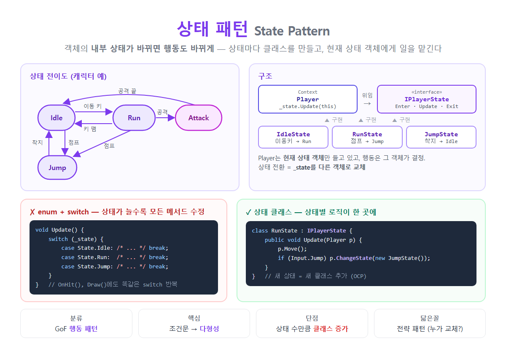

# [상태 패턴](../KeywordsList.md)

</img>

| 항목 | 내용 |
| --- | --- |
| 분류 | GoF 행동 패턴 |
| 정의 | 내부 상태에 따라 행동이 바뀌도록, 상태를 객체로 분리 |
| 구성 | Context + State 인터페이스 + ConcreteState들 |
| 핵심 | 조건문(`switch`) → 다형성(위임) |
| 상태 전환 | 현재 상태 객체를 다른 객체로 교체 (`ChangeState`) |
| 생명주기 | `Enter` → `Update`(반복) → `Exit` |
| 장점 | 조건문 제거, SRP, OCP, 명확한 전환 |
| 단점 | 상태 수만큼 클래스 증가, 상태가 적으면 과한 구조 |
| 관련 개념 | FSM(유한 상태 기계), 전략 패턴 |
| 대표 사례 | 게임 캐릭터·AI, 자판기, 주문 처리, TCP 연결 상태, Unity Animator |

## 정의

- GoF 디자인 패턴 중 행동 패턴의 하나
- 상태마다 별도의 클래스를 만들고, 객체(Context)는 현재 상태 객체에게 일을 맡깁니다(위임)
- 상태가 바뀌면 상태 객체만 다른 것으로 교체
- 게임 캐릭터(대기/달리기/점프/공격), 자판기(대기/동전 투입/판매 중), 문(열림/닫힘/잠김), 주문(접수/결제/배송/완료)처럼 상태에 따라 행동이 달라지는 객체에 사용.

#### 필요한 이유

- enum + switch의 문제

```csharp
// ❌ 상태를 enum으로 관리
enum State { Idle, Run, Jump }

class Player
{
    private State _state = State.Idle;

    public void Update()
    {
        switch (_state)
        {
            case State.Idle: if (Input.Move) _state = State.Run; break;
            case State.Run:  Move(); if (Input.Jump) _state = State.Jump; break;
            case State.Jump: Fall(); if (IsGrounded) _state = State.Idle; break;
        }
    }

    public void OnHit()
    {
        switch (_state) { /* 또 상태별 분기... */ }
    }

    public void Draw()
    {
        switch (_state) { /* 또 상태별 분기... */ }
    }
}
```

- 문제점
    - 상태 하나를 추가할 때마다 모든 메서드의 switch를 수정해야 함. 이는 OCP 위반.
    - 한 상태의 로직이 여러 메서드에 흩어져 있어서, "점프 상태에서 무엇을 하는지"를 한눈에 볼 수 없음.
    - 상태가 늘어날수록 클래스가 거대해지고, 분기를 빠뜨리는 버그가 생기기 쉬움.

#### 해결

- 상태를 클래스로 변경해서 해결

```csharp
// 1. 상태 인터페이스
public interface IPlayerState
{
    void Enter(Player p);    // 상태에 들어갈 때 (애니메이션 시작 등)
    void Update(Player p);   // 매 프레임 동작 + 전환 조건 검사
    void Exit(Player p);     // 상태를 나갈 때 (정리)
}

// 2. 구체 상태들: 각 상태의 로직이 한 클래스에 모임
public class IdleState : IPlayerState
{
    public void Enter(Player p) => p.PlayAnim("Idle");
    public void Update(Player p)
    {
        if (p.Input.Move) p.ChangeState(new RunState());
        if (p.Input.Jump) p.ChangeState(new JumpState());
    }
    public void Exit(Player p) { }
}

public class RunState : IPlayerState
{
    public void Enter(Player p) => p.PlayAnim("Run");
    public void Update(Player p)
    {
        p.Move();
        if (!p.Input.Move) p.ChangeState(new IdleState());
        if (p.Input.Jump)  p.ChangeState(new JumpState());
    }
    public void Exit(Player p) { }
}

public class JumpState : IPlayerState
{
    public void Enter(Player p) { p.PlayAnim("Jump"); p.ApplyJumpForce(); }
    public void Update(Player p)
    {
        p.Fall();
        if (p.IsGrounded) p.ChangeState(new IdleState());
    }
    public void Exit(Player p) => p.PlaySound("Land");
}

// 3. Context: 현재 상태만 들고 있고, 일은 위임
public class Player
{
    private IPlayerState _state = new IdleState();

    public void ChangeState(IPlayerState next)
    {
        _state.Exit(this);     // 이전 상태 정리
        _state = next;         // 교체
        _state.Enter(this);    // 새 상태 시작
    }

    public void Update() => _state.Update(this);   // switch 없음!
    // ... Move(), Fall(), PlayAnim() 등
}
```

#### 구성 요소

| 구성 요소 | 역할 | 예 |
| --- | --- | --- |
| **Context** | 상태를 가진 객체. 현재 상태 객체를 보관하고 요청을 위임 | `Player` |
| **State (인터페이스)** | 모든 상태가 지켜야 할 공통 메서드 정의 | `IPlayerState` |
| **ConcreteState** | 실제 상태. 그 상태의 행동 + 다음 상태로의 전환 조건 | `IdleState`, `RunState`, `JumpState` |

## 특징

- 조건문 대신 다형성을 사용. `switch (_state)`가 `_state.Update()` 한 줄로 바뀜.
- 상태별 로직이 한 클래스에 모임. 점프와 관련된 모든 것은 `JumpState`에 있음(SRP).
- 새 상태는 클래스 추가만으로 넣을 수 있음. 기존 상태의 코드는 거의 건드리지 않음(OCP).
- 전환이 명시적. `ChangeState`를 거치므로 `Enter`/`Exit`에서 진입·이탈 처리를 한 곳에서 할 수 있음.
- 유한 상태 기계(FSM, Finite State Machine)를 객체지향으로 구현한 것.

## 기능

| 효과 | 설명 |
| --- | --- |
| **조건문 제거** | 상태 검사 분기가 사라져 코드가 단순해짐 |
| **응집도 향상** | 한 상태의 모든 행동이 한 곳에 |
| **확장 용이** | 새 상태 = 새 클래스 |
| **잘못된 전환 방지** | 각 상태가 갈 수 있는 다음 상태만 정의 → 불가능한 전환을 구조적으로 막음 |
| **진입/이탈 처리** | `Enter`/`Exit`로 애니메이션, 사운드, 타이머 초기화를 깔끔하게 |