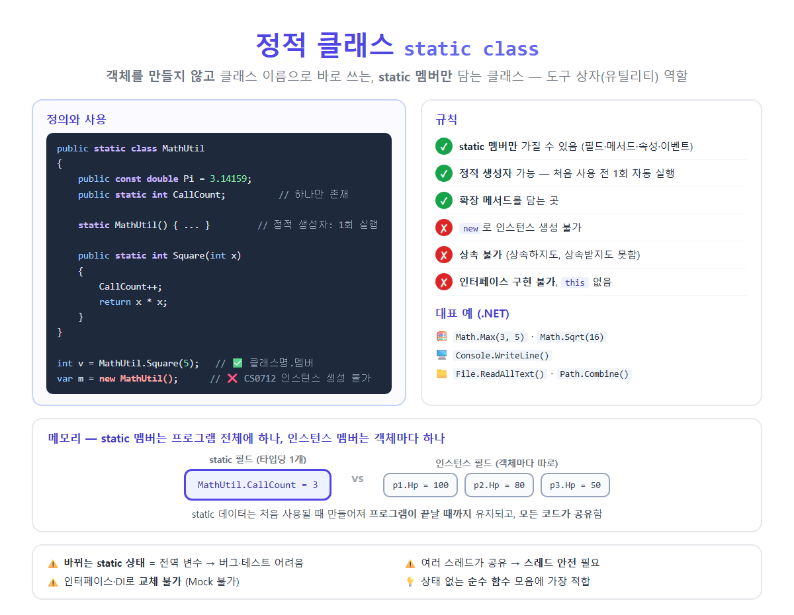

# [Static class](../KeywordsList.md)

</img>

| 항목 | 내용 |
| --- | --- |
| 정의 | `static` 키워드로 선언하고, static 멤버만 가지는 인스턴스화 불가 클래스 |
| 접근 | `클래스명.멤버` |
| 인스턴스 | ❌ (`new` 불가, CS0712) |
| 상속 | ❌ (상속하지도, 받지도 못함) |
| 인터페이스 | ❌ 구현 불가 |
| 생성자 | 정적 생성자만 (1회, 자동, 스레드 안전) |
| IL 표현 | `abstract sealed` |
| 메모리 | static 데이터는 타입당 1개, 프로그램 종료까지 유지 |
| 대표 예 | `Math`, `Console`, `File`, `Path`, `Convert`, `Enumerable` |
| 주 용도 | 유틸리티 함수, 확장 메서드, 상수 모음 |
| 주의 | 바뀌는 static 상태(전역 변수화), 스레드 안전, 테스트 어려움 |

## 정의

- static 키워드를 붙여 선언한 클래스
- static 멤버만 가질 수 있음
- 객체(인스턴스)를 만들 수 없음. 대신 클래스 이름으로 멤버에 바로 접근
- 특정 객체의 상태와 상관없이 쓰는 도구 모음(유틸리티)을 만들 때 사용

```csharp
public static class MathUtil
{
    public const double Pi = 3.14159;           // const는 자동으로 static
    public static int CallCount;                // 프로그램 전체에 하나

    static MathUtil()                           // 정적 생성자: 처음 사용 전 1회 실행
    {
        Console.WriteLine("MathUtil 초기화");
    }

    public static int Square(int x)
    {
        CallCount++;
        return x * x;
    }
}

int v = MathUtil.Square(5);    // ✅ 클래스명.멤버 → 25
var m = new MathUtil();        // ❌ CS0712: 정적 클래스의 인스턴스를 만들 수 없음
```

## 특징

| 규칙 | 설명 | 어기면 |
| --- | --- | --- |
| **static 멤버만** | 필드, 메서드, 속성, 이벤트 모두 `static`이어야 함 (`const`는 자동으로 static) | CS0708 |
| **인스턴스 생성 불가** | `new MathUtil()` 불가 | CS0712 |
| **상속 불가** | 정적 클래스를 상속할 수도, 정적 클래스가 다른 클래스를 상속할 수도 없음 (`object`만) | CS0709, CS0713 |
| **인스턴스 생성자 없음** | 일반 생성자는 정의할 수 없고, 정적 생성자만 가능 | CS0710 |
| **인터페이스 구현 불가** | `static class A : IFoo` 불가 | CS0714 |
| **`this` 없음** | 인스턴스가 없으므로 `this`를 쓸 수 없음 |  |

## 기능

| 용도 | 예 |
| --- | --- |
| **유틸리티·헬퍼 함수** | `Math.Max()`, `Path.Combine()`, `Convert.ToInt32()` |
| **확장 메서드 보관** | 확장 메서드는 반드시 정적 클래스 안에 정의해야 함 |
| **상수·설정값 모음** | `GameConstants.MaxPlayers`, `Colors.Primary` |
| **팩토리 메서드 모음** | `Shapes.CreateCircle(5)` |
| **진입점·전역 도구** | `Console`, `Environment`, `GC` |

```csharp
// 상수 모음
public static class GameConstants
{
    public const int MaxPlayers = 4;
    public const float Gravity = -9.81f;
    public static readonly TimeSpan RoundTime = TimeSpan.FromMinutes(3);
}

// 확장 메서드
public static class StringExtensions
{
    public static bool IsBlank(this string? s) => string.IsNullOrWhiteSpace(s);
}
```