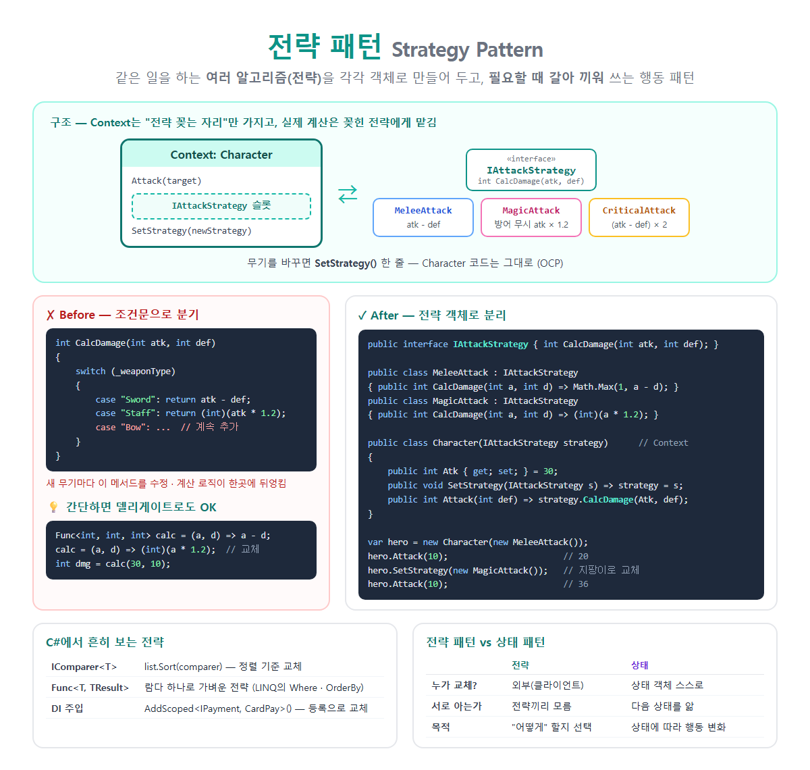

# [전략 패턴(Strategy)](../KeywordsList.md)

</img>

| 항목 | 내용 |
| --- | --- |
| 분류 | GoF 행동 패턴 |
| 정의 | 여러 알고리즘을 각각 캡슐화하고 교체 가능하게 만듦 |
| 구성 | Strategy(인터페이스), ConcreteStrategy, Context, Client |
| 핵심 | 조건문 → 다형성, 상속 → 합성 |
| 교체 | 외부(클라이언트)가 선택, 실행 중 교체 가능 |
| 장점 | OCP, SRP, 조건문 제거, 알고리즘 독립 테스트, 재사용 |
| 단점 | 클래스 수 증가, 클라이언트가 전략 차이를 알아야 함, 단순한 경우 과설계 |
| C# 형태 | 인터페이스, `Func`/`Action` 델리게이트, `IComparer<T>`, DI 주입 |
| 대표 예 | 정렬 기준, 결제 방식, 할인 정책, 데미지 공식, AI 행동 |

## 정의

- 같은 목적을 가진 여러 알고리즘을 각각 캡슐화하여 서로 교체할 수 있게 만든다. 알고리즘을 사용하는 쪽과 독립적으로 알고리즘을 바꿀 수 있다.
- 무엇을 할지"는 같은데 "어떻게 할지"가 여러 가지일 때 사용
    - 각 방법(알고리즘)을 별도 객체(전략)로 만듦.
    - 사용하는 쪽(Context)은 전략을 꽂는 자리만 가짐.
    - 필요할 때 전략을 갈아 끼움.

## 필요한 이유

```csharp
// ❌ 무기 종류에 따라 조건문으로 분기
public class Character
{
    private string _weaponType = "Sword";

    public int CalcDamage(int atk, int def)
    {
        switch (_weaponType)
        {
            case "Sword": return Math.Max(1, atk - def);
            case "Staff": return (int)(atk * 1.2);          // 방어 무시
            case "Bow":   return Math.Max(1, atk - def / 2);
            // 새 무기가 생길 때마다 여기를 수정...
            default: return 0;
        }
    }
}
```

- 문제점
    - 새 무기를 추가할 때마다 `Character`를 수정해야 함(OCP 위반).
    - 여러 계산 로직이 한 메서드에 뒤엉켜 읽고 테스트하기 어려움.
    - 같은 `switch`가 다른 곳에도 생기기 쉬움.
- 해결 : 전략 객체로 분리

```csharp
// 1. 전략 인터페이스
public interface IAttackStrategy
{
    int CalcDamage(int atk, int def);
}

// 2. 구체 전략들: 알고리즘 하나당 클래스 하나
public class MeleeAttack : IAttackStrategy
{
    public int CalcDamage(int atk, int def) => Math.Max(1, atk - def);
}

public class MagicAttack : IAttackStrategy
{
    public int CalcDamage(int atk, int def) => (int)(atk * 1.2);       // 방어 무시
}

public class RangedAttack : IAttackStrategy
{
    public int CalcDamage(int atk, int def) => Math.Max(1, atk - def / 2);
}

// 3. Context: 전략을 가지고 위임
public class Character
{
    private IAttackStrategy _strategy;
    public int Atk { get; set; } = 30;

    public Character(IAttackStrategy strategy) => _strategy = strategy;

    public void SetStrategy(IAttackStrategy strategy) => _strategy = strategy;   // 실행 중 교체

    public int Attack(int targetDef) => _strategy.CalcDamage(Atk, targetDef);
}

// 사용
var hero = new Character(new MeleeAttack());
Console.WriteLine(hero.Attack(10));     // 20

hero.SetStrategy(new MagicAttack());    // 지팡이로 무기 교체
Console.WriteLine(hero.Attack(10));     // 36
```

## 구성 요소

| 구성 요소 | 역할 | 예 |
| --- | --- | --- |
| Strategy (인터페이스) | 알고리즘의 공통 약속 | `IAttackStrategy` |
| ConcreteStrategy | 실제 알고리즘 구현 | `MeleeAttack`, `MagicAttack`, `RangedAttack` |
| Context | 전략을 보관하고 일을 위임 | `Character` |
| Client | 어떤 전략을 쓸지 선택해서 주입 | 게임 코드, DI 설정 |

## 특징

- 상속 대신 합성(Composition)을 씀. Context가 전략 객체를 필드로 가지고 일을 맡김.
- 실행 중에 교체할 수 있음. `SetStrategy()`로 언제든 바꿈.
- 전략끼리 서로 모름. 각자 독립적인 알고리즘.
- 선택은 외부(클라이언트)가 함. 상태 패턴과 다른 점.
- 조건문을 다형성으로 바꿈. `switch` 대신 `_strategy.CalcDamage()` 한 줄이면 됨.

## 기능

| 분야 | 예 |
| --- | --- |
| **게임** | 무기별 데미지 계산, 이동 방식(걷기·비행·수영), AI 난이도, 길찾기 알고리즘(A*·BFS) |
| **정렬·비교** | 이름순, 가격순, 날짜순 정렬 기준 교체 |
| **결제** | 카드, 계좌이체, 간편결제 |
| **할인 정책** | 일반, VIP, 시즌 할인 |
| **압축·암호화** | ZIP, GZip, Brotli 선택 |
| **파일 내보내기** | CSV, JSON, Excel 형식 |
| **검증 규칙** | 국가별 전화번호, 우편번호 형식 |