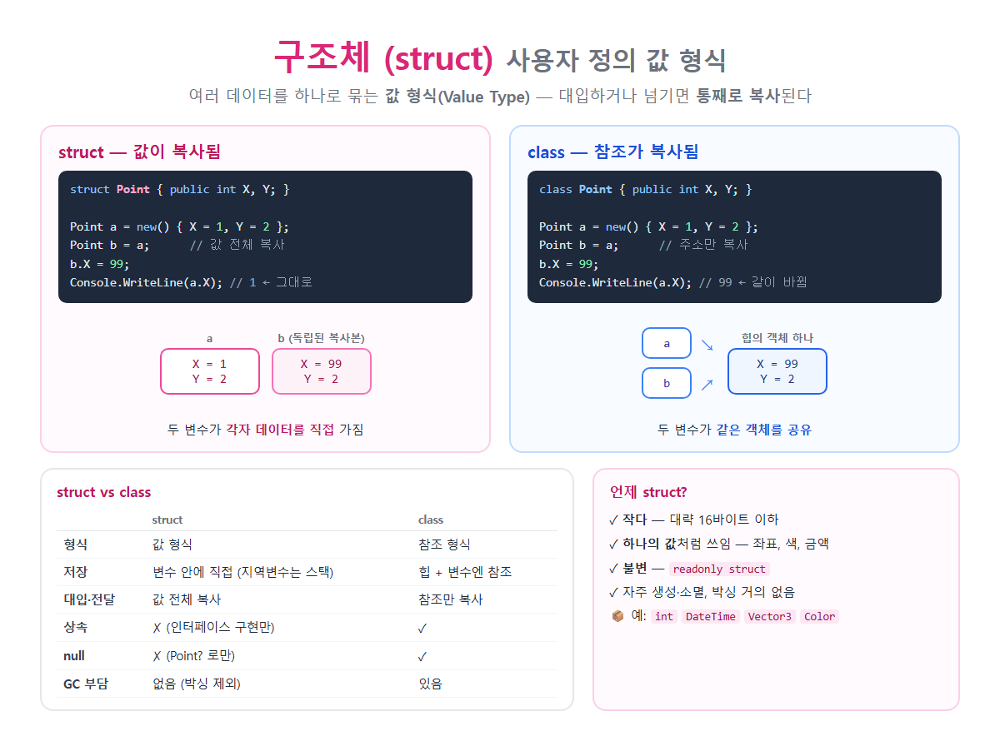

# [구조체](../KeywordsList.md)

</img>

| 항목 | 내용 |
| --- | --- |
| 정의 | `struct` 키워드로 만드는 사용자 정의 값 형식 |
| 부모 | `System.ValueType` (암묵적 sealed) |
| 복사 | 대입·전달·반환 시 값 전체 복사 |
| 저장 | 지역 변수는 스택, 필드·배열 요소는 그 안에 직접 |
| 상속 | ❌ (인터페이스 구현만 가능) |
| null | ❌ → `Nullable<T>` (`T?`) |
| 기본값 | 모든 필드 0 / null |
| 변형 | `readonly struct`, `record struct`, `ref struct` |
| 적합한 경우 | 작고(≈16바이트 이하), 하나의 값처럼 쓰이고, 불변인 데이터 |
| 주의 | 박싱, 가변 구조체의 복사 함정, 큰 구조체의 복사 비용 |

## 정의

- struct 키워드로 정의하는 사용자 정의 값 형식(Value Type)
- 관련된 여러 데이터(필드)와 기능(메서드, 속성)을 하나의 단위로 묶는다는 점은 클래스와 같지만 변수가 데이터를 직접 담고, 대입하거나 전달할 때 통째로 복사된다는 점이 클래스와 다름.

```csharp
public struct Point
{
    public int X;
    public int Y;

    public Point(int x, int y) { X = x; Y = y; }

    public double DistanceTo(Point other)
        => Math.Sqrt(Math.Pow(X - other.X, 2) + Math.Pow(Y - other.Y, 2));

    public override string ToString() => $"({X}, {Y})";
}

Point a = new Point(1, 2);
Point b = a;          // ← 값 전체가 복사됨
b.X = 99;
Console.WriteLine(a); // (1, 2)  ← a는 그대로
Console.WriteLine(b); // (99, 2)
```

## 특징

- 값 형식. 모든 구조체는 `System.ValueType`을 상속.
- 대입, 매개변수 전달, 반환할 때 값 전체가 복사됨. 복사본을 바꿔도 원본에는 영향이 없음.
- 저장 위치
    - 지역 변수라면 보통 스택에 저장됨.
    - 클래스의 필드이거나 배열의 요소라면 그 객체나 배열 안에 직접(inline) 저장됨.
    - 따로 힙 객체를 만들지 않으므로 GC 부담이 없음.
- 상속할 수 없음. 다른 구조체나 클래스를 상속할 수 없고, 다른 타입이 구조체를 상속할 수도 없음(암묵적으로 `sealed`). 인터페이스 구현은 가능함.
- null이 될 수 없음. null이 필요하면 `Point?`(`Nullable<Point>`)를 씀.
- 기본값은 모든 필드가 0/null인 상태. `default(Point)`나 `new Point()`(매개변수 없는 생성자를 따로 정의하지 않은 경우)로 만들 수 있음.
- `==` 연산자는 자동으로 제공되지 않음. 직접 오버로드해야 함. 단, `record struct`는 자동으로 제공됨.

## 기능

| 기능 | 설명 |
| --- | --- |
| **작은 데이터 묶기** | 좌표, 크기, 색, 범위, 금액처럼 여러 값이 모여 하나의 의미가 되는 데이터 |
| **성능 최적화** | 힙 할당이 없어 GC 부담 감소, 배열에 연속 저장되어 캐시 효율 향상 |
| **안전한 값 의미** | 복사되므로 다른 곳에서 몰래 수정될 걱정이 없음 |
| **멤버 정의** | 필드, 속성, 메서드, 생성자, 연산자 오버로드, 인터페이스 구현 모두 가능 |