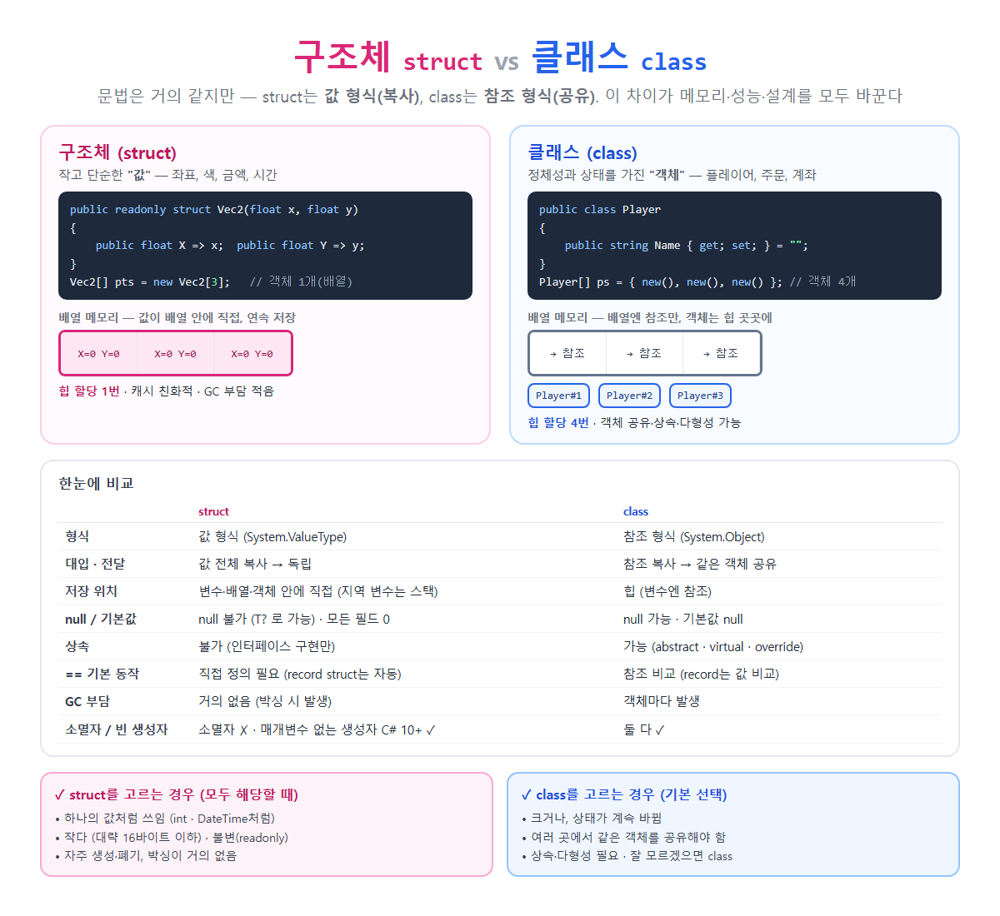

# [구조체 vs 클래스](../KeywordsList.md)

</img>

| 구분 | 구조체 (struct) | 클래스 (class) |
| --- | --- | --- |
| 형식 | 값 형식 (`System.ValueType`) | 참조 형식 (`System.Object`) |
| 대입·전달 | 값 전체 복사 → 독립 | 참조 복사 → 같은 객체 공유 |
| 저장 위치 | 변수·배열·객체 안에 직접 (지역 변수는 스택) | 힙 (변수엔 참조) |
| 기본값 | 모든 필드 0 | `null` |
| null | ❌ (`T?`로만) | ✅ |
| 상속 | ❌ (인터페이스 구현만, 암묵적 sealed) | ✅ (`abstract`, `virtual`, `override`) |
| `==` 기본 동작 | 직접 정의 필요 (`record struct`는 자동) | 참조 비교 (`record`는 값 비교) |
| `Equals` 기본 동작 | 필드 값 비교 (리플렉션이라 느릴 수 있음) | 참조 비교 |
| 소멸자 | ❌ | ✅ |
| 매개변수 없는 생성자 | C# 10부터 정의 가능 | ✅ |
| GC 부담 | 거의 없음 (박싱 시 발생) | 객체마다 발생 |
| 전달 비용 | 크기만큼 복사 (크면 비쌈) | 항상 참조 크기 (8바이트) |
| 박싱 | `object`·인터페이스로 바꾸면 발생 | 없음 |
| 대표 예 | `int`, `DateTime`, `Guid`, `Vector3`, `Color` | `string`, `List<T>`, `Exception`, 도메인 객체 |

## 구조체

- `struct` 키워드로 정의하는 사용자 정의 값 형식. 변수가 데이터를 직접 담고, 대입하거나 전달하면 값 전체가 복사됨.
    - 쓰임 : 좌표(`Vector3`), 색(`Color`), 시간(`DateTime`), 금액처럼 작고 단순하며, 하나의 "값"으로 다루는 데이터
    - 권장 형태 : readonly struct나 record struct 같은 불변 구조체

```csharp
public readonly struct Vec2
{
    public float X { get; }
    public float Y { get; }
    public Vec2(float x, float y) => (X, Y) = (x, y);
    public Vec2 Add(Vec2 o) => new(X + o.X, Y + o.Y);   // 새 값을 반환
}
```

## 클래스

- `class` 키워드로 정의하는 사용자 정의 참조 형식. 객체는 힙에 만들어지고, 변수에는 그 참조(주소)가 들어감. 대입하면 같은 객체를 공유.
    - 쓰임 : 플레이어, 주문, 계좌, 서비스처럼 정체성(identity)과 바뀌는 상태를 가진 "객체", 상속이나 다형성이 필요한 설계

```csharp
public class Player
{
    public string Name { get; set; } = "";
    public int Hp { get; private set; } = 100;
    public virtual void TakeDamage(int d) => Hp = Math.Max(0, Hp - d);
}
```

## 핵심 차이

#### **대입했을 때 : 복사 vs 공유**

```csharp
struct SPoint { public int X; }
class  CPoint { public int X; }

var s1 = new SPoint { X = 1 };  var s2 = s1;  s2.X = 99;
var c1 = new CPoint { X = 1 };  var c2 = c1;  c2.X = 99;

Console.WriteLine(s1.X);   // 1   ← 구조체: 복사본만 바뀜
Console.WriteLine(c1.X);   // 99  ← 클래스: 같은 객체라서 함께 바뀜
```

#### **배열에 담았을 때 : 메모리 구조가 다름**

```csharp
Vec2[]   points  = new Vec2[1000];     // 힙 할당 1번 (배열 하나 안에 1000개 값이 연속 저장)
Player[] players = new Player[1000];   // 배열은 참조 1000개만 담음 (전부 null)
for (int i = 0; i < 1000; i++)
    players[i] = new Player();         // 힙 할당 1000번 더 (객체가 곳곳에 흩어짐)
```

```
struct 배열: [ X,Y | X,Y | X,Y | ... ]                ← 값이 연속 → 캐시 효율 ↑, GC 부담 ↓
class  배열: [ ref | ref | ref | ... ]  → 객체 객체 객체  ← 참조를 따라가야 함
```

#### **메서드에 넘겼을 때**

```csharp
void Hit(SPoint p) => p.X = 0;    // 복사본 수정 → 원본 그대로
void Hit(CPoint p) => p.X = 0;    // 같은 객체 수정 → 원본도 바뀜
```

#### **상속과 다형성**

```csharp
class Enemy : Character { }        // 클래스는 상속 가능
struct Vec3 : Vec2 { }             // 구조체는 상속 불가 (CS0527)
struct Vec3 : IEquatable<Vec3> { } // 인터페이스 구현은 가능
```

## 언제 무엇을 쓸지

struct를 고려하는 경우 (Microsoft 가이드: 아래를 모두 만족할 때)

1. 하나의 값을 논리적으로 표현. (`int`, `DateTime`처럼)
2. 인스턴스 크기가 약 16바이트 이하.
3. 불변.
4. 박싱이 자주 일어나지 않음.

class를 쓰는 경우 (기본 선택)

- 데이터가 크거나 상태가 계속 바뀜.
- 여러 곳에서 같은 객체를 공유해야 함.
- 상속이나 다형성이 필요.
- 객체의 정체성이 중요. 예: "이 플레이어"와 "저 플레이어"는 이름이 같아도 다른 존재
- 판단이 서지 않는다면 class.

| 예시 | 선택 | 이유 |
| --- | --- | --- |
| 2D/3D 좌표, 벡터 | struct | 작고, 값 그 자체, 대량 생성 |
| 색상 (RGBA) | struct | 4바이트, 불변 값 |
| 금액 + 통화 | struct (`readonly`) | 값 의미, 불변 |
| 게임 캐릭터 | class | 상태 변화, 정체성, 상속 |
| 주문, 회원 | class | 크고, 공유, DB 엔터티 |
| API 응답 DTO | record (class) | 불변 데이터 + 값 비교 |