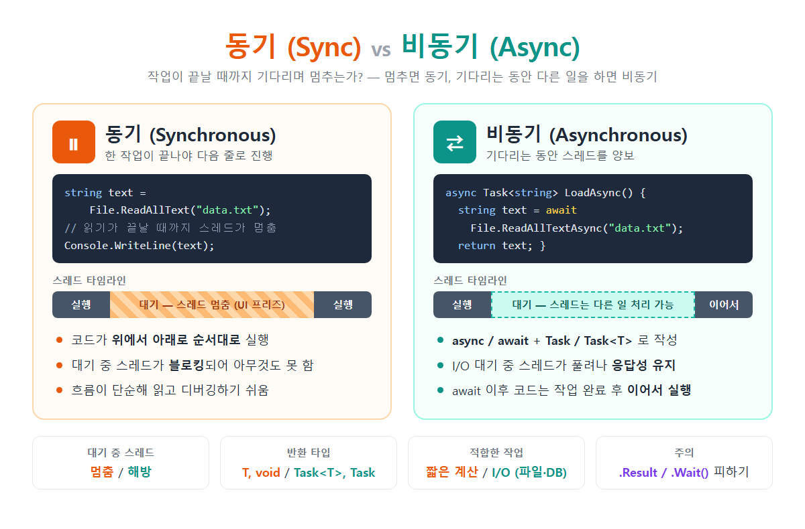

# [동기 vs  비동기](../KeywordsList.md)

</img>

| 구분 | 동기 (Sync) | 비동기 (Async) |
| --- | --- | --- |
| 실행 방식 | 작업이 끝나야 다음 줄 진행 | 작업을 시작해 두고, 완료되면 이어서 진행 |
| 대기 중 스레드 | 블로킹: 멈춤 | 논블로킹: 다른 일 처리 가능 |
| 키워드 | 없음 | `async`, `await` |
| 반환 타입 | `T`, `void` | `Task<T>`, `Task`, `ValueTask<T>` |
| 메서드 이름 관례 | `ReadAllText` | `ReadAllTextAsync` |
| UI 응답성 | 오래 걸리는 작업 중에 화면이 멈춤 | 화면이 계속 반응함 |
| 코드 난이도 | 쉬움 | 조금 더 복잡함 (예외 처리, 취소, 데드락 주의) |
| 적합한 작업 | 짧은 계산, 단순한 로직 | 파일, 네트워크, DB 같은 I/O 대기 작업 |

## 동기(Synchronous)

### 정의

- 동기는 작업을 순서대로 하나씩 실행하는 방식
- 호출한 작업이 끝날 때까지 기다린 뒤에야 다음 코드로 넘어감.

```csharp
string text = File.ReadAllText("data.txt");  // 다 읽을 때까지 여기서 멈춤
Console.WriteLine(text);                     // 읽기가 끝나야 실행됨
```

### 특징

- 실행 순서가 코드 순서와 같아서 흐름을 예측하기 쉬움.
- 블로킹(Blocking) : 파일, 네트워크, DB처럼 기다려야 하는 작업 중에는 현재 스레드가 멈춰서 다른 일을 하지 못함.
- 코드가 단순해서 읽기와 디버깅이 쉬움.

### 기능

- 바로 끝나는 계산이나 단순한 콘솔 프로그램에 적합함.
- 실행 순서가 반드시 보장되어야 하는 간단한 로직에 씀.

## 비동기(Asynchronous)

### 정의

- 비동기는 시간이 걸리는 작업을 시작만 해두고, 기다리는 동안 스레드를 놓아주는 방식
- 스레드는 그 사이에 다른 일을 하고, 작업이 끝나면 남은 코드를 이어서 실행
- C#에서는 async / await 키워드와 Task 타입으로 작성

```csharp
async Task<string> LoadAsync()
{
    string text = await File.ReadAllTextAsync("data.txt"); // 기다리는 동안 스레드 양보
    return text;                                           // 완료 후 여기서부터 이어서 실행
}

string result = await LoadAsync();
```

### 특징

- 논블로킹(Non-blocking) : `await`를 만나면 메서드가 잠시 멈추지만 스레드는 멈추지 않고 호출한 쪽으로 돌아감.
- 반환 타입
    - 반환값이 있으면 `Task<T>`, 없으면 `Task`를 씀.
    - 더 가볍게 하려면 `ValueTask<T>`를 쓸 수도 있음.
- 동기 코드처럼 위에서 아래로 읽히게 쓸 수 있음. 실제 이어 붙이는 처리는 컴파일러가 상태 머신을 만들어서 해 줌.
- 관례상 비동기 메서드 이름 끝에 `Async`를 붙임. 예: `ReadAllTextAsync`

### 기능

- I/O 작업(파일 읽기·쓰기, HTTP 요청, DB 조회)을 기다리는 동안 UI가 굳지 않게 함.
- 서버(ASP.NET Core) : 요청을 기다리는 동안 스레드를 반납하므로, 같은 서버 자원으로 더 많은 요청을 동시에 처리할 수 있음.
- 여러 작업을 동시에 실행할 수 있음.

```csharp
Task<string> a = client.GetStringAsync(url1);
Task<string> b = client.GetStringAsync(url2);
string[] results = await Task.WhenAll(a, b);  // 두 요청을 동시에 진행
```