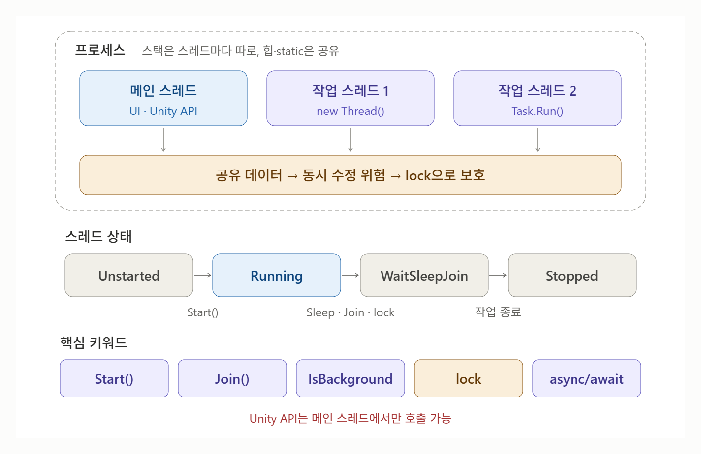

# [Thread](../KeywordsList.md)

</img>

| 항목 | 내용 |
| --- | --- |
| 정의 | 프로세스 안에서 코드를 실행하는 흐름 |
| 메모리 | 힙·static은 공유, 스택(지역 변수)은 스레드마다 별도 |
| 생성 / 실행 | `new Thread(메서드)` → `Start()` |
| 대기 | `Join()`(끝날 때까지), `Thread.Sleep(ms)`(일정 시간) |
| 종류 | 포그라운드(기본, 끝나야 종료) / 백그라운드(`IsBackground = true`) |
| 상태 | Unstarted → Running → WaitSleepJoin → Stopped |
| 주요 위험 | 경쟁 상태, 데드락 |
| 동기화 | `lock`, `Interlocked`, `Monitor` |
| 현대적 대안 | `Task.Run`, `async/await` (스레드 풀 재사용) |
| Unity 주의점 | Unity API는 메인 스레드에서만 호출 가능 |

## 개념

- 프레스 : 실행 중인 프로그램 하나. 자기만의 메모리 공간을 가짐
- 스레드 : 프로세스 안에서 실제로 코드를 실행하는 흐름. 프로그램이 시작되면 메인 스레드 하나가 생기고, 필요하면 스레드를 더 만들어 여러 작업을 동시에 처리 할 수 있음
- 같은 프로세스 안의 스레드들은 힙 메모리(객체, static 변수)를 공유하고 스택(지역변수)은 각자 따로 가짐

## 포그라운드 vs 백그라운드 스레드

```csharp
t.IsBackground = true;
```

- **포그라운드(기본값)** : 이 스레드가 끝나야 프로그램이 종료됨.
- **백그라운드** : 메인 스레드가 끝나면 함께 강제 종료됨. 로그 기록, 감시 작업 등에 사용.

## 스레드 상태

| 상태 | 의미 |
| --- | --- |
| `Unstarted` | 만들었지만 `Start()` 전 |
| `Running` | 실행 중 |
| `WaitSleepJoin` | `Sleep`, `Join`, `lock` 대기 중 |
| `Stopped` | 작업 종료 |
- `t.ThreadState`, `t.IsAlive`로 확인할 수 있음.

## 경쟁 상태(Race Condition)

- 여러 스레드가 같은 변수를 동시에 바꾸면 결과가 꼬임

```csharp
int count = 0;

Thread a = new Thread(() => { for (int i = 0; i < 100000; i++) count++; });
Thread b = new Thread(() => { for (int i = 0; i < 100000; i++) count++; });
a.Start(); b.Start();
a.Join();  b.Join();

Console.WriteLine(count);  // 200000이 아닐 수 있음!
```

- `count++`는 "읽기 → 1 더하기 → 쓰기" 세 단계라서, 두 스레드가 중간에 끼어들면 값이 유실됨.
- 해결 : `lock`

```csharp
object locker = new object();

Thread a = new Thread(() =>
{
    for (int i = 0; i < 100000; i++)
        lock (locker) { count++; }   // 한 번에 한 스레드만 진입
});
```

- 단순 증가라면 `Interlocked.Increment(ref count);`가 더 빠름. 단, lock을 여러 개 서로 엇갈려 잡으면 서로를 영원히 기다리는 데드락이 생길 수 있으니 주의.

## Task와 async/await

- `Thread`를 직접 만드는 건 비용이 크고 관리가 번거로움. 실무에서는 보통 스레드 풀을 재사용하는 `Task`를 씀.

```csharp
// 스레드 풀에서 실행
Task task = Task.Run(() => HeavyCalc());
await task;

// 결과값 받기
int result = await Task.Run(() => 1 + 2);
```

- `Thread`는 아주 오래 실행되는 전용 작업이나 스레드 설정(우선순위 등)을 직접 제어할 때 주로 사용]

## Unity에서 주의할 점

- Unity API(`transform`, `GameObject`, `Instantiate` 등)는 메인 스레드에서만 호출할 수 있음. 다른 스레드에서 건드리면 오류가 남.

```csharp
// 다른 스레드에서 계산만 하고
var result = await Task.Run(() => PathFind());
// await 이후 메인 스레드로 돌아와 Unity API 사용
transform.position = result;
```

- Unity에서 "몇 초 뒤 실행" 같은 작업은 스레드 대신 코루틴을 쓰는 경우가 많음. 코루틴은 메인 스레드에서 나눠 실행되는 것이지 진짜 멀티스레드는 아님.