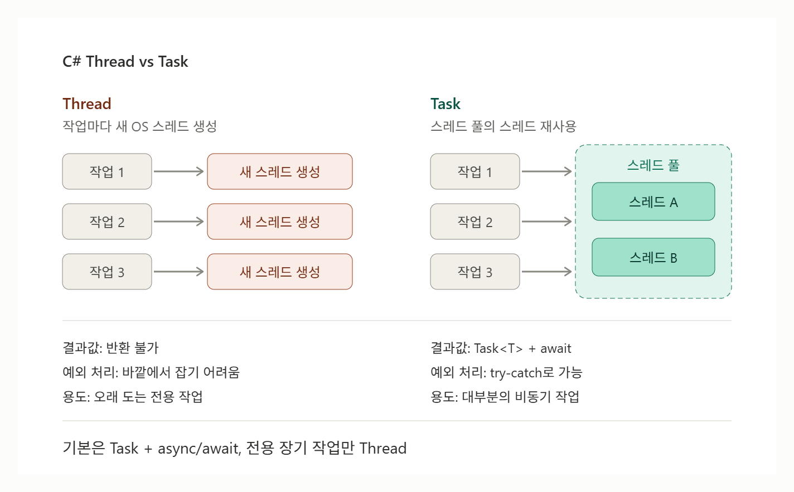

# [Thread와 Task](../KeywordsList.md)

</img>

| 구분 | Thread | Task |
| --- | --- | --- |
| 네임스페이스 | System.Threading | System.Threading.Tasks |
| 추상화 수준 | 저수준 (OS 스레드 직접 제어) | 고수준 (작업 단위) |
| 실행 방식 | 매번 새 스레드 생성 | 스레드 풀 재사용 |
| 생성 비용 | 큼 (스레드당 약 1MB 스택) | 작음 |
| 결과값 반환 | 불가 (공유 변수 필요) | 가능 (`Task<T>`) |
| 예외 처리 | 바깥에서 잡기 어려움 | `await` + `try-catch`로 가능 |
| 취소/조합 | 직접 구현 | `CancellationToken`, `WhenAll`, `WhenAny` |
| async/await | 지원 안 함 | 지원 (표준 방식) |
| 주 용도 | 오래 도는 전용 작업, 저수준 제어 | 대부분의 비동기 작업 |
- Thread와 Task는 둘 다 작업을 동시에(비동기로) 실행하기 위한 도구

## Task

- 개념
    - 실행할 작업을 나타내는 객체. 작업은 내부적으로 스레드 풀에서 실행됨
    - 스레드 풀은 이미 만들어 둔 스레드를 재사용. 그래서 스레드를 매번 새로 만드는 비용이 없고, 짧은 작업을 많이 처리할 때 효율적
    - async / await와 함께 쓰는 것이 현대 C#의 표준 방식

```csharp
using System.Threading.Tasks;

// 1) 결과값이 없는 작업
Task t = Task.Run(() => Console.WriteLine("스레드 풀에서 실행"));
await t;

// 2) 결과값이 있는 작업: Task<T>
Task<int> sumTask = Task.Run(() =>
{
    int sum = 0;
    for (int i = 1; i <= 100; i++) sum += i;
    return sum;
});
int result = await sumTask;   // 5050
```

- 특징
    - 결과값을 돌려받을 수 있음. Task<T>를 쓰고, await로 받음
    - 예외 처리가 쉬움. await할 때 작업 안에서 발생한 예외가 다시 던져지므로 평소처럼 try-catch로 잡을 수 있음
    
    ```csharp
    try { await Task.Run(() => throw new Exception("에러")); }
    catch (Exception e) { Console.WriteLine(e.Message); }
    ```
    
    - 조합 기능이 풍부함.
        - `Task.WhenAll(...)`: 여러 작업이 모두 끝날 때까지 기다림.
        - `Task.WhenAny(...)`: 여러 작업 중 하나라도 끝나면 진행함.
        - `ContinueWith(...)`: 작업이 끝난 뒤 이어서 실행할 작업을 지정함.
    - 취소를 지원. `CancellationToken`으로 실행 중인 작업을 안전하게 중단할 수 있음.
    - I/O 작업에서 스레드를 낭비하지 않음. 파일이나 네트워크를 기다리는 `await` 동안에는 스레드를 점유하지 않음.

## Thread vs Task 비교

```csharp
// Thread: 결과를 받으려면 공유 변수가 필요
int threadResult = 0;
var th = new Thread(() => threadResult = Compute());
th.Start();
th.Join();

// Task: 결과를 바로 받음
int taskResult = await Task.Run(() => Compute());
```

## Unity에서 쓸 때

- Unity API는 메인 스레드에서만 호출 가능. `Thread`나 `Task.Run` 안에서 `transform`, `GameObject` 등을 건드리면 에러가 남. 별도 스레드에서는 계산만 하고, 결과는 메인 스레드에서 적용.
- Unity에서는 `async`/`await`를 쓸 수 있고, Unity 2023.1 이상에서는 `Awaitable`이라는 Unity 전용 타입도 제공. 프레임 단위로 기다리는 단순한 대기 작업에는 여전히 코루틴이 흔히 쓰임.