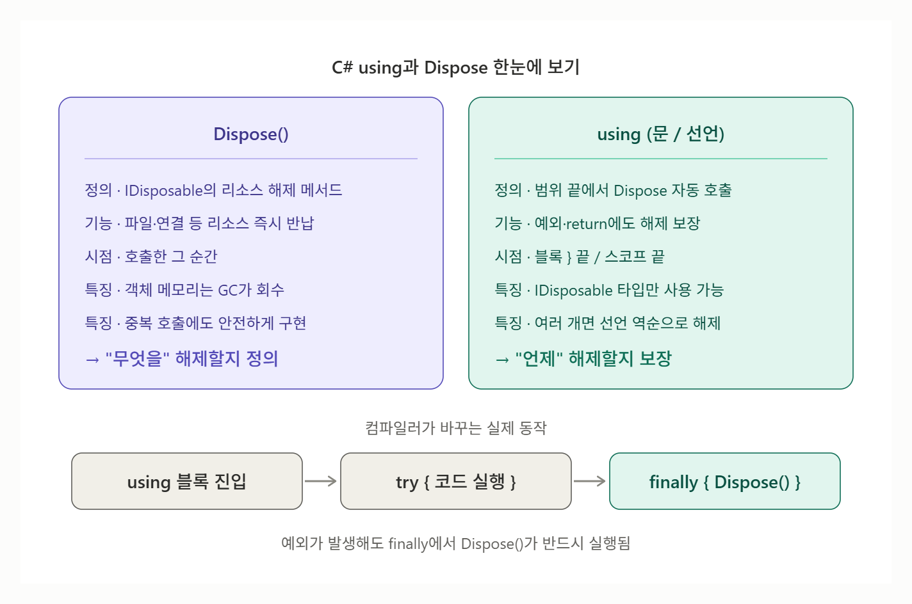

# [Using/Dispose](../KeywordsList.md)

</img>

| 구분 | `Dispose` | `using` (문/선언) |
| --- | --- | --- |
| **정의** | `IDisposable` 인터페이스의 리소스 해제 메서드 | `IDisposable` 객체의 범위를 정하고 끝날 때 자동으로 `Dispose()`를 호출하는 구문 |
| **기능** | 파일·연결·핸들 등 비관리 리소스를 즉시 반납 | 예외·`return`이 발생해도 `Dispose()` 실행을 보장 |
| **동작 방식** | 개발자가 직접 호출 (또는 `using`이 호출) | 컴파일 시 `try-finally` 코드로 변환 |
| **해제 시점** | 호출한 그 순간 | 블록 `}` 끝 / (선언형) 스코프 끝 |
| **주요 특징** | 객체 메모리는 GC가 회수 · 중복 호출에 안전하게 구현 · 해제 후 사용 시 `ObjectDisposedException` | `IDisposable` 타입만 가능 · 변수는 읽기 전용 · 여러 개면 역순 해제 |
| **관련 문법** | `Dispose(bool)` 패턴, 종료자, `GC.SuppressFinalize` | `using var`(C# 8+), `await using` + `IAsyncDisposable` |
| **주의** | 직접 호출만 하면 예외 시 누락 위험 | 네임스페이스용 `using` 지시문과는 다른 기능 |

## 배경 : 왜 필요한가?

- C#은 가비지 컬렉터가 메모리를 자동으로 관리함. 하지만 GC가 관리하는 것은 관리되는 메모리 뿐.
- 비관리 리소스(Unmanaged resource)는 GC가 알아서 정리해주지 않거나, 언제 정리할 지 알 수 없음.
    - 파일 핸들(`FileStream`)
    - 네트워크 연결, 소켓
    - 데이터베이스 연결(`SqlConnection`)
    - OS 핸들, 그래픽 리소스 등
- 이런 리소스는 개수가 제한되어 있고 다른 프로세스와 공유되기도 하므로 다 쓰는 즉시 명시적으로 반납해야 함. ⇒ 이를 위한 장치가 `Dispose`이고 이를 안전하고 편하게 호출해주는 문법이 `using`

## `Dispose`

### 정의

- `Dispose`는 `IDisposable` 인터페이스에 정의된 유일한 메서드로, 객체가 가진 리소스를 해제하는 역할

```csharp
public interface IDisposable
{
    void Dispose();
}
```

### 기능

- 파일, 연결, 핸들 같은 리소스를 원하는 시점에 즉시 해제
- GC가 언젠가 처리해 주길 기다리지 않고, 개발자가 결정적(deterministic)으로 정리 시점을 정할 수 있음.

```csharp
FileStream fs = new FileStream("data.txt", FileMode.Open);
// ... 파일 사용 ...
fs.Dispose();   // 파일 핸들 즉시 반납
```

### 특징

- 객체 메모리 자체를 해제하는 것이 아님 : 객체의 메모리는 여전히 나중에 GC가 회수함. Dispose는 그 객체가 붙잡고 있던 외부 리소스를 놓아주는 것.
- 여러 번 호출해도 안전하게 구현하는 것이 원칙
- Dispose된 객체를 다시 사용하면 보통 ObjectDisposedException이 발생
- 직접 호출만 하면 예외 발생 시 호출이 누락될 수 있다는 약점이 있음 → 이걸 해결하는 게 using

### Dispose 패턴

```csharp
public class ResourceHolder : IDisposable
{
    private FileStream _stream = new FileStream("log.txt", FileMode.Create);
    private bool _disposed = false;

    public void Dispose()
    {
        Dispose(true);
        GC.SuppressFinalize(this);   // 이미 정리했으니 종료자 호출 불필요
    }

    protected virtual void Dispose(bool disposing)
    {
        if (_disposed) return;        // 중복 호출 방지

        if (disposing)
        {
            _stream?.Dispose();       // 관리되는 IDisposable 객체 정리
        }
        // 여기서 비관리 리소스(네이티브 핸들 등) 직접 해제

        _disposed = true;
    }

    ~ResourceHolder()                 // 종료자(Finalizer): Dispose를 깜빡했을 때의 안전장치
    {
        Dispose(false);
    }
}
```

- `disposing == true`: 개발자가 `Dispose()`를 직접 호출한 경우 → 관리/비관리 리소스 모두 정리
- `disposing == false`: GC가 종료자를 통해 호출한 경우 → 비관리 리소스만 정리 (다른 관리 객체는 이미 수거됐을 수 있으므로)
- 비관리 리소스를 직접 다루지 않는다면 종료자는 생략하는 것이 일반적

## `Using`

| 구분 | 예시 | 의미 |
| --- | --- | --- |
| using **지시문** | `using System.IO;` | 네임스페이스 가져오기 (Dispose와 무관) |
| using **문/선언** | `using (var fs = ...) { }` | 리소스 자동 해제 |

### 정의

- `using` 문은 `IDisposable`을 구현한 객체의 사용 범위를 지정하고, 범위를 벗어날 때 자동으로 `Dispose()`를 호출해주는 구문

### 기능

```csharp
using (StreamReader reader = new StreamReader("data.txt"))
{
    string text = reader.ReadToEnd();
    Console.WriteLine(text);
}   // 여기서 reader.Dispose()가 자동 호출됨
```

컴파일러는 위 코드를 대략 다음처럼 바꿈

```csharp
StreamReader reader = new StreamReader("data.txt");
try
{
    string text = reader.ReadToEnd();
    Console.WriteLine(text);
}
finally
{
    if (reader != null)
        reader.Dispose();
}
```

- `try-finally`의 축약형이라서 블록 안에서 예외가 발생하거나 `return`으로 빠져나가도 `Dispose`가 반드시 실행됨.

### 특징

- `IDisposable`을 구현한 타입에만 사용 가능(아니면 컴파일 오류)
- `using`으로 선언한 변수는 읽기 전용이라 블록 안에서 다른 객체를 대입할 수 없음
- 여러 리소스를 함께 쓸 수 있고, 선언의 역순으로 Dispose됨

```csharp
using (var fs = new FileStream("a.txt", FileMode.Open))
using (var reader = new StreamReader(fs))
{
    // ...
}   // reader → fs 순서로 Dispose
```

- using 선언 : 중괄호 없이 쓰면 변수가 속한 스코프가 끝날 때 Dispose됨.

```csharp
void ReadFile()
{
    using var reader = new StreamReader("data.txt");
    Console.WriteLine(reader.ReadToEnd());
}   // 메서드가 끝날 때 reader.Dispose()
```

- 비동기 버전 `await using` : `IAsyncDisposable`을 구현한 객체는 `DisposeAsync()`를 비동기로 호출함.

```csharp
await using var stream = new FileStream("data.txt", FileMode.Open);
```

- Unity에서도 같은 원리가 적용됨. 예를 들어 `UnityWebRequest`는 `IDisposable`이라 `using`으로 감싸 쓰는 것이 권장되고, 최근 Unity 버전에서는 using 선언 문법도 쓸 수 있음. 다만 `MonoBehaviour`나 `GameObject`같은 유니티 객체는 `Dispose`가 아니라 `Destroy()`로 정리한다는 점은 구분해야 함.