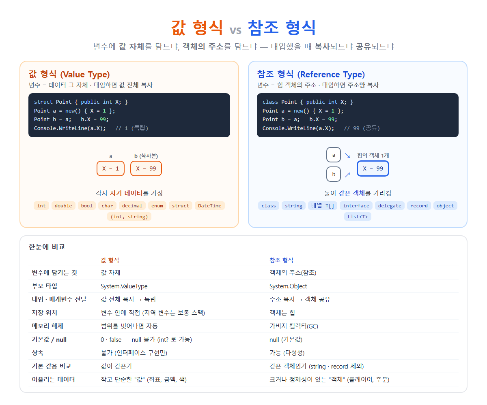

# [값 형식 vs 참조 형식](../KeywordsList.md)

</img>

| 구분 | 값 형식 | 참조 형식 |
| --- | --- | --- |
| 변수에 담기는 것 | 값 자체 | 객체의 주소(참조) |
| 부모 타입 | `System.ValueType` | `System.Object` |
| 대표 종류 | `int`, `double`, `bool`, `char`, `enum`, `struct` | `class`, `string`, 배열, `interface`, `delegate`, `record` |
| 대입·전달 | 값 전체 복사 → 독립 | 주소 복사 → 객체 공유 |
| 저장 위치 | 변수 안에 직접 (지역 변수는 보통 스택) | 객체는 힙 |
| 메모리 해제 | 범위를 벗어나면 자동 | 가비지 컬렉터(GC) |
| 기본값 | `0`, `false` 등 | `null` |
| null 가능 | ❌ (`int?`로만) | ✅ |
| 상속 | ❌ (인터페이스 구현만) | ✅ (다형성) |
| `==` 기본 동작 | 값 비교 | 참조 비교 (같은 객체인가) |
| 전달 비용 | 크기만큼 복사 (작으면 빠름, 크면 느림) | 항상 주소 크기 (8바이트) |
| GC 부담 | 없음 (박싱 제외) | 있음 |
| 대표 예외 | 오버플로 등 | `NullReferenceException` |
| 어울리는 데이터 | 작고 불변인 "값" | 크거나 정체성이 있는 "객체" |

## 값 형식(Value Type)

- 변수가 데이터(값) 자체를 직접 담는 형식
- 대입하거나 메서드에 넘기면 값 전체가 복사되므로, 복사된 변수는 원본과 완전히 독립적
    - 종류 : `int`, `double`, `bool`, `char`, `decimal` 같은 기본형, `enum`, `struct`(`DateTime`, `Vector3` 등), 튜플, `Nullable<T>`
    - 쓰임 : 좌표, 금액, 색상, 날짜처럼 작고 단순한 "값"을 표현할 때

```csharp
int a = 10;
int b = a;     // 10이 복사됨
b = 20;
Console.WriteLine(a);   // 10 ← 그대로
```

## 참조 형식(Reference Type)

- 변수가 힙에 있는 객체의 주소(참조)를 담는 형식
- 대입하면 주소만 복사되므로, 두 변수가 같은 객체를 공유
    - 종류 : `class`, `string`, 배열, `interface`, `delegate`, `record`, `object`, `List<T>` 같은 컬렉션
    - 쓰임 : 플레이어, 주문, 계좌처럼 크거나 정체성(identity)이 있는 "객체", 여러 곳에서 공유해야 하는 데이터

```csharp
var list1 = new List<int> { 1 };
var list2 = list1;     // 주소만 복사 → 같은 리스트
list2.Add(2);
Console.WriteLine(list1.Count);   // 2 ← 같이 바뀜
```

## 핵심 차이

```csharp
struct PointS { public int X; }     // 값 형식
class  PointC { public int X; }     // 참조 형식

var s1 = new PointS { X = 1 };  var s2 = s1;  s2.X = 99;
var c1 = new PointC { X = 1 };  var c2 = c1;  c2.X = 99;

Console.WriteLine(s1.X);   // 1   ← 복사본만 바뀜
Console.WriteLine(c1.X);   // 99  ← 같은 객체라서 함께 바뀜
```

## 메서드에 넘길 때의 차이

```csharp
void ChangeValue(PointS p) { p.X = 100; }   // 복사본 수정 → 원본 그대로
void ChangeRef(PointC p)   { p.X = 100; }   // 같은 객체 수정 → 원본도 바뀜
void Replace(PointC p)     { p = new PointC { X = 500 }; }   // 주소 복사본만 교체 → 원본 그대로
```

| 상황 | 값 형식 | 참조 형식 |
| --- | --- | --- |
| 메서드 안에서 멤버 수정 | 원본 그대로 | 원본 변경 |
| 메서드 안에서 새 값/객체 대입 | 원본 그대로 | 원본 그대로 |
| `ref`로 전달 후 수정·대입 | 원본 변경 | 원본 변수 자체가 바뀜 |