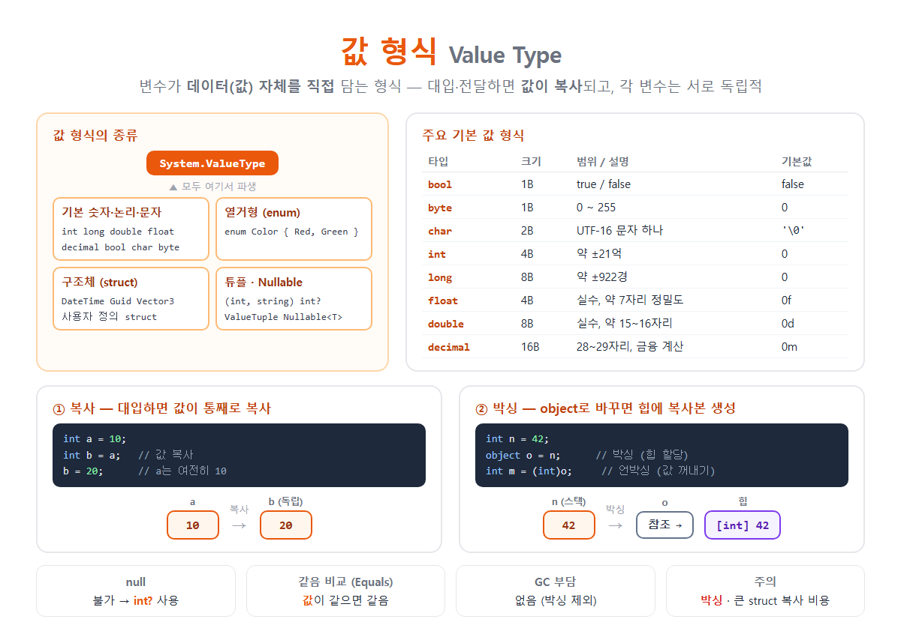

# [값 형식](../KeywordsList.md)

</img>

| 항목 | 내용 |
| --- | --- |
| 정의 | 변수가 데이터 자체를 직접 담는 형식 |
| 부모 | `System.ValueType` |
| 종류 | 정수·실수·`bool`·`char`, `enum`, `struct`, 튜플, `Nullable<T>` |
| 복사 | 대입·전달·반환 시 값 전체 복사 |
| null | 불가 → `int?` |
| 기본값 | 0 / `false` / `'\0'` |
| 저장 | 변수 안에 직접 (지역 변수는 보통 스택) |
| 비교 | 값 비교 (`Equals`) |
| 장점 | 빠름, GC 부담 없음, 메모리 효율, 독립성 |
| 주의 | 박싱, 큰 struct의 복사 비용, 가변 struct의 복사 함정 |

## 정의

- 변수가 데이터(값) 자체를 직접 담는 형식
- 변수에 다른 변수를 대입하거나 메서드에 넘기면 값이 통째로 복사
- 복사된 두 변수는 서로 완전히 독립적

```csharp
int a = 10;
int b = a;      // a의 값 10이 b로 "복사"됨
b = 20;

Console.WriteLine(a);   // 10  ← b를 바꿔도 a는 그대로
Console.WriteLine(b);   // 20
```

## 종류

| 타입 | .NET 이름 | 크기 | 범위 / 설명 | 기본값 | 리터럴 |
| --- | --- | --- | --- | --- | --- |
| `bool` | `Boolean` | 1B | `true` / `false` | `false` | `true` |
| `byte` | `Byte` | 1B | 0 ~ 255 | `0` | `255` |
| `char` | `Char` | 2B | UTF-16 문자 하나 | `'\0'` | `'A'` |
| `short` | `Int16` | 2B | -32,768 ~ 32,767 | `0` |  |
| `int` | `Int32` | 4B | 약 ±21억 | `0` | `100` |
| `long` | `Int64` | 8B | 약 ±922경 | `0` | `100L` |
| `float` | `Single` | 4B | 실수, 약 7자리 정밀도 | `0f` | `3.14f` |
| `double` | `Double` | 8B | 실수, 약 15~16자리 정밀도 | `0d` | `3.14` |
| `decimal` | `Decimal` | 16B | 28~29자리, 금융 계산용 | `0m` | `3.14m` |

## 특징

- 값 복사 (Copy Semantics) : 대입, 매개변수 전달, 반환할 때 값 전체가 복사됨.

```csharp
void Change(int x) { x = 100; }    // 복사본만 바뀜
int n = 5;
Change(n);
Console.WriteLine(n);              // 5
```

- null이 될 수 없음 : null이 필요하면 nullable 값 형식 `T?`를 씀.

```csharp
int x = null;           // ❌ CS0037
int? y = null;          // ✅ Nullable<int>
int z = y ?? 0;         // null이면 0
if (y.HasValue) Console.WriteLine(y.Value);
```

- 항상 기본값이 있음 : 선언만 하면 0에 해당하는 값으로 채워짐. 필드나 배열 요소라면 자동으로 초기화되고, 지역 변수는 직접 할당해야 함.

```csharp
int[] arr = new int[3];          // { 0, 0, 0 }
DateTime d = default;            // 0001-01-01 00:00:00
```

- 저장 위치: 변수 안에 직접(inline)
    - 지역 변수라면 보통 스택에 저장됨.
    - 클래스의 필드라면 그 객체 안(힙)에, 배열의 요소라면 배열 안에 연속으로 저장됨.
    - 따로 힙 객체를 만들지 않아서 GC 부담이 없음.
- 값으로 비교 : `Equals`는 담긴 값이 같으면 같다고 판단. 기본형은 `==`도 값으로 비교. 사용자 정의 struct는 `==`를 직접 정의하거나 `record struct`를 써야 함.
- 상속할 수 없음 : 값 형식은 모두 암묵적으로 `sealed`. 인터페이스 구현은 가능

## 기능

| 기능 | 설명 |
| --- | --- |
| **빠른 할당·해제** | 힙 할당이 없어 생성과 소멸이 빠름 |
| **GC 부담 없음** | 수많은 작은 값을 만들어도 GC가 할 일이 없음 |
| **메모리 효율** | 배열에 연속 저장 → 캐시 효율이 좋음, 객체 헤더 오버헤드 없음 |
| **안전한 독립성** | 복사되므로 다른 곳에서 값이 몰래 바뀌지 않음 |
| **null 안전** | 기본적으로 null이 아니라서 NullReferenceException 걱정이 없음 |