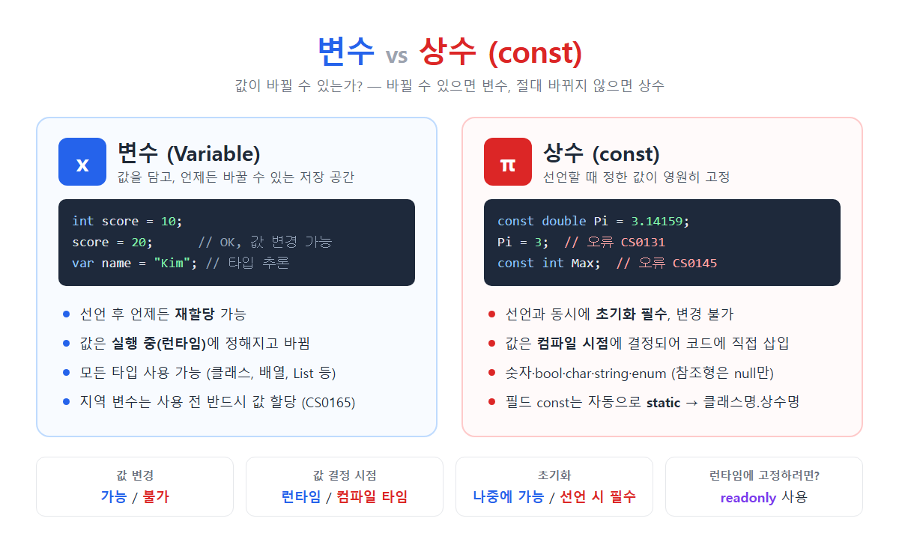

# [변수 vs 상수(const)](../KeywordsList.md)



| 구분 | 변수 | 상수 (const) |
| --- | --- | --- |
| 키워드 | 타입명 또는 `var` | `const` |
| 값 변경 | ✅ 가능 | ❌ 불가 |
| 초기화 | 나중에 해도 됨 (지역 변수는 사용 전까지) | 선언할 때 반드시 |
| 값 결정 시점 | 런타임(실행 중) | 컴파일 타임 |
| 사용 가능 타입 | 모든 타입 | 숫자, bool, char, string, enum, null |
| static 여부 | 직접 지정 | 필드면 자동으로 static |
| 메서드 결과 대입 | 가능 | 불가 |
| 주 용도 | 바뀌는 상태 저장 | 절대 안 바뀌는 고정값 (원주율, 최대치 등) |

## 변수(Variable)

### 정의

- 변수는 값을 저장하는 이름 붙은 메모리 공간. 저장한 값은 프로그램이 실행되는 동안 언제든 바꿀 수 있음

```csharp
int score = 10;      // 선언 + 초기화
score = 20;          // 재할당 OK
var name = "Kim";    // var: 컴파일러가 타입을 string으로 추론
```

### 특징

- 재할당 가능 : 선언한 뒤 몇 번이든 새 값을 넣을 수 있음.
- 런타임에 값 결정 : 사용자 입력, 계산 결과, 메서드 반환값처럼 실행 중에 정해지는 값을 담을 수 있음.
- 모든 타입 사용 가능 : 기본형(int, double 등), 클래스, 배열, `List<T>` 등 어떤 타입이든 됨.
- 지역 변수와 필드
    - 메서드 안의 지역 변수는 사용하기 전에 반드시 값을 넣어야 함. 넣지 않고 쓰면 오류 CS0165가 발생함.
    - 클래스의 필드는 값을 넣지 않으면 기본값(`0`, `false`, `null` 등)으로 자동 초기화됨.

### 기능

- 프로그램의 상태(점수, 체력, 입력값, 반복 카운터 등)를 저장하고 바꿈.
- 값을 메서드 사이에 전달하고 계산 결과를 보관.

## 상수(Const)

### 정의

- `const` 키워드로 선언하며, 선언할 때 정한 값이 끝까지 바뀌지 않는 이름 붙은 값

```csharp
const double Pi = 3.14159;
Pi = 3;              // ❌ CS0131: 상수에는 대입할 수 없음
const int Max;       // ❌ CS0145: 상수는 선언 시 값을 넣어야 함

class Config
{
    public const int MaxPlayers = 4;
}
int n = Config.MaxPlayers;   // 클래스명.상수명으로 접근
```

### 특징

- 선언과 동시에 초기화해야 하고, 이후에는 바꿀 수 없음.
- 값이 컴파일 시점에 결정됨. 그래서 `const int x = GetValue();` 처럼 메서드 호출 결과는 넣을 수 없음.
- 사용할 수 있는 타입이 정해져 있음 : 숫자형, `bool`, `char`, `string`, `enum`. 그 밖의 참조형은 `null`만 넣을 수 있음.
- 필드로 선언한 const는 자동으로 static. 그래서 `static const`라고 쓰면 오류(CS0504)가 나고, `클래스명.상수명`으로 접근함.
- 메서드 안에서 지역 상수로도 선언할 수 있음.

### 기능

- 매직 넘버를 없앰. 예를 들어 `if (count > 4)` 대신 `if (count > MaxPlayers)`라고 쓰면 의미가 분명해짐.
- 실수로 값을 바꾸는 것을 컴파일러가 막아 줌.
- 값을 한 곳에서 관리하므로 고칠 때 한 군데만 바꾸면 됨.