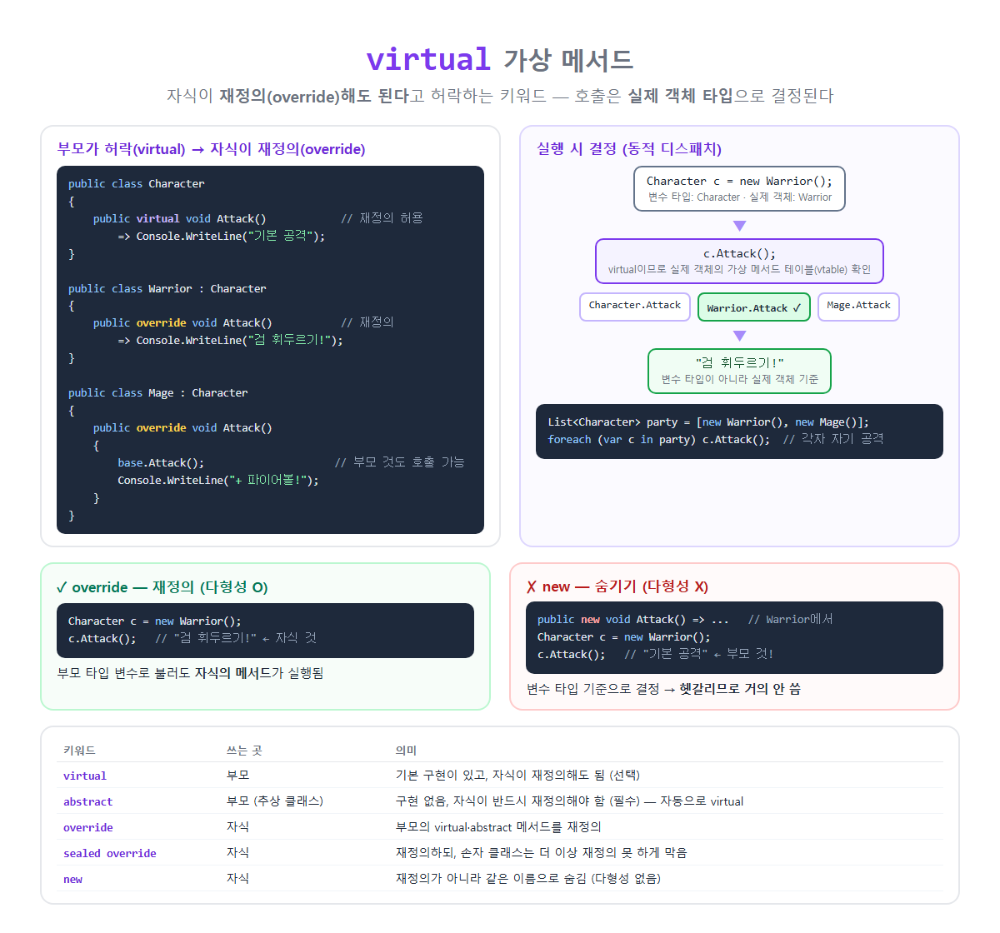

# [가상화(virtual)](../KeywordsList.md)

</img>

| 항목 | 내용 |
| --- | --- |
| 정의 | 자식 클래스가 재정의할 수 있도록 허용하는 키워드 |
| 대상 | 메서드, 속성, 인덱서, 이벤트 |
| 짝꿍 | 자식의 `override` |
| 기본 구현 | 있음 (재정의는 선택) |
| 호출 결정 | 런타임, 실제 객체 타입 기준 (동적 디스패치) |
| 내부 원리 | 가상 메서드 테이블(vtable) |
| 부모 호출 | `base.메서드()` |
| 사용 불가 | `static`, `private`, struct |
| C# 기본값 | 메서드는 **non-virtual** (명시 필요) |
| 재정의 막기 | `sealed override`, `sealed class` |
| 관련 패턴 | 템플릿 메서드, 전략, 상태 |

## 정의

- 부모 클래스의 메서드(또는 속성, 인덱서, 이벤트)에 붙이는 키워드
- 자식 클래스가 이 멤버를 재정의(override)해도 된다고 허락하는 표시
- `virtual` 메서드를 호출하면, 변수의 타입이 아니라 실행 시점의 실제 객체 타입을 보고 어떤 메서드를 실행할지 결정
- 이를 동적 디스패치(Dynamic Dispatch) 또는 늦은 바인딩(Late Binding)
- 객체지향의 핵심인 다형성(Polymorphism)을 가능하게 하는 키워드

```csharp
public class Character
{
    public virtual void Attack() => Console.WriteLine("기본 공격");   // 재정의 허용
}

public class Warrior : Character
{
    public override void Attack() => Console.WriteLine("검 휘두르기!"); // 재정의
}

public class Mage : Character
{
    public override void Attack() => Console.WriteLine("파이어볼!");
}

Character c = new Warrior();     // 변수 타입: Character / 실제 객체: Warrior
c.Attack();                      // "검 휘두르기!" ← 실제 객체(Warrior)의 메서드가 실행됨

List<Character> party = [new Warrior(), new Mage(), new Character()];
foreach (var p in party) p.Attack();
// 검 휘두르기!
// 파이어볼!
// 기본 공격
```

## 특징

- 기본 구현을 가짐. `virtual` 메서드는 본문이 있음. 자식이 재정의하지 않으면 부모의 구현이 그대로 쓰입니다. 재정의는 선택.
- 자식은 `override`로 재정의. 시그니처(이름, 매개변수, 반환 타입)와 접근 수준이 부모와 같아야 함.
- `base.메서드()`로 부모의 원래 구현을 호출할 수 있음. 부모 동작에 기능을 덧붙일 때 유용함.

```csharp
public override void Attack()
{
    base.Attack();                       // 부모의 "기본 공격" 먼저
    Console.WriteLine("+ 추가 화염 피해");
}
```

- C#에서 메서드는 기본적으로 virtual이 아님. Java는 기본이 virtual이지만, C#은 명시적으로 `virtual`을 붙여야 재정의를 허용. 의도하지 않은 재정의를 막기 위한 설계.
- 쓸 수 없는 곳
    - `static` 메서드 : 객체가 없으므로 다형성이 없음.
    - `private` 메서드 : 자식이 볼 수 없으므로 재정의할 수 없음(CS0621).
    - 구조체(struct) : 상속이 안 되므로 의미가 없음.
- 재정의된 메서드도 계속 virtual. 손자 클래스가 다시 `override`할 수 있음. 막으려면 `sealed override`를 씀.

## 기능

| 기능 | 설명 |
| --- | --- |
| **다형성** | 부모 타입 하나로 여러 자식 객체를 다루고, 각자 자기 방식으로 동작 |
| **기본 동작 + 확장** | 공통 기본 구현을 제공하면서, 필요한 자식만 바꿈 |
| **OCP 실현** | 새 자식 클래스를 추가해도 부모 타입을 쓰는 코드는 수정 불필요 |
| **템플릿 메서드 패턴** | 큰 흐름은 부모가 정하고, 세부 단계를 `virtual`로 열어 둠 |
| **프레임워크 확장 지점** | `ToString()`, `Equals()`, `Dispose(bool)` 등을 재정의해 동작 맞춤 |

```csharp
// 모든 클래스가 상속하는 object의 virtual 메서드를 재정의
public class Player
{
    public string Name { get; set; } = "";
    public override string ToString() => $"Player({Name})";   // object.ToString()은 virtual
}
```

## override vs new

```csharp
public class Parent
{
    public virtual void Hello() => Console.WriteLine("부모");
}

public class ChildOverride : Parent
{
    public override void Hello() => Console.WriteLine("자식(override)");
}

public class ChildNew : Parent
{
    public new void Hello() => Console.WriteLine("자식(new)");
}

Parent a = new ChildOverride();  a.Hello();   // "자식(override)" ← 실제 객체 기준
Parent b = new ChildNew();       b.Hello();   // "부모"           ← 변수 타입 기준!
ChildNew c = new ChildNew();     c.Hello();   // "자식(new)"
```

| 구분 | `override` | `new` |
| --- | --- | --- |
| 의미 | 재정의 | 숨김(hiding) |
| 결정 기준 | 실제 객체 타입 (런타임) | 변수 타입 (컴파일 타임) |
| 다형성 | ✅ | ❌ |
| 부모에 virtual 필요 | ✅ 필요 | 필요 없음 |
| 추천 | ⭐ 일반적으로 사용 | 거의 쓰지 않음 (헷갈림) |
- `new`도 `override`도 붙이지 않고 같은 이름을 쓰면 경고 CS0108/CS0114가 나면서 `new`로 처리됨.