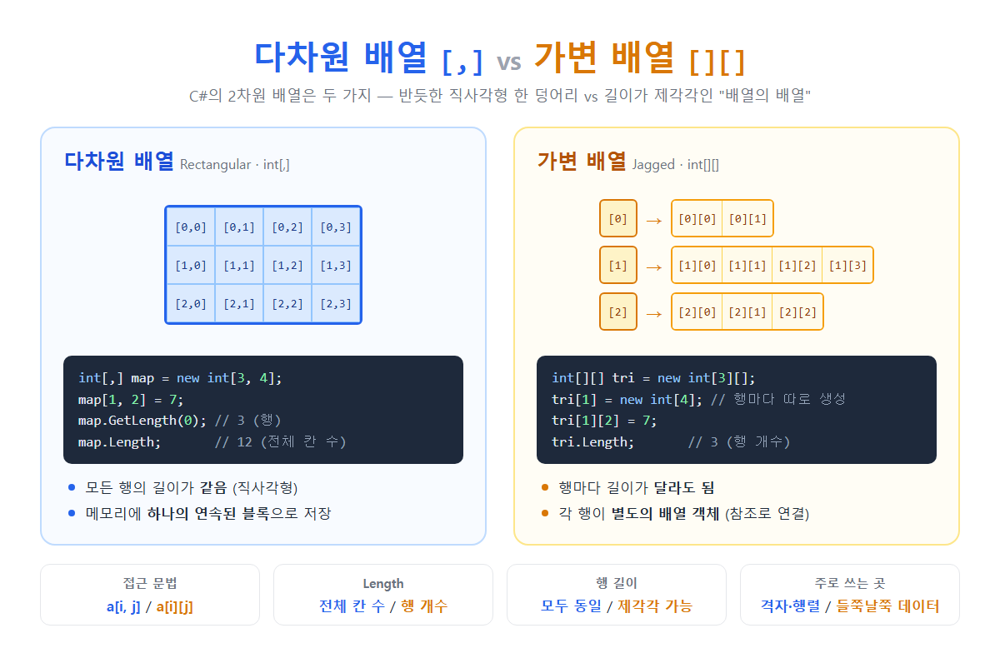

# [array2D의 두가지 종류](../KeywordsList.md)

</img>

| 구분 | 다차원 배열 `int[,]` | 가변 배열 `int[][]` |
| --- | --- | --- |
| 모양 | 직사각형 (행 길이 동일) | 들쭉날쭉 (행 길이 제각각) |
| 선언 | `new int[3, 4]` | `new int[3][]` 후 행마다 `new int[n]` |
| 접근 | `arr[i, j]` | `arr[i][j]` |
| 객체 수 | 배열 객체 1개 | 바깥 배열 1개 + 행 배열 N개 |
| 메모리 | 하나의 연속된 블록 | 행마다 따로 떨어진 블록 (참조로 연결) |
| `Length` | 전체 칸 수 (3×4 = 12) | 행 개수 (3) |
| 행/열 크기 | `GetLength(0)`, `GetLength(1)` | `arr.Length`, `arr[i].Length` |
| 생성 직후 | 모든 칸 사용 가능 (기본값) | 각 행이 `null`이라 따로 생성해야 함 |
| 행 단위 조작 | 불가 (`arr[1]`처럼 행만 꺼낼 수 없음) | 가능 (`arr[1]`이 `int[]`) |
| LINQ 사용 | 불편함 (`Cast<int>()` 필요) | 편리함 |
| 성능 | 인덱스 계산 비용이 있어 상대적으로 느린 편 | .NET에서 보통 더 빠른 편 |
| 주 용도 | 격자, 행렬, 게임 맵 | 행마다 크기가 다른 데이터 |

## 다차원 배열(Rectangular Array, int[,])

### 정의

- 쉼표로 차원을 구분하는 배열
- 모든 행의 길이가 같은 직사각형 모양 표이고, 하나의 배열 객체

```csharp
int[,] map = new int[3, 4];        // 3행 4열
map[1, 2] = 7;                     // 대괄호 하나에 쉼표로 접근

int[,] m = { { 1, 2, 3 },
             { 4, 5, 6 } };        // 선언과 동시에 초기화

for (int i = 0; i < m.GetLength(0); i++)       // GetLength(0): 행 수 → 2
    for (int j = 0; j < m.GetLength(1); j++)   // GetLength(1): 열 수 → 3
        Console.Write(m[i, j]);
```

### 특징

- 모든 행의 길이가 같음. 3×4로 만들면 반드시 12칸.
- 메모리에 하나의 연속된 블록으로 저장됨. 행 순서대로 이어서 놓임.
- 만들면 모든 칸이 바로 사용할 수 있는 상태가 됨. 칸은 기본값(`0`)으로 채워짐.
- `Length`는 전체 칸 수(12), `Rank`는 차원 수(2).
- `foreach`로 돌리면 모든 칸을 행 순서대로 하나씩 꺼냄.

### 기능

- 게임 맵(타일), 체스판, 행렬 연산, 이미지 픽셀처럼 크기가 반듯하게 정해진 격자 데이터에 씀

## 가변 배열(Jagged Array, int[][])

### 정의

- 배열을 요소로 가지는 배열
- 각 행이 독립된 1차원 배열이라서 행마다 길이가 달라도 됨

```csharp
int[][] tri = new int[3][];        // 행 3개만 준비 (아직 각 행은 null)
tri[0] = new int[2];               // 행마다 따로 생성
tri[1] = new int[4];
tri[2] = new int[3];
tri[1][2] = 7;                     // 대괄호 두 개로 접근

int[][] j = {
    new[] { 1, 2 },
    new[] { 3, 4, 5, 6 },
    new[] { 7 }
};

for (int r = 0; r < j.Length; r++)          // j.Length: 행 수 → 3
    for (int c = 0; c < j[r].Length; c++)   // j[r].Length: 그 행의 길이
        Console.Write(j[r][c]);
```

### 특징

- 행마다 길이가 다를 수 있음
- 바깥 배열은 각 행 배열을 가리키는 참조를 담음. 그래서 행들은 메모리 곳곳에 따로 떨어져 있음
- `new int[3][]`만 하면 각 행은 `null`. 행을 따로 만들지 않고 접근하면 `NullReferenceException` 발생.
- `Length`는 행 개수이고 각 행의 길이는 `arr[i].Length`로 구함.
- 행 하나를 통째로 꺼내거나 바꿀 수 있음.

### 기능 / 쓰임

- 요일 별 일정 수, 반별 학생 점수, 삼각형 모양 데이터(파스칼 삼각형), 줄마다 길이가 다른 텍스트처럼 행마다 크기가 다른 데이터에 쓰임.