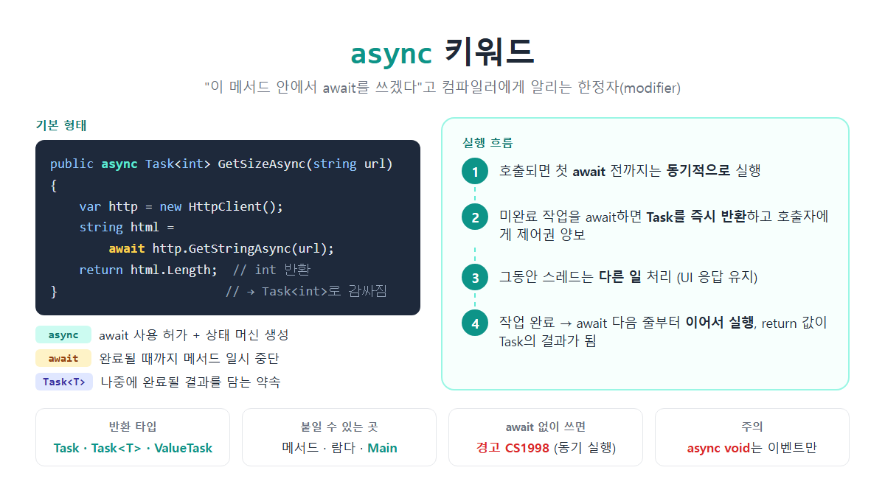

# [async](../KeywordsList.md)

</img>

| 항목 | 내용 |
| --- | --- |
| 종류 | 한정자(modifier) |
| 역할 | 메서드 안에서 `await`를 쓸 수 있게 하고, 비동기 상태 머신을 생성 |
| 붙일 수 있는 곳 | 메서드, 람다(`async () => ...`), 익명 메서드, 로컬 함수, `Main` (C# 7.1+) |
| 붙일 수 없는 곳 | 인터페이스·추상 메서드 선언, 프로퍼티, 생성자 |
| 짝꿍 | `await`, `Task`, `Task<T>` |
| 스레드 생성 | ❌ 하지 않음 |
| await 없이 사용 | 경고 CS1998, 동기로 실행됨 |
| 이름 관례 | 메서드 이름 끝에 `Async` 붙이기 |
| 매개변수 제한 | `ref`, `out`, `in` 매개변수 사용 불가 |

## 정의

- `async`는 메서드, 람다, 익명 메서드 앞에 붙이는 한정자(modifier).
- 컴파일러에게 "이 메서드는 비동기 메서드이고, 안에서 `await`를 쓰겠다"고 알려줌.

```csharp
public async Task<int> GetSizeAsync(string url)
{
    var http = new HttpClient();
    string html = await http.GetStringAsync(url);  // async가 있어야 await 사용 가능
    return html.Length;                            // int를 return하면 Task<int>로 감싸짐
}
```

## 특징

- `await`를 쓸 수 있게 해 줌.
    - `async`가 없는 메서드에서 `await`를 쓰면 컴파일 오류(CS4032 등)가 발생함.
    - 반대로 `async`만 붙이고 `await`를 하나도 안 쓰면 경고 CS1998이 나고, 메서드는 그냥 동기로 실행됨.
- 새 스레드를 만들지 않음. `async`를 붙였다고 메서드가 다른 스레드에서 돌아가는 것은 아님.
    - 첫 `await`가 나오기 전까지는 호출한 스레드에서 동기적으로 실행됨.
- 컴파일러가 상태 머신을 만들어 줌.
    - `await` 지점에서 메서드를 멈췄다가 작업이 끝나면 이어서 실행하는 코드를 컴파일러가 대신 작성함.
- 반환값이 자동으로 Task로 감싸짐.
    - 반환 타입이 `Task<int>`인 메서드에서 `return 5;`처럼 `int`만 반환하면 됨.
    - 반환 타입이 `Task`인 메서드에서는 `return;`만 쓰거나 아예 생략함.
- 예외도 Task에 담김.
    - 메서드 안에서 예외가 나면 바로 던져지지 않고 반환된 Task에 저장됨.
    - 그 예외는 호출한 쪽에서 `await`할 때 던져지므로, `try-catch`로 잡을 수 있음.
- 메서드 시그니처에 포함되지 않음.
    - `async`는 구현 방식을 나타낼 뿐이라, 인터페이스나 추상 메서드 선언에는 붙일 수 없음.
    - 인터페이스에는 `Task<T> GetAsync();`처럼 반환 타입만 적고, 구현하는 쪽에서 `async`를 붙임.

## 기능

1. 메서드가 호출되면 첫 `await`가 나오기 전까지는 일반 메서드처럼 실행됨.
2. 아직 끝나지 않은 작업을 `await`하면 미완료 상태의 Task를 즉시 반환하고, 호출한 쪽으로 제어권을 돌려줌.
3. 작업을 기다리는 동안 스레드는 다른 일을 처리. 그래서 UI가 계속 반응함.
4. 작업이 끝나면 `await` 다음 줄부터 이어서 실행함. 마지막 `return` 값이 Task의 결과가 됨.

## 사용 가능한 반환 타입

| 반환 타입 | 의미 | 예 |
| --- | --- | --- |
| `Task` | 결과값 없음 (void 역할) | `async Task SaveAsync()` |
| `Task<T>` | T 타입 결과 반환 | `async Task<int> CountAsync()` |
| `ValueTask` / `ValueTask<T>` | 동기적으로 바로 끝나는 경우가 많을 때 메모리 할당을 줄인 버전 | 캐시 조회 등 |
| `IAsyncEnumerable<T>` | 비동기 스트림 (`yield return` + `await foreach`) | 데이터를 하나씩 비동기로 받기 |
| `void` | 이벤트 핸들러 전용 | `async void Button_Click(...)` |