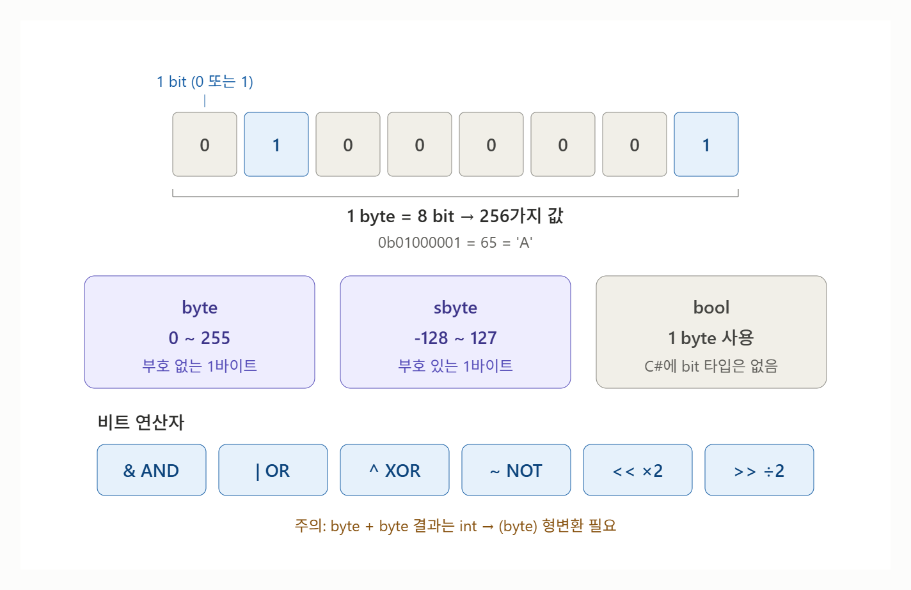

# [bit/byte](../KeywordsList.md)

</img>

| 구분 | bit (비트) | byte (바이트) |
| --- | --- | --- |
| 정의 | 0 또는 1을 저장하는 최소 단위 | 비트 8개의 묶음 |
| 표현 가능한 값 | 2가지 | 256가지 (2⁸) |
| C# 전용 타입 | 없음 (`bool`도 1바이트 사용) | `byte`(0~255), `sbyte`(-128~127) |
| 다루는 방법 | 정수형 + 비트 연산자 `& | ^ ~ << >>` | `byte` 변수, `byte[]` 배열 |
| 리터럴 / 변환 | `0b1010`, `Convert.ToString(x, 2)` | `BitConverter`, `Encoding.UTF8.GetBytes` |
| 주의점 | 시프트·부호 비트(`~`) 결과 확인 | 연산 시 `int`로 승격 → 형변환 필요, 오버플로 시 순환 |
| 주요 활용 | `[Flags]` 열거형, LayerMask, 상태 플래그 | 파일 입출력, 네트워크, 이미지·직렬화 데이터 |

## 정의

- **bit(비트)** : 컴퓨터가 다루는 가장 작은 단위. `0` 또는 `1` 하나만 저장.
- **byte(바이트)** : 비트 8개를 묶은 단위. 8비트로 2⁸ = 256가지 값을 표현.

## bit 자료형

- c#에는 1비트만 차지하는 자료형이 없음 ⇒ 메모리는 바이트 단위로 주소가 매겨지기 때문
- `bool`은 true/false만 담지만 실제로는 1바이트를 차지함.

```csharp
Console.WriteLine(sizeof(bool));  // 1 (byte)
Console.WriteLine(sizeof(byte));  // 1
Console.WriteLine(sizeof(int));   // 4
Console.WriteLine(sizeof(long));  // 8
```

- 비트를 직접 다루려면 정수형 변수에 비트 연산자를 사용

## byte 자료형

```csharp
byte  b  = 255;   // 부호 없음: 0 ~ 255
sbyte sb = -128;  // 부호 있음: -128 ~ 127
```

- 연산하면 int로 바뀜.

```csharp
byte a = 10, b = 20;
// byte c = a + b;        // 컴파일 오류! a + b의 결과는 int
byte c = (byte)(a + b);   // 명시적 형변환 필요
```

- 오버플로가 나면 값이 한 바퀴 돔.

```csharp
byte x = 255;
x++;                       // 0이 됨 (기본은 unchecked)

checked
{
    byte y = 255;
    y++;                   // OverflowException 발생
}
```

- 주 용도는 byte 배열(`byte[]`). 파일, 네트워크 통신, 이미지 데이터 등 "날것의 데이터"는 대부분 `byte[]`로 다룸.

```csharp
byte[] data = System.Text.Encoding.UTF8.GetBytes("Hi");  // [72, 105]
byte[] intBytes = BitConverter.GetBytes(1000);           // int → 4바이트
int back = BitConverter.ToInt32(intBytes, 0);            // 4바이트 → int
```

## 비트 연산

- 정수 안의 비트를 하나하나 조작할 때 사용

```csharp
int a = 0b1100;   // 12  (0b 접두사 = 2진수 리터럴)
int b = 0b1010;   // 10

Console.WriteLine(a & b);   // 0b1000 = 8   AND: 둘 다 1이면 1
Console.WriteLine(a | b);   // 0b1110 = 14  OR : 하나라도 1이면 1
Console.WriteLine(a ^ b);   // 0b0110 = 6   XOR: 서로 다르면 1
Console.WriteLine(~a);      // -13          NOT: 모든 비트 반전
Console.WriteLine(a << 1);  // 0b11000 = 24 왼쪽 이동 (×2)
Console.WriteLine(a >> 1);  // 0b0110 = 6   오른쪽 이동 (÷2)

// 2진수 문자열로 확인하기
Console.WriteLine(Convert.ToString(a, 2));  // "1100"
```

- 자주 쓰는 패턴: 특정 비트 켜기/끄기/확인

```csharp
int flags = 0;
int n = 2;

flags |=  (1 << n);                 // n번째 비트 켜기
flags &= ~(1 << n);                 // n번째 비트 끄기
flags ^=  (1 << n);                 // n번째 비트 뒤집기
bool isOn = (flags & (1 << n)) != 0; // n번째 비트 확인
```

- Unity의 LayerMask도 이 방식. `1 << LayerMask.NameToLayer("Ground")` 같은 코드가 바로 “Ground 레이어 번호의 비트를 켠 값”이라는 뜻.