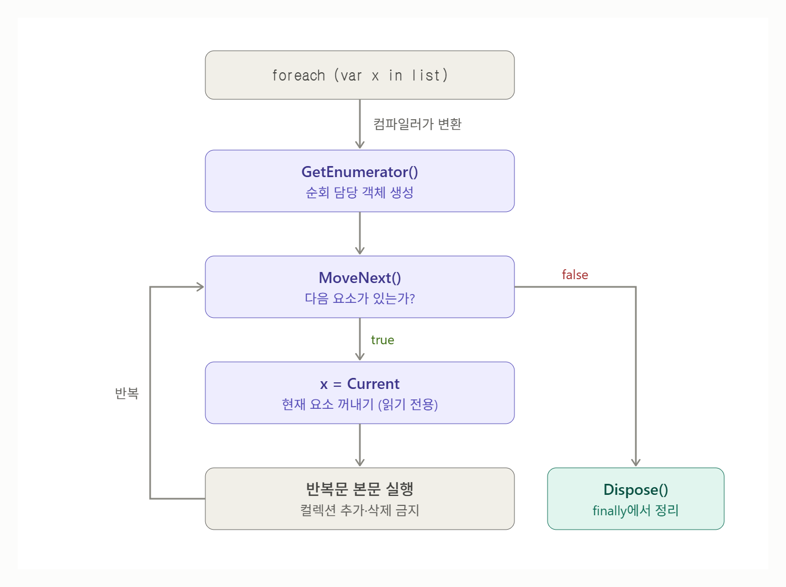

# [foreach](../KeywordsList.md)

</img>

| 항목 | 핵심 내용 |
| --- | --- |
| **정의** | 컬렉션 요소를 순서대로 하나씩 꺼내는 반복문. 컴파일러가 변환해 주는 문법적 편의 기능 |
| **동작 원리** | `GetEnumerator()` → `while (MoveNext())` → `Current` 읽기 → `finally`에서 `Dispose()` |
| **사용 조건** | `IEnumerable` 구현 여부가 아니라 `GetEnumerator`/`MoveNext`/`Current` 패턴만 있으면 됨 (덕 타이핑) |
| **반복 변수** | 읽기 전용. 참조 타입이면 내부 필드 수정은 가능 |
| **컬렉션 수정** | 순회 중 추가·삭제 시 `InvalidOperationException` |
| **배열 최적화** | 배열은 `for`문으로 변환되어 성능 차이 거의 없음 |
| **GC 할당** | `List`·`Dictionary`는 struct Enumerator라 할당 없음. `IEnumerable` 경유·LINQ·`yield`는 할당 발생 |
| **확장 기능** | `yield return`(지연 생성), `await foreach`(비동기), `ref foreach`(복사 없는 접근) |
| **람다 캡처** | C# 5부터 반복마다 새 변수라 캡처 안전 |
| **for와 선택 기준** | 단순 읽기 순회는 `foreach`, 인덱스·수정·삭제가 필요하면 `for` |

## 정의

- foreach는 컬렉션의 요소를 처음부터 끝까지 하나씩 꺼내며 반복하는 문장
- 인덱스를 직접 다루지 않고 다음 요소가 있으면 꺼내라는 방식으로 동작

```csharp
List<int> numbers = new List<int> { 1, 2, 3 };

foreach (int n in numbers)
{
    Console.WriteLine(n);
}
```

- foreach는 실행 시점에 특별한 동작을 하는 문법이 아님. 컴파일러가 이터레이터(Enumerator) 패턴 코드로 바꿔주는 문법적 편의 기능(syntactic sugar)

## 내부 동작 원리

- 위 코드는 컴파일러가 대략 아래와 같이 변환

```csharp
List<int>.Enumerator e = numbers.GetEnumerator();
try
{
    while (e.MoveNext())        // 다음 요소로 이동, 없으면 false
    {
        int n = e.Current;      // 현재 요소 가져오기
        Console.WriteLine(n);
    }
}
finally
{
    e.Dispose();                // 반복이 끝나거나 예외가 나도 정리
}
```

- 핵심 구성 요소
    - **`GetEnumerator()`** : 컬렉션이 "순회 담당 객체(Enumerator)"를 만들어 돌려줌.
    - **`MoveNext()`** : 커서를 다음 요소로 옮기고, 요소가 있으면 `true`, 끝이면 `false`를 반환. 처음 호출 전 커서는 첫 요소의 앞에 있음.
    - **`Current`**: 커서가 가리키는 현재 요소를 반환
- 여기에 `try`/`finally`로 `Dispose()`를 호출해 자원 정리를 보장. 그래서 `foreach` 도중 `break`나 예외가 발생해도 Enumerator가 안전하게 정리됨.

## 기능

- 배열·컬렉션·문자열 등 모든 순회 가능한 대상 지원 : `int[]`, `List<T>`, `Dictionary<K,V>`, `string`, LINQ 결과 등에서 같은 문법을 씀

```csharp
foreach (char c in "abc") { }
foreach (KeyValuePair<string, int> kv in dict) { }
foreach (var (key, value) in dict) { }   // 분해(deconstruction)도 가능
```

- `yield return`으로 직접 순회 대상 만들기 : 메서드 안에서 `yield return`을 쓰면 컴파일러가 Enumerator 클래스를 자동 생성함. 요소를 미리 다 만들지 않고 요청될 때마다 하나씩 생성(지연 실행)

```csharp
IEnumerable<int> Evens(int max)
{
    for (int i = 0; i <= max; i += 2)
        yield return i;
}

foreach (int e in Evens(10)) { }
```

- 비동기 순회 (`await foreach`, C# 8) : `IAsyncEnumerable<T>`을 순회하며 각 요소를 비동기로 기다림.
- 참조 순회 (`ref`/`ref readonly`) : `Span<T>` 등에서 `foreach (ref var item in span)`으로 요소를 복사 없이 직접 수정할 수 있음.

## foreach vs for

| 구분 | foreach | for |
| --- | --- | --- |
| 접근 방식 | Enumerator로 순차 접근 | 인덱스로 직접 접근 |
| 요소 수정 | 반복 변수 대입 불가 | 가능 (`arr[i] = ...`) |
| 순회 중 추가·삭제 | 예외 발생 | 가능 (역순 순회 권장) |
| 사용 가능 대상 | 순회 패턴을 가진 모든 것 | 인덱서가 있는 것 |
| 가독성 | 높음 | 상대적으로 낮음 |