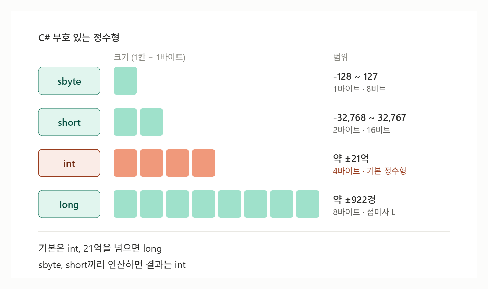

# [sbyte, short, int, long](../KeywordsList.md)

</img>

| 타입 | .NET 타입 | 크기 | 범위 | 리터럴 | 주요 용도 |
| --- | --- | --- | --- | --- | --- |
| `sbyte` | System.SByte | 1바이트 (8비트) | -128 ~ 127 | 캐스팅/대입 | 바이너리·패킷 데이터 |
| `short` | System.Int16 | 2바이트 (16비트) | -32,768 ~ 32,767 | 캐스팅/대입 | 대량 데이터 메모리 절약 |
| `int` | System.Int32 | 4바이트 (32비트) | 약 ±21억 | `100` (기본값) | 기본 정수형, 대부분의 경우 |
| `long` | System.Int64 | 8바이트 (64비트) | 약 ±922경 | `100L` | 큰 수, 시간, ID |
- `sbyte`, `short`, `int`, `long`은 모두 부호 있는(signed) 정수형

## 개념

- sbyte
    - 크기 : 8비트(1바이트)
    - 범위 : -128 ~ 127
    - 가장 작은 부호 있는 정수형. 실제로는 잘 쓰이지 않고, 바이너리 파일이나 네트워크 패킷처럼 데이터 형식이 정해진 경우에 주로 사용
    - 참고로 byte는 부호 없는 8비트(0 ~ 255)
- short
    - 크기 : 16비트(2바이트)
    - 범위 : -32,768 ~ 32,767
    - 값의 범위가 작고 큰 배열에 아주 많이 저장해야 할 때  메모리를 아끼려고 사용.
    - 예시 : 오디오 샘플 데이터나 타일맵 ID
- int
    - 크기 : 32비트(4바이트)
    - 범위 : 2,147,483,648 ~ 2,147,483,647 (약 ±21억)
    - C#의 기본 정수형. `10`처럼 정수 리터럴을 쓰면 기본적으로 `int`가 됩니다.
    - 특별한 이유가 없으면 `int`를 쓰는 것이 표준. 반복문 인덱스, 점수, 개수 등이 여기에 해당.
    - CPU가 32비트 연산에 최적화되어 있어서, 작은 타입을 써도 연산 속도는 빨라지지 않음.
- long
    - 크기 : 64비트(8바이트)
    - 범위 : -9,223,372,036,854,775,808 ~ 9,223,372,036,854,775,807 (약 ±922경)
    - `int` 범위를 넘는 큰 값에 사용.
    - 예tl : 타임스탬프(`DateTime.Ticks`), 파일 크기, 누적 재화, 고유 ID.
    - 리터럴 뒤에 `L` 접미사를 붙여 `long`임을 명시.

## 특징

- **범위 확인 : `MinValue`, `MaxValue`**

```csharp
Console.WriteLine(short.MaxValue);  // 32767
Console.WriteLine(int.MinValue);    // -2147483648
```

- **형변환 규칙**
    - 작은 타입을 큰 타입에 넣을 때는 **암시적 변환**이 됨. 데이터 손실이 없기 때문.
    - 큰 타입을 작은 타입에 넣을 때는 **명시적 캐스팅**이 필요. 값이 잘릴 수 있음.

```csharp
int a = 100;
long b = a;          // OK (암시적)
short c = (short)a;  // 캐스팅 필요
```

- **sbyte, short 연산 결과는 int가 됩니다 (자주 하는 실수)**

```csharp
short x = 10, y = 20;
// short z = x + y;        // 컴파일 에러! x + y는 int
short z = (short)(x + y);  // OK
```

- **오버플로**
    - 기본 상태(unchecked)에서는 범위를 넘으면 에러 없이 값이 반대쪽 끝으로 넘어감. `checked`를 쓰면 `OverflowException`이 발생.

```csharp
int max = int.MaxValue;
int r1 = max + 1;              // -2147483648 (조용히 넘어감)
int r2 = checked(max + 1);     // OverflowException 발생
```

- **부호 없는 짝꿍 타입**
    - 각 타입에 대응하는 부호 없는 타입이 있음.
    - 순서대로 `byte`, `ushort`, `uint`, `ulong`이며, 0부터 시작하는 대신 양수 범위가 약 2배 넓음.