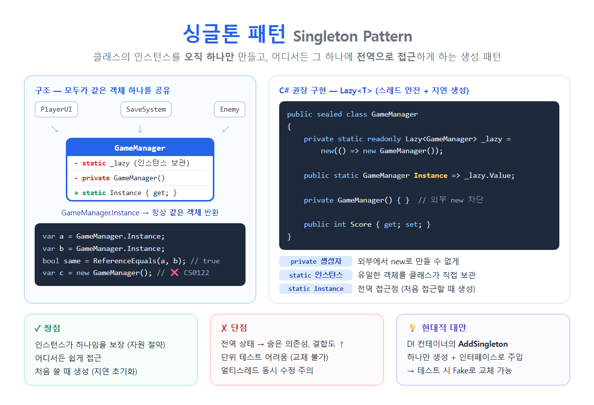

# [싱글톤 패턴](../KeywordsList.md)



| 항목 | 내용 |
| --- | --- |
| 분류 | GoF 생성 패턴 |
| 정의 | 인스턴스를 하나만 만들고, 전역 접근점을 제공 |
| 구성 | `private` 생성자 + `static` 인스턴스 + `static` 접근 속성 |
| 관례 | `sealed` 클래스 |
| C# 권장 구현 | `Lazy<T>` 또는 `static readonly` |
| 스레드 안전 | 기본 구현은 ❌ → `Lazy<T>`, lock, static 초기화로 해결 |
| 장점 | 유일성 보장, 쉬운 접근, 지연 초기화 |
| 단점 | 전역 상태, 숨은 의존성, 테스트 어려움, SRP 위반 |
| 현대적 대안 | DI 컨테이너의 `AddSingleton` |

## 정의

- GoF 디자인 패턴 중 생성 패턴의 하나
- 클래스의 인스턴스가 오직 하나만 만들어짐.
- 그 하나에 어디서든 접근할 수 있는 전역 접근점을 제공
- 게임 매니저, 설정 관리자, 로거처럼 프로그램 전체에 딱 하나만 있어야 하는 객체를 만들 때 사용.

```csharp
public sealed class GameManager
{
    private static readonly Lazy<GameManager> _lazy = new(() => new GameManager());

    public static GameManager Instance => _lazy.Value;   // 전역 접근점

    private GameManager() { }                            // 외부에서 new 금지

    public int Score { get; set; }
}

// 사용
GameManager.Instance.Score += 10;

var a = GameManager.Instance;
var b = GameManager.Instance;
Console.WriteLine(ReferenceEquals(a, b));   // True ← 같은 객체
var c = new GameManager();                   // ❌ CS0122: 생성자에 접근할 수 없음
```

## 특징

| 구성 요소 | 역할 |
| --- | --- |
| **`private` 생성자** | 외부에서 `new`로 객체를 만들지 못하게 막음 |
| **`static` 필드** | 유일한 인스턴스를 클래스가 직접 보관 |
| **`static` 속성/메서드 (`Instance`)** | 그 인스턴스를 돌려주는 전역 접근점. 처음 요청할 때 생성하기도 함 |
- `sealed`를 붙이는 것이 관례. 상속을 허용하면 자식 클래스를 통해 인스턴스가 하나 더 생길 수 있기 때문.
- 지연 초기화(Lazy Initialization)를 할 수 있음. 실제로 처음 쓰는 순간에 객체를 만들어서 자원을 아낌.
- 프로그램이 끝날 때까지 살아 있음. static 필드가 참조를 쥐고 있어서 GC가 회수하지 않음.

## 기능

| 용도 | 예 |
| --- | --- |
| **공유 상태 관리** | 게임 매니저(점수, 스테이지), 세션 정보 |
| **설정** | 앱 설정, 환경 변수 읽기 |
| **로깅** | 로그 파일에 쓰는 객체 하나 |
| **캐시** | 메모리 캐시 |
| **비싼 자원 공유** | DB 연결 풀, 하드웨어 장치 접근 객체 |
| **Unity** | `GameManager`, `AudioManager`, `UIManager` |