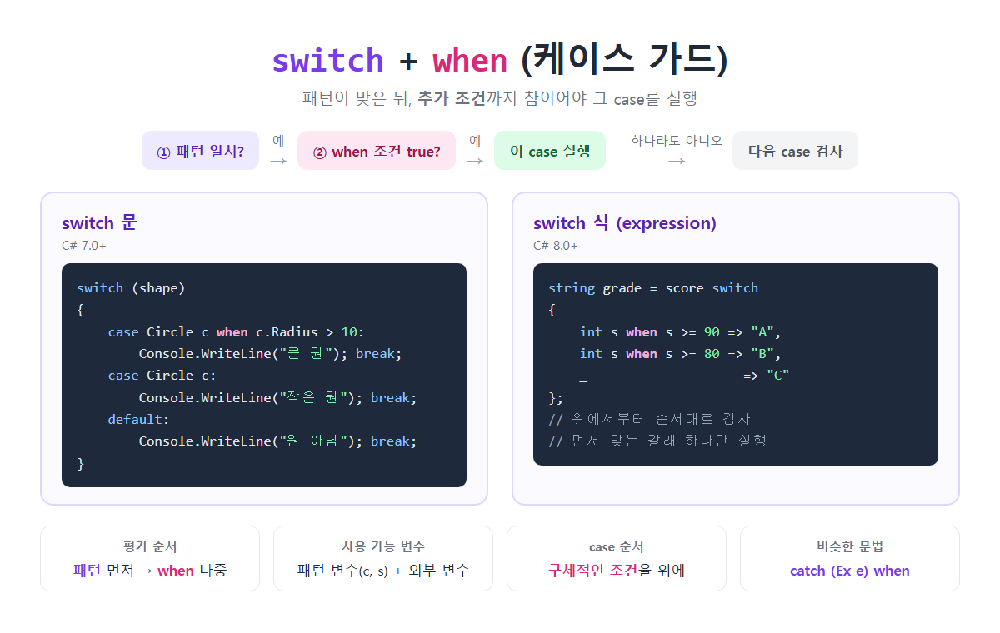

# [switch when](../KeywordsList.md)

</img>

| 항목 | 내용 |
| --- | --- |
| 이름 | 케이스 가드 (case guard), when 절 |
| 도입 버전 | switch 문 C# 7.0, switch 식 C# 8.0 |
| 형태 | `case 패턴 when 조건:` / `패턴 when 조건 => 값,` |
| 실행 조건 | 패턴 일치 AND when 조건 true |
| 평가 순서 | 패턴 먼저, when 나중, case는 위에서 아래로 |
| 사용 가능 변수 | 패턴 변수 + 바깥 지역 변수, 필드 |
| 제약 | `default`에는 사용 불가 |
| 주의 | 구체적인 조건을 위에 두기, 조건식에 부수 효과(side effect) 넣지 않기 |
| 비슷한 문법 | 예외 필터 `catch (Exception e) when (조건)` |

## 정의

- when은 switch의 case(또는 switch 식의 갈래)에 붙이는 추가 조건절이며, 케이스 가드(case guard)라고 부름.
- 패턴이 일치하는 것만으로는 부족하고, when 뒤의 조건식까지 true여야 그 case가 실행됨.

```csharp
switch (shape)
{
    case Circle c when c.Radius > 10:   // Circle이면서 반지름이 10보다 커야 함
        Console.WriteLine("큰 원");
        break;
    case Circle c:                       // 위 조건에 안 맞은 나머지 Circle
        Console.WriteLine("작은 원");
        break;
    default:
        Console.WriteLine("원 아님");
        break;
}
```

## 특징

- C# 7.0부터 switch 문에서 쓸 수 있고, C# 8.0부터는 switch 식에서도 쓸 수 있음.
- 평가 순서 : ① 패턴이 일치하는지 먼저 확인하고 → ② 일치하면 `when` 조건을 검사함. 둘 중 하나라도 거짓이면 다음 case로 넘어감.
- 패턴 변수를 쓸 수 있음. 패턴에서 선언한 변수(`c`, `s` 등)를 `when` 조건에서 바로 쓸 수 있고, 메서드의 지역 변수나 필드 같은 바깥 변수도 쓸 수 있음.
- 조건식은 `bool`이기만 하면 됨. `&&`, `||`, 메서드 호출 등 어떤 식이든 넣을 수 있음.
- case 순서가 중요함. 위에서부터 차례로 검사해서 처음 맞는 case 하나만 실행됨.
    - 그래서 조건이 구체적인 case를 위에 두어야 함.
    - `case Circle c:`를 `case Circle c when ...:`보다 위에 두면, 아래 가드 case에는 영영 도달하지 못함. 이 경우 컴파일러가 오류 CS8120을 발생시킴.
- `default`에는 `when`을 붙일 수 없음.

## 기능

- 타입과 값 조건을 한 번에 검사함. “Circle 이면서 반지름이 10 초과” 같은 조건을 if문 중첩 없이 한 줄로 쓸 수 있음.
- 같은 타입을 조건별로 나눠서 처리할 수 있음. 예를 들어 같은 `int`라도 범위에 따라 다른 결과를 냄.
- switch 식과 함께 쓰면 매핑 코드가 짧아짐.

```csharp
string grade= scoreswitch
{
    int swhen s>= 90 => "A",
    int swhen s>= 80 => "B",
    _                  => "C"   // _ : 나머지 전부 (discard 패턴)
};
```

- 여러 case 레이블이 하나의 실행 블록을 공유할 때는 레이블마다 따로 `when`을 붙일 수 있음.

```csharp
caseint n when n< 0:
caseint n when n> 100:
    Console.WriteLine("범위 밖");
    break;
```