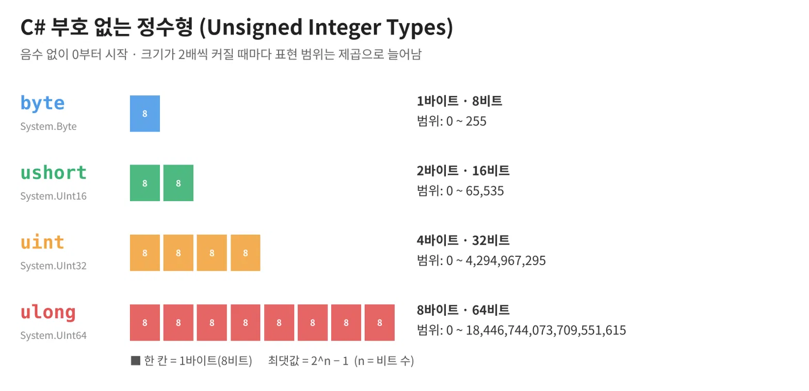

# [byte, ushort, uint, ulong](../KeywordsList.md)

</img>

| 타입 | .NET 타입 | 크기 | 범위 | 리터럴 | 대응 signed 타입 | 주 용도 |
| --- | --- | --- | --- | --- | --- | --- |
| `byte` | System.Byte | 1B / 8bit | 0 ~ 255 | (없음) | `sbyte` | 바이너리 데이터, 색상 채널 |
| `ushort` | System.UInt16 | 2B / 16bit | 0 ~ 65,535 | (없음) | `short` | 포트 번호, 인덱스 버퍼 |
| `uint` | System.UInt32 | 4B / 32bit | 0 ~ 4,294,967,295 | `10u` | `int` | ID, 해시, 비트 플래그 |
| `ulong` | System.UInt64 | 8B / 64bit | 0 ~ 18,446,744,073,709,551,615 | `10UL` | `long` | 큰 카운터, 64비트 마스크 |

## 개념

- 부호 없는(unsigned) 정수형
- byte
    - 크기는 1바이트(8비트), 범위는 0 ~ 255.
    - C#에서 부호 없는 타입 가운데 이름에 `u`가 붙지 않는 유일한 타입. 부호 있는 1바이트 타입은 반대로 `sbyte`라는 이름을 씀.
    - 파일·네트워크 데이터를 다룰 때 `byte[]` 형태로 많이 쓰임. 이미지 픽셀 값에도 자주 쓰이며, Unity의 `Color32`는 R, G, B, A 각 채널을 byte로 저장.
- ushort
    - 크기는 2바이트(16비트), 범위는 0 ~ 65,535.
    - 쓰이는 곳은 비교적 한정적. 대표적으로 포트 번호, 일부 파일 포맷의 헤더 값, 메모리를 아껴야 하는 대량 데이터(예: 메시 인덱스 버퍼)에 사용.
- uint
    - 크기는 4바이트(32비트), 범위는 0 ~ 약 42억.
    - 리터럴 값 뒤에 `u`를 붙여 표기. 예: `uint a = 10u;`
    - ID, 해시값, 비트 플래그, 색상값을 0xRRGGBBAA 형식으로 저장할 때 쓰임.
- ulong
    - 크기는 8바이트(64비트), 범위는 0 ~ 약 1,844경.
    - 리터럴 값 뒤에 `ul` 또는 `UL`을 붙여 표기. 예: `ulong big = 10UL;`
    - 아주 큰 카운터, 64비트 해시, 고유 ID, 64개 상태를 한 번에 담는 비트마스크에 쓰임.

## 특징

- 오버플로/언더플로가 발생. `byte b = 255; b++;`를 실행하면 b는 0이 됨. 마찬가지로 `uint u = 0; u--;`를 실행하면 u는 4,294,967,295가 됨. 이런 상황을 예외로 잡아내고 싶다면 `checked { }` 블록을 사용해야 함.
- 연산 결과는 int로 바뀜. byte와 ushort끼리 산술 연산을 하면 결과가 int로 승격됨. 그래서 `byte c = a + b;`는 컴파일 에러가 남. `(byte)(a + b)`처럼 결과를 직접 형변환해야 함.
- 일반적인 수치에는 int가 기본. .NET API와 Unity API 대부분이 int를 사용. 그래서 "음수가 안 나오는 값"이라는 이유만으로 uint를 쓰면 형변환할 일이 오히려 늘어남. unsigned 타입은 메모리 절약, 비트 연산, 외부 포맷과의 호환이 필요할 때 쓰는 것이 좋음.
- CLS 비호환 문제가 있음. ushort, uint, ulong은 CLS(공용 언어 사양)를 준수하지 않음. 따라서 다른 .NET 언어에서 쓸 공개 라이브러리 API에는 노출하지 않는 것이 관례. byte는 CLS를 준수함.