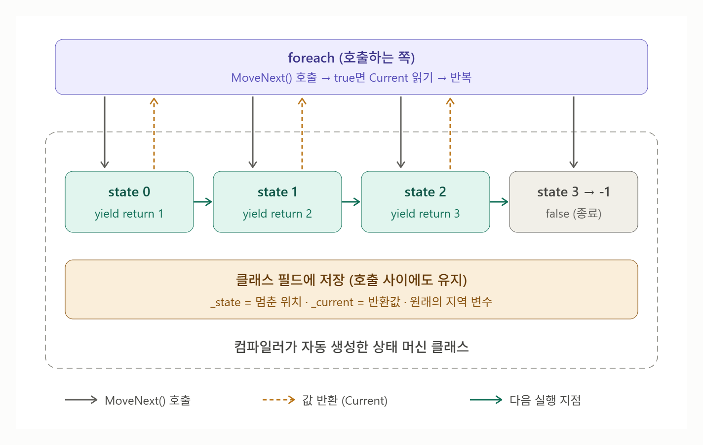

# [yield return 원리](../KeywordsList.md)

</img>

| **구분** | **내용** |
| --- | --- |
| **정체** | 컴파일러가 코드를 변환해 주는 문법 설탕 |
| **변환 결과** | `IEnumerator<T>`를 구현한 숨겨진 상태 머신 클래스 |
| **`_state` 필드** | 몇 번째 yield return까지 실행했는지 기억 (멈춘 위치) |
| **`_current` 필드** | 마지막으로 반환한 값, `Current`로 노출 |
| **지역 변수** | 호출 사이에 값이 유지되도록 클래스 필드로 이동 |
| **`MoveNext()`** | 다음 yield return까지 실행 → 값 저장 → true, 끝나면 false |
| **실행 시점** | 지연 실행: 첫 MoveNext() 호출 때부터 본문 실행 |
| **`yield break`** | 즉시 종료 상태로 전환, MoveNext()가 false 반환 |
| **`finally`** | 중간에 break해도 Dispose()를 통해 실행 보장 |
| **유니티 코루틴** | 엔진이 매 프레임 MoveNext()를 호출하고 Current(대기 조건)로 스케줄링 |

## `yield return`

- iterator를 쉽게 만들기 위한 문법
- 메서드가 값을 한번에 반환하지 않고, 값을 하나 넘겨준 뒤 실행을 그 자리에서 멈췄다가 다음 요청이 오면 멈춘 지점부터 이어서 실행

```csharp
IEnumerable<int> GetNumbers()
{
    Console.WriteLine("시작");
    yield return 1;
    Console.WriteLine("1 다음");
    yield return 2;
    Console.WriteLine("2 다음");
    yield return 3;
    Console.WriteLine("끝");
}

foreach (var n in GetNumbers())
    Console.WriteLine($"받음: {n}");
```

```csharp
시작
받음: 1
1 다음
받음: 2
2 다음
받음: 3
끝
```

## 원리

- `yield`는 런타임 기능이 아니라 컴파일러가 코드를 변환해 줌.
- `yield return`이 들어간 메서드를 컴파일 하면, 컴파일러는 메서드 본문을 숨겨진 클래스로 바꿈

```csharp
class GetNumbers_Iterator : IEnumerable<int>, IEnumerator<int>
{
    private int _state = 0;   // 현재 어디까지 실행했는지
    private int _current;     // 마지막으로 yield한 값

    public int Current => _current;

    public bool MoveNext()
    {
        switch (_state)
        {
            case 0:
                Console.WriteLine("시작");
                _current = 1;
                _state = 1;      // 다음엔 여기서부터
                return true;     // "값 있음"

            case 1:
                Console.WriteLine("1 다음");
                _current = 2;
                _state = 2;
                return true;

            case 2:
                Console.WriteLine("2 다음");
                _current = 3;
                _state = 3;
                return true;

            case 3:
                Console.WriteLine("끝");
                _state = -1;     // 종료 상태
                return false;    // "더 이상 값 없음"
        }
        return false;
    }

    public IEnumerator<int> GetEnumerator() => this;
    // Reset, Dispose 등 생략
}
```

- `_state` 필드 : 몇 번째 `yield return`까지 실행했는지 기억함.
- `MoveNext()` : 호출될 때마다 다음 `yield return`까지 코드를 실행하고, 값을 `Current`에 넣은 뒤 `true`를 반환. 메서드 끝에 도달하면 `false`를 반환
- 지역 변수의 필드화 : 원래 메서드의 지역 변수는 MoveNext()가 끝나면 사라지면 안되므로 컴파일러가 이를 클래스의 필드로 옮김. → 그래서 다음 호출에서도 값이 유지됨

## `foreach`

- `foreach`도 결국 아래 코드로 바뀜

```csharp
var e = GetNumbers().GetEnumerator();
try
{
    while (e.MoveNext())
    {
        var n = e.Current;
        Console.WriteLine($"받음: {n}");
    }
}
finally
{
    e.Dispose();
}
```

- 즉 `MoveNext()` 호출 한 번 = 다음 `yield return`까지 실행 한 번

## 중요한 특징

- **지연 실행(Lazy Evaluation) :** `GetNumbers()`를 호출하는 순간에는 본문이 한 줄도 실행되지 않음. 상태 머신 객체만 만들어지고, 첫 `MoveNext()`가 호출될 때 비로소 실행이 시작됨. 그래서 무한 시퀀스도 만들 수 있음.

```csharp
IEnumerator Blink()
{
    sprite.enabled = false;
    yield return new WaitForSeconds(0.5f);
    sprite.enabled = true;
}
```

- **`yield break` :** 이터레이션을 즉시 끝냄. 상태 머신에서는 상태를 종료로 바꾸고 `MoveNext()`가 `false`를 반환하는 것과 같음.
- **`finally`와 `Dispose` :** `try/finally` 안에서 `yield return`을 쓰면, `foreach`를 중간에 `break`로 빠져나와도 `Dispose()`가 호출되면서 `finally` 블록이 실행됨. 리소스 정리가 보장되는 이유.
- **제약 사항 :** `yield`는 `IEnumerable`, `IEnumerable<T>`, `IEnumerator`, `IEnumerator<T>`(그리고 `IAsyncEnumerable<T>`)를 반환하는 메서드에서만 쓸 수 있고, `ref`/`out` 매개변수를 가질 수 없으며, `catch` 블록 안에서는 `yield return`을 쓸 수 없음.

## 유니티 코루틴과의 관계

```csharp
IEnumerator Blink()
{
    sprite.enabled = false;
    yield return new WaitForSeconds(0.5f);
    sprite.enabled = true;
}
```

- `StartCoroutine`은 이 `IEnumerator`를 받아 보관해 두고, 유니티 엔진이 매 프레임 `MoveNext()`를 호출함.
- 이때 `Current` 값(`WaitForSeconds`, `null` 등)을 보고 “0.5초 뒤에 다시 `MoveNext()` 호출”, "다음 프레임에 호출" 같은 식으로 스케줄링함.
- 즉 코루틴은 멀티스레드가 아니라, 메인 스레드에서 상태 머신을 조금씩 진행시키는 방식