# [U02_Running](../UnityStudy_List.md)

2D Infinite Running 게임

### [CONSOLE]

- Collapse : 같은 종류의 메세지는 묶어서 보여줌
- c#꿀팁 : 영역 선택 후 컨트롤+h : 찾아 바꾸기 가능.

### [Sprite Renderer]

- sprite renderer : 게임 오브젝트의 이미지를 나타내는 컴포넌트
    - Sprite를 렌더링하고 스프라이트가 씬에 시각적으로 표시되는 방식을 제어
    - order in layer : 크기가 클수록 앞으로 나옴

### [물리엔진]

- Box2D : 기본 2D 물리 시스템(Rigidbody 2D, BoxCollider2D 등).
- 충돌 감지, 중력, 힘 적용 등 기본적인 2D 상호작용은 모두 이 엔진을 기반으로 작동

### [애니메이터]

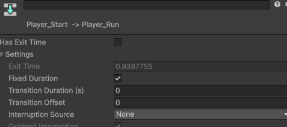</img>

- 하늘에서 떨어지고 나서 점프 모션이 끝나면 뛰는게 아니고 땅에 닿자마자 뛰는 거니까 has exit time은 해제
- 전환하는데 지연시간이 있으면 안되니까 transition duration은 0

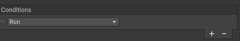</img>

- 전이 조건 : Run이 호출되면 애니메이션 전환

```csharp
private void OnCollisionEnter2D(Collision2D collision)//플레이어가 땅에 닿는 순간 호출(충돌)
{//함수호출 : 플레이어 | 파라미터 : 블록

//게임 시작 상태가 아닐때만 게임을 시작하고 점프 동작을 달리는 동작으로 바꿔줌
    if(game.GameStart == false)
    {
        game.StartGame();//

        animator.SetTrigger("Run");//애니메이터의 트리거를 Run으로 설정
    }
}//그러면 땅에 닿자 마자 Run 애니메이션으로 달림
```

game.StartGame() 왜하는 건지 질문 그냥 땅에 닿으면 애니메이션만 바꾸면 되는거 아닌가? 왜 스타트게임을 따로 또 하는거지? 애니메이터에 스타트 상태라서 그런건가?

⇒배경 이미지 움직임이라든지 블록 움직이라든지 게임과 관련된 사항을 bool bGameStart변수로 여기저기 가져와서 관리를 하기 위함

### [점프 기능 추가]

```csharp
[Player]
private new Rigidbody2D rigidbody2D;
//부모클래스에 rigidbody2D가 이미 있어서 숨김처리됨. 
//new키워드를 사용해서 부모 클래스의 변수명은 무시하고 그냥 이걸로 쓸거라고 선언.

private void Awake()//앱이 시작할 때 호출(Start보다 먼저 실행)
{
    rigidbody2D = GetComponent<Rigidbody2D>(); //Player의 Rigidbody2D를 가져옴
}

private void Update()
{
    if (Input.GetKeyDown(KeyCode.Space)) //스페이스바가 입력되면
    {
        rigidbody2D.linearVelocityY = 10.0f; //y축 이동속도 10.0f로 설정
    }
}
```

- 스페이스바를 누르면 Player가 y방향으로 10.0f속도로 위로 올라갔다 내려옴
- Rigidbody2D.linearVelocityY : 2D 강체의 Y축(수직) 이동 속도를 읽거나 설정할 때 사용하는 속성

⇒대신 누를 때마다 계속 쩜푸함… 바닥에 닿았을 때만 점프하도록 수정 필요

- 땅에 닿았을 때를 저장하는 변수 : `private bool bLanded;`

```csharp
private void Update()
{
    if (Input.GetKeyDown(KeyCode.Space) == false)
        return;

    if (bLanded == false)
        return;
    //여기까지 return이 안되면 스페이스바도 눌리고 땅에도 닿아있는 상태
    bLanded = false; //점프하니까 false로 바꿔주고
    
    animator.SetBool("Jump", true);//동작도 점프 동작으로 바꿔줌

    rigidbody2D.linearVelocityY = 10.0f; //Jump
}

private void OnCollisionEnter2D(Collision2D collision)//플레이어가 땅에 닿으면 호출(충돌)
{//함수호출 : 플레이어 | 파라미터 : 블록
    
    if(game.GameStart == false)//게임 시작 상태가 아닐때만 게임을 시작하고 점프 동작을 달리는 동작으로 바꿔줌
    {
        game.StartGame();

        animator.SetTrigger("Run");
    }

    bLanded = true;
    animator.SetBool("Jump", false);//땅에 닿아있는 상태니까 애니메이터의 jump는 false

    
}
```

⇒ 이렇게 되면 플레이어는 무조건 땅에 닿았을 때 한번 점프 가능!

⇒근데 나는 2번 점프 하고 싶어

- 2단점프 기능 jumpCount변수를 생성해서 조건문 걸어줌 : `private int jumpCount;`

```csharp
private void Update()
{
    if (Input.GetKeyDown(KeyCode.Space) == false)
        return;

    if (bLanded || jumpCount < 2)//땅을 밟고 있거나 점프를 2번 미만으로 뛴 경우
    {
        bLanded = false; //점프했으니까 false로 바꿔주고
        jumpCount++;//점프 횟수 증가
        animator.SetBool("Jump", true);//동작도 점프 동작으로 바꿔줌

        rigidbody2D.linearVelocityY = 10.0f; //Jump
    }
}

private void OnCollisionEnter2D(Collision2D collision)
{
		```
    bLanded = true;
    jumpCount = 0;//땅에 닿는 순간은 무조건 카운트가 0이됨
    animator.SetBool("Jump", false);
		```
}
```

⇒ 이렇게 하면 2단 점프 가능!

⇒ 근데 나는 최대 점프 횟수를 에디터에서 좀 조절하고 싶어

```csharp
[SerializeField, Range(1,4)]
private int maxJumpCount = 2; //기본값은 2로 설정하고 에디터에서 1~4까지 설정할수 있게 SerializeField로 지정
 
private void Update()
{
    if (Input.GetKeyDown(KeyCode.Space) == false)
        return;

    if (bLanded || jumpCount < maxJumpCount)//땅을 밟거나 점프 횟수가 최대 점프 횟수보다 작을 경우
    {
        bLanded = false; 
        jumpCount++;
        animator.SetBool("Jump", true);

        rigidbody2D.linearVelocityY = 10.0f; //Jump
    }
}
```

⇒이렇게 하면 기본은 2단 점프지만 에디터에서 설정한 대로 1~ 4단점프까지 가능!

## [Collider]

- Collision > 때리면 충돌하는 거
- Collider > 칼로 갈겼을 때 관통되는 거 = Is Trigger 체크
- 충돌이 일어날 때는 부딪히는 둘중 하나는 물리엔진을 가지고 있어야 함 : rigidbody

```csharp
[unit test - Collider / Collision]
using UnityEngine;

public class UnitTest_Collider : MonoBehaviour
{
    private void OnCollisionEnter2D(Collision2D collision)//딱 부딪힌 순간
    {
        print($"Collision Enter : {collision.gameObject.name}");
    }

    private void OnCollisionStay2D(Collision2D collision)//부딪혀서 붙어있을 때
    {
        print($"Collision Stay : {collision.gameObject.name}");
    }
    private void OnCollisionExit2D(Collision2D collision)//떨어졌을 때
    {
        print($"Collision Exit : {collision.gameObject.name}");
    }

    private void OnTriggerEnter2D(Collider2D collision)//딱 부딪힌 순간
    {
        print($"Trigger Enter : {collision.gameObject.name}");
    }

    private void OnTriggerStay2D(Collider2D collision)//부딪혀서 붙어있을 때
    {
        print($"Trigger Stay : {collision.gameObject.name}");
    }
    private void OnTriggerExit2D(Collider2D collision)//떨어졌을 때
    {
        print($"Trigger Exit : {collision.gameObject.name}");
    }
}

```

### <Destroyer>

- 땅이 화면을 완전히 벗어나서 안보이면(destroyer를 빠져 나가면) 블록 삭제

```csharp
using UnityEngine;

public class Destroyer : MonoBehaviour
{
    private void OnTriggerExit2D(Collider2D collision)
    {
        //Destroy(collision); 
        //collision은 충돌체이기 때문에 이대로 하면 box collider 컴포넌트만 사라짐
        Destroy(collision.gameObject);//이 collision을 가진 게임 오브젝트를 삭제
    }
}
```

### <Creator>

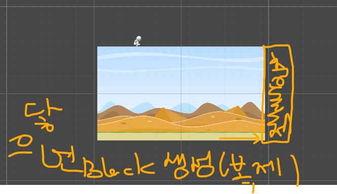</img>

- spriteRenderer를 꺼서 하얀 상자가 안보이게 만들어줌
- 오른쪽에 충돌체를 만들어서 블록이 닿으면 복제해서 땅을 생성해줌
    
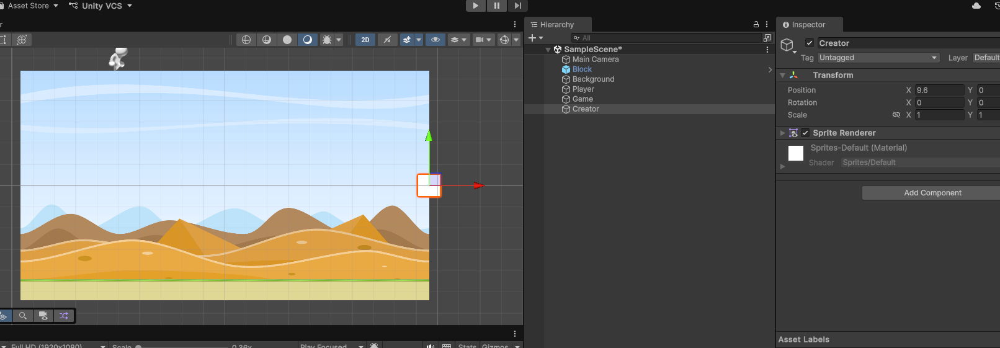</img>
    
- 위치 :
    - 화면 가로 크기 :  1920 / pixes per unit 100 = 19.2 / 2이 화면의 반의 끝 = 9.6 - 0.5 = 9.1
        - 100픽셀*100픽셀은 유니티에서의 1*1
    
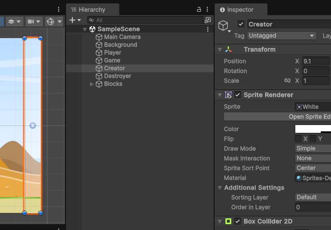</img>
    

```csharp
[SerializeField]//private 변수를 에디터에 노출 시켜줌
private GameObject blockPrefab;//파일에서 불러온 원본 프리팹

private GameObject blocks; //복제된 블록들을 담아둘 폴더 같은 거
```

- prefab : 게임 오브젝트를 미리 만들어서 파일로 저장해둔 것

```csharp
private void OnTriggerEnter2D(Collider2D collision)
{
    //print($"Trigger Enter : {collision.gameObject.name}");

    GameObject obj = Instantiate<GameObject>(blockPrefab, blocks.transform);
    obj.name = $"Block_{blocks.transform.childCount}"; //childCount : blocks의 자식의 개수 근데 이렇게 하면 나중에 똑같은 이름으로 된 애들이 계속 나옴

    float x = transform.position.x; //transform 컴포넌트만 미리 선언을 안해도 내부적으로 getComponent된 변수가 있음 //creator 위치

    x += 5.0f;//블록 간 간격

    if(collision.gameObject.name != "Block_Start")//부딪힌 블록이 Block Start가 아닐때만
        x += collision.transform.localScale.x; //이전에 충돌한 블록의 x 크기만큼 x좌표에 더해서 x좌표를 한칸 더 뒤로 미룸

		//게임 오브젝트의 로컬 x 좌표값만 변경
    Vector2 position = obj.transform.localPosition; //복제된 블록의 부모 기준 위치를 position에 저장
    position.x = x;//position의 x좌표만 새로 설정한 x값으로 저장
    obj.transform.localPosition = position;//수정된 position값을 복사된 블록의 로컬 위치에 할당하여 실제로 위치 변경
}
```

- 블록이 Creator를 관통해야 하기 때문에 IsTrigger 체크 : OnTriggerEnter2D / Collider2D 사용
- Instantiate<GameObject> : 프리팹이나 게임 오브젝트를 복사해 새로운 오브젝트를 화면에 만드는 기능
- 복사한 블록은 blocks의 child가 될거고 이름은 childCount를 써서 구분해줌
    - 이렇게 하면 블록이 사라지면서 child갯수가 일정해져서 계속 block6만 생김…
    - 블록의 개수를 count하는 int형 변수 선언 후 Creator에 블록이 부딪힐 때마다 카운
    
    ```csharp
    private int blockCount = 0;
    
    private void OnTriggerEnter2D(Collider2D collision)
    {
    		obj.name = $"Block_{++blockCount}";
    }
    ```
    

#### **[블록 간격]**

- 복사한 블록이 크리에이터와 맞닿아 있으면 무한 복사가 되기 때문에 간격을 설정함
    - transform 컴포넌트만 getComponent로 가져오지 않아도 내부적으로 getComponent된 변수가 있음 > Creator의 x좌표를 가져와서 x에 저장
    - creator 위치에서 5.0f만큼 간격을 줌
    - 부딪힌 블록이 Block Start가 아닐때만 충돌한 블록의 x 크기 만큼 x좌표에 더해줘서 뒤로 미룸.
    - 복사한 블록의 로컬 x 좌표값만 새로 설정한 float x의 x 값으로 변경
    
    ⇒ 근데 간격이 일정하면 노잼 → 블록 간의 간격을 랜덤하게 변경
    

```csharp
[SerializeField]
private Vector2 distance = new Vector2(4, 8);

private void OnTriggerEnter2D(Collider2D collision)
{
		```
		x += Random.Range(distance.x, distance.y);
		```
}
```

- Vector2 : x, y 좌표를 가진 자료형이지만 최소, 최댓값을 넣어 저장하는 방법으로도 많이 사용함.
- Random.Range(min, max) : min~max의 범위에서 난수 발생.
    - c#에서는 랜덤 객체를 new로 생성해서 사용했지만 유니티는 스태틱 함수로 사용 가능

#### [블록 크기]

블록의 크기도 랜덤한 크기로 바꿔줌

```csharp
[SerializeField]
private Vector2 size = new Vector2(10, 16);

private void OnTriggerEnter2D(Collider2D collision)
{
    //x += 6.0f(블록크기) * 0.5f;//블록 x 크기의 반만큼 위치를 조정 (블록의 간격을 보장하기 위함)
    float scaleX = Random.Range(size.x, size.y);
    x += scaleX * 0.5f;

    Vector2 scale = Vector2.one;//(1,1) 이제 이 스케일은 안씀. 스프라이트 렌더러랑 박스콜라이더 사이즈를 바꿔줄거임>이미지 늘어난거 없어지게 하려고
		scale.x = scaleX;
		obj.transform.localScale = scale;

}
```

- 블록 간격과 동일하게 랜덤 범위를 Vector2로 지정하고 Random.Range로 scaleX에 저장해주고 복제된 obj의 scale에 넣어주면 됨.
- 대신 이렇게 하면 일정해야하는 블록의 간격이 블록의 크기 때문에 줄어들거나 늘어나는 일이 발생하게 됨 ⇒ 블록의 크기와 관계없이 간격은 늘 일정해야함!
- 블록의 x좌표를 블록 크기의 반만큼 뒤로 이동시켜주면 블록의 끝에서 시작지점까지의 간격이 지정해준 블록의 간격만큼 유지가 됨

## [블록의 스피드]

```csharp
/*Game Script*/
[SerializeField, Range(5, 30)]
private float blockSpeed = 15.0f;
public float BlockSpeed => blockSpeed; //외부에서 사용 가능하도록 프로퍼티 생성
```

게임을 관리하는 게임 스크립트에 블록스피드를 선언하고 외부에서 사용 가능하게 프로퍼티 생성

```csharp
/*Block Script*/

transform.Translate(-game.BlockSpeed * Time.deltaTime, 0.0f, 0.0f);

```

## 캐릭터 회전 잠금

- 캐릭터가 자꾸 앞으로 굴러가는 거 막아줘야 함.

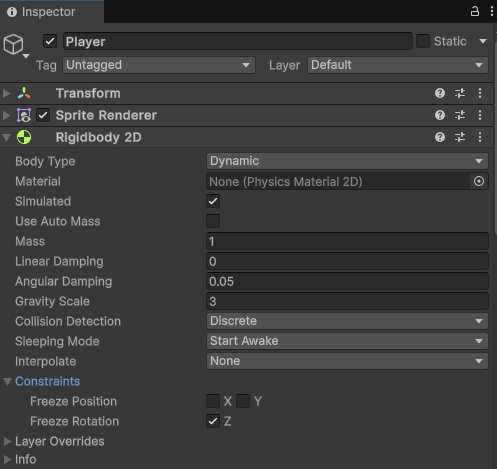</img>

- Player의 Rigidbody 2D의 Constraints에서 Freeze를 선택해줌.
- 플레이어는 지금 z축을 기준으로 자꾸 돌아가니까 z축을 잠궈준다.

## [블록의 이미지 늘어남]

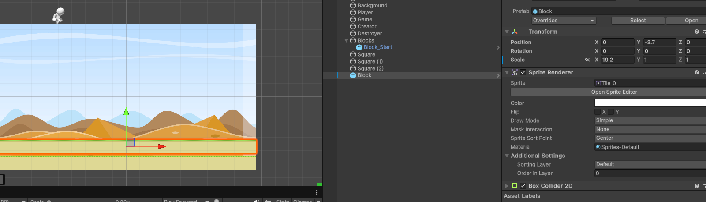</img>

- 블록의 sprite가 늘린 이미지처럼 되어있는 걸 수정해야 함.
    - SPRITE EDITOR - 파란선
        - SPRITE MODE - SINGE : 사진 한장만 사용(배경같은 단일 이미지는 싱글 사용)
        - MULTIPLE : 여러장 사용(하나의 이미지에서 여러개의 sprite를 만들수 있음)
    - SPRITE EDITOR - 초록선
        - 으로 둘러쌓여 있으면 크기가 가변
        - 이외의 구역은 고정

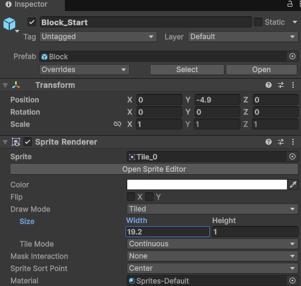</img>

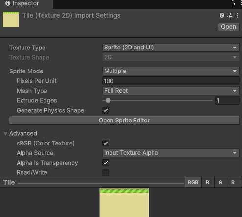</img>

- Block.SpriteRenderer - Draw Mode : Tiled
    - 스프라이트 모드 - 멀티플
    - 메쉬 타입 - 풀렉트
- 이렇게 해주면 타일 스프라이트를 타일처럼 다다다닥 박아서 블록의 윗부분이 정상적으로 나옴

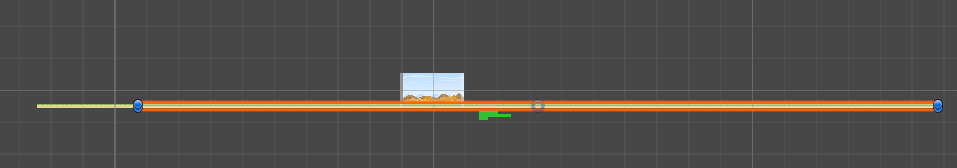</img>

- 블록의 이미지는 정상적으로 나오는데 게임 플레이 후 블록의 상태가….
    
    →블록 프리팹(원본)은 사이즈를 1,1로 하고 블록 스타트는 sprite renderer 사이즈를 19.2로 조정. 이후에 들어오는 블록들도 이미지 늘어남 방지를 위해 sprite renderer 랑 box collider 2D의 사이즈를 변경하는 것으로 수정
    

```csharp
//Vector2 scale = Vector2.one;//(1,1) 
//이제 이 스케일은 안씀. 스프라이트 렌더러랑 박스콜라이더 사이즈를 바꿔줄거임
//=>이미지 늘어난거 없어지게 하려고
//scale.x = scaleX;
//obj.transform.localScale = scale;

SpriteRenderer spriteRenderer = obj.GetComponent<SpriteRenderer>();//복제한 블록의 스프라이트 렌더러를 가져옴
spriteRenderer.size = new Vector2(scaleX, 1.0f);

BoxCollider2D boxCollider2D = obj.GetComponent<BoxCollider2D>();//박스 콜라이더도 크기에 맞춰서 바꿔줌
boxCollider2D.size = new Vector2(scaleX, 1.0f);
```

- 수정 후 : 간격 어디갔냐

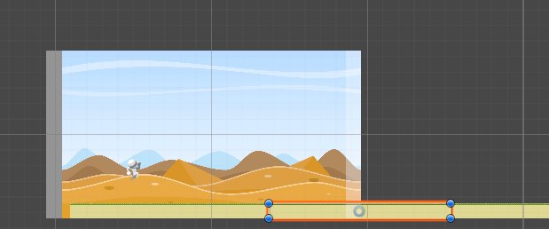</img>

- 로컬 스케일을 사용해서 간격을 조절했는데 로컬 스케일이 없어져서 간격이 없어진거임.
    
    →Sprite Renderer로 간격 조절 필요
    
    ```csharp
    if(collision.gameObject.name != "Block_Start")//최초 블록이 아니라면
    {
        //x += collision.transform.localScale.x; //이전에 충돌한 블록의 크기만큼 x 크기에 더함
    
        x += collision.GetComponent<SpriteRenderer>().size.x;//충돌체의 SpriteRenderer의 크기의 x값만큼
    
    }
    ```
    

## [블록의 높이]

- 블록의 높이도 랜덤하게 바뀌도록 만들어 보자

```csharp
[SerializeField]
private Vector2 height = new Vector2(1, 5);
```

- 우선 높이가 될 height 변수를 선언 후 1, 5의 최소, 최대값을 설정함(에디터에서 변경 가능)

```csharp
int scaleY = Random.Range((int)height.x, (int)height.y + 1);
//높이는 float형 말고 1, 2, 3 이런식으로 딱 배수로만 될수 있게 int형으로 Casting
//대신 int형으로 casting할 경우 범위가 최소~최대-1이 됨. +1해줘야 설정한 최대값까지 나옴

SpriteRenderer spriteRenderer = obj.GetComponent<SpriteRenderer>();//복제한 블록의 스프라이트 렌더러를 가져옴
spriteRenderer.size = new Vector2(scaleX, scaleY);

BoxCollider2D boxCollider2D = obj.GetComponent<BoxCollider2D>();
boxCollider2D.size = new Vector2(scaleX, scaleY);
```

- scaleY에 랜덤으로 생성한 값을 대입하고 spriteRenderer의 size와 boxCollider2D의 size에 대입해줌.
- 그렇게 되면 사이즈는 커지지만 블록의 중심을 기준으로 사이즈가 커지고 블록이 여러겹으로 쌓인 것처럼 나옴.

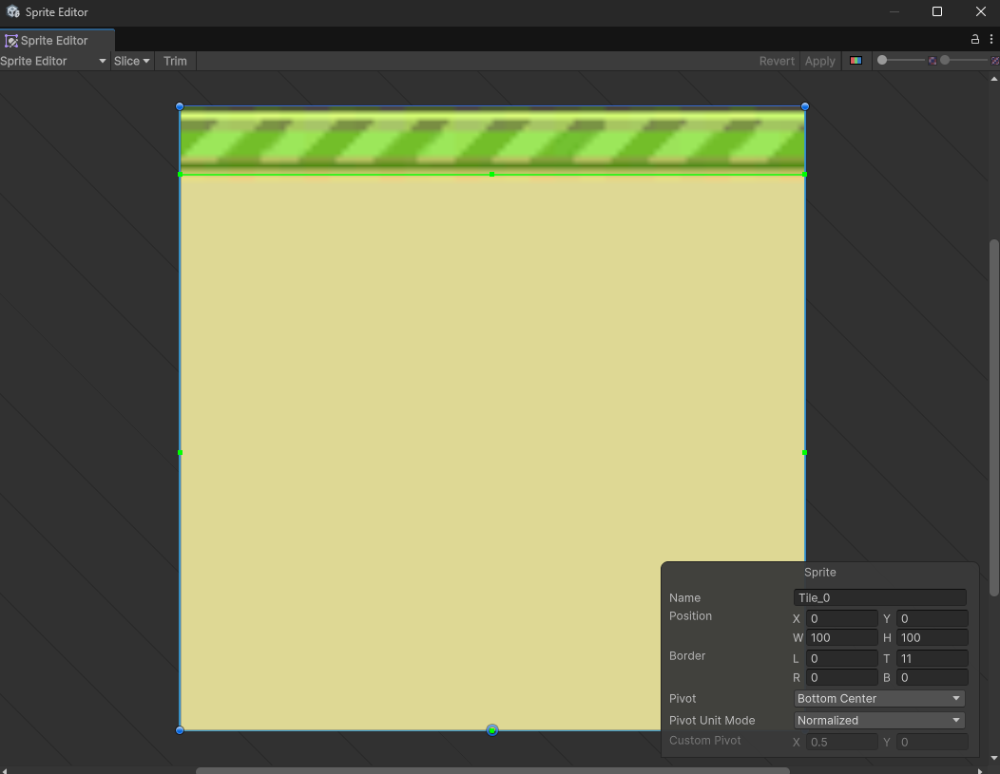</img>

- Tile의 Sprite Editor에서 늘어나도 되는 노란 부분은 초록색 선으로 감싸줌
- pivot을 Center→Bottom Center로 변경
- 블록의 높이를 0.5만큼 내려줌

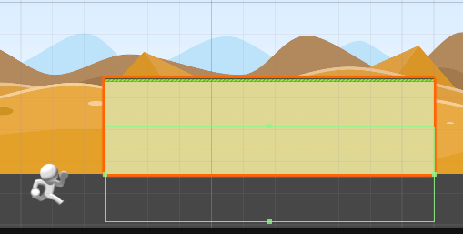</img>

- Sprite는 정상적으로 나오지만 boxCollider는 여전히 아래로 내려가 있음 → box Collider는 pivot에 영향을 받지 않기 때문
    - offset : 충돌 영역(초록색 박스)의 중심 위치를 게임 오브젝트의 피벗(Pivot, 중심점) 기준으로 이동시키는 기능
    - Block Start는 임의로 offset을 0.5만큼 올려주고 복제되는 블록들은 블록 높이의 반만큼 offset을 설정해줌.

```csharp
boxCollider2D.offset = new Vector2(0.0f, scaleY * 0.5f);
```

[유니티]
preference → 에디터 전체에 대한 설정
project setting → 이 프로젝트에 대한 설정

## [배경 움직이기]

- 횡스크롤 게임에서는 블록의 속도보다 뒤 이미지의 속도가 느리게 흘러가게 함 → 자연스러움
- 배경을 하나 복제해서 두개의 배경을 나란히 두고 천천히 움직이다 처음 배경이 화면을 완전히 벗어나면 다시 원위치를 시켜줌.
- Mathf.Repeat(float a, float b) : a가 0~b사이를 계속 반복하도록 만들어주는 함수(%연산)
    - %연산자로 나머지를 반환하는 것과 비슷하지만 Mathf.Repeat은 음수 처리 가능

```csharp
private SpriteRenderer spriteRenderer;
private float spriteSize;

private Vector3 start;
private void Awake()
{
    spriteRenderer = GetComponent<SpriteRenderer>();//배경의 SpriteRenderer를 가져옴
    spriteSize = spriteRenderer.localBounds.size.x;//spriteSize에 원본 이미지 가로 길이를 입력
    start = transform.position; //처음 시작 위치를 start에 저장
}

private void Update()
{
    float x = Mathf.Repeat(Time.time * 3.0f, spriteSize);//게임 실행 후 경과된 시간*3배(이동속도) 가 spriteSize에 도달하면 초기화
    transform.position = start + Vector3.left * x;//이미지의 처음 위치에서 왼쪽으로 x만큼 이동
}
```

- localBounds : 스케일(Transform Scale)이나 회전, 월드 위치의 영향을 받지 않은 스프라이트 에셋 순수의 영역 정보

## [게임오버]

### 블록 옆에 닿은 경우

- 플레이어가 Block에 충돌한 방향을 가지고 판단해서 블록 위가 아닌 옆에 닿았을 때는 게임오버, 점프 초기화가 되지 않게 처리

```csharp
[Game]
private bool bGameOver;
public  bool IsGameOver => bGameOver;

public void GameOver()
{
    bGameOver = true;
}
```

```csharp
[Block]
private void Update()
{
    if (game.GameStart == false)
        return;

    if (game.IsGameOver) //추가
        return;

    transform.Translate(-game.BlockSpeed * Time.deltaTime, 0.0f, 0.0f);
}

private void OnCollisionEnter2D(Collision2D collision)
{
    //print(collision.gameObject.name);

    ContactPoint2D contact = collision.GetContact(0);
    if(Mathf.Abs(contact.normal.x)>=0.9f)//양옆 어디에서 부딪히든지 방향과는 상관없이 옆에서 부딪히면 무조건 게임오버임 > 절대값 처리를 해서 값이 1보다 크면 게임오버
    {
        game.GameOver();
    }
}
```

- 플레이어의 게임 오버는 언제든 발생할 수 있음: 점프할 때, 달릴 때 등등…
- 매번 각 상태에서 트랜지션 발생해서 애니메이션을 바꾸는 건 너무 비효율적임

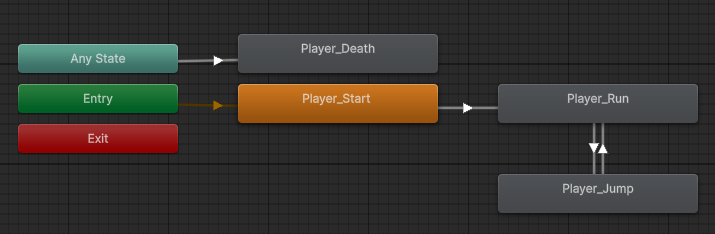</img>

- ⇒그럴땐 바로 애니 스테이트 → 플레이어 데스를 해주면 됨!
    - 애니 스테이트는 앞선 행동이 없기 때문에 기본 세팅이 has  exit time 이 해제 되어 있음.
    - Trigger 조건으로 트랜지션
- 게임 오버되면 블록 멈추고 플레이어가 살짝 튀어 올랐다가 아래로 떨어짐
- box collider 2D 꺼주기, 애니메이션 데스로 변경해주기

```csharp
[Game]

private bool bGameOver;
public  bool IsGameOver => bGameOver;//IsGameOver로 bGamoOver 값을 가져옴

public void GameOver()
{
    bGameOver = true; //bGameOver를 true로 변경

    GameObject player = GameObject.Find("Player");//Player 객체를 찾아서
    Rigidbody2D rigid = player.GetComponent<Rigidbody2D>();//Player의 Rigidbody2D 가져옴
    rigid.AddForce(Vector2.up * 20.0f, ForceMode2D.Impulse);//player를 위쪽으로 순간적으로 올림
    //velocity: 일정하게 유지되는 힘, Addforce : 한번에 주는 힘

    BoxCollider2D collider = player.GetComponent<BoxCollider2D>();//Player의 BoxCollider2D도 가져옴
    collider.enabled = false;//게임오버 되면 꺼줌

    Animator animator = player.GetComponent<Animator>();//플레이어의 애니메이터도 가져옴
    animator.SetTrigger("Death");//애니메이션 Death 트리거도 켜줌

    panel_GameOver.SetActive(true); //게임오버 패널도 활성화
}
```

#### Rigidbody에 물리적인 힘이나 변화를 주는 방법

- LinearVelocity/angularVelocity : 속도 직접 수정
    - 개념 : 현재 물체의 속도를 강제로 특정 값으로 덮어 씌우거나 고침
    - 특징 : 질량(`Mass`)이나 기존 이동 속도를 완전히 무시하고 즉각적인 속도를 부여함
    - 추천 사용처 **:**
        - 플랫포머 게임의 즉각적인 캐릭터 이동 및 정지
        - 똑같은 속도로 발사되는 총알
- AddForce : 힘 가하기
    - 개념 : 현실 세계처럼 방향과 힘을 지속적이거나 순간적으로 전달
    - 특징 : 2번째 매개변수인 `ForceMode`에 따라 적용되는 방식이 달라짐.

| **ForceMode** | **설명** | **적용 예시** |
| --- | --- | --- |
| **`Force`** (기본값) | 질량을 고려하여 지속적인 힘을 줌 | 자동차 가속, 바람, 로켓 추진 |
| **`Impulse`** | 질량을 고려하여 순간적인 충격을 줌 | 점프, 폭발 반동, 총알 피격 |
| **`Acceleration`** | 질량을 무시하고 지속적 가속을 줌 | 중력 제어, 일정한 가속 장치 |
| **`VelocityChange`** | 질량을 무시하고 순간적 속도 변화를 줌 | 즉각적인 순간 이동형 대시, 반응 빠른 점프 |
- AddTorque : 회전력 가하기
    - 개념: 물체를 회전시키는 물리적 비틀림 힘(항렬)을 줌.
    - 특징: `AddForce`처럼 `ForceMode`를 지원하며, 회전 속도를 빠르게 만들거나 팽이처럼 계속 돌게 만듦.
    - 추천 사용처: 팽이 회전, 공의 스핀, 구르는 바퀴
- AddForceAtPosition : 특정 지점에 힘 가하기
    - 개념 : 물체 중심이 아닌 특정 좌표에 힘을 가함
    - 특징 : 힘이 중심을 비켜나가면 직선 이동과 함께 자연스러운 회전력이 동시 발생
    - 추천 사용처 : 자동차 타이어 마찰력, 총알에 맞았을 때 피격 부위가 뒤로 젖혀지는 연출
- AddExplosionForce : 폭발력 가하기
    - 개념 : 특정 위치를 기준으로 방사형 폭발 힘을 가함
    - 특징 : 폭발 중심과의 거리, 범위를 계산하여 멀어질수록 적은 힘을 전달하며 위로 띄우는 효과(upwardModifier)도 줄 수 있음
    - 추천 사용처 : 폭탄 explosion, 건물이 무너지는 파편 연출

### 플레이어 낙사

- 플레이어가 화면 밖, 카메라의 음수 크기보다 작으면 떨어진거니까 게임 오버

```csharp
[Player]
private void Update()
{
	...
	if (transform.position.y < -Camera.main.orthographicSize)//Player의 포지션의 y가 카메라의 음수 크기보다 작으면
	{
	    game.GameOver();//게임 오버
	    return;
	}
	...
}
```

- Camera.main.orthographicSize : Projection이 Orthographic이라 orthographicSize를 가져옴

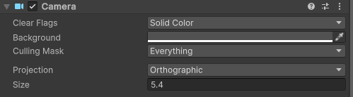</img>

### 게임 오버 후 점프 방지

- 게임 오버되도 스페이스바 누르면 점프하는 거 막기

```csharp
[Player]

private void Update()
{
    if (game.IsGameOver)//게임이 오버되면
        return;//아예 점프 실행 전에 나와버림

    if (transform.position.y < -Camera.main.orthographicSize)
    {
        game.GameOver();
        return;
    }

    if (Input.GetKeyDown(KeyCode.Space) == false)
        return;
    
    if (bLanded || jumpCount < maxJumpCount)//땅을 밟고 있거나 점프를 2번 미만으로 뛴 경우에는 점프 가능
    {
        bLanded = false; //점프하니까 false로 바꿔주고
        jumpCount++;//횟수 증가
        animator.SetBool("Jump", true);//동작도 점프 동작으로 바꿔줌

        rigidbody2D.linearVelocityY = 10.0f; //Jump
    }
    
    
}
```

## [몬스터]

- 몬스터를 옆에서 부딪히면 사망, 위에서 부딪히면 몬스터 죽이기, 몬스터 랜덤 생성
    - 몬스터 애니메이션 클립 만들기, 애니메이션 컨트롤러 만들기
    - 스프라이트 렌더러 추가해서 크기 맞추기, 위치 조정하기
    - monster_walk 루프 추가해주고 걷는 속도 조절해주기
    - 블록 옆에 게임 오브젝트가 플레이어가 아니면 게임 오버 실행 x

```csharp
[Monster 전체 Script]

using UnityEngine;

public class Monster : MonoBehaviour
{
    private new Rigidbody2D rigidbody2D;
    private Game game;
    private Animator animator;
    private BoxCollider2D boxCollider2D;
    //getComponent는 기본적으로 awake에서

    private void Awake()
    {
        rigidbody2D = GetComponent<Rigidbody2D>();
        GameObject obj = GameObject.Find("Game");
        game = obj.GetComponent<Game>();
        animator = GetComponent<Animator>();
        boxCollider2D = GetComponent<BoxCollider2D>();
    }

    private void Update()
    {
        if (game.GameStart == false)
            return;

        if (game.IsGameOver)
            return;

        rigidbody2D.linearVelocityX = -game.MonsterSpeed; //몬스터 스피드만큼 -방향으로 움직임
    }

    private void OnCollisionEnter2D(Collision2D collision)
    {
        //if (collision.gameObject.name != "Player") //몬스터가 벽에 부딪혔다고 게임오버되면 안되니까
        //{
        //    boxCollider2D.enabled = false;
        //    return; 
        //}

        ContactPoint2D contact = collision.GetContact(0);

        if (collision.gameObject.name.Contains("Block"))//부딪힌 게임오브젝트의 이름에 Block이 포함되어 있으면
        {
            if (Mathf.Abs(contact.normal.x) >= 0.9f)몬스터도 블록 옆에 닿으면
            {
                boxCollider2D.enabled = false; //충돌체 끄고
                Destroy(gameObject); //몬스터 삭제
                return;
            }
        }
        
        if (collision.gameObject.name == "Player") //플레이어가 몬스터에 부딪히면
        {
            if (Mathf.Abs(contact.normal.x) >= 0.9f)//몬스터 옆에 부딪히면
                game.GameOver();//게임오버

            if (contact.normal.y <= -0.9f)//몬스터 위에서 부딪히면
            {
                rigidbody2D.constraints = RigidbodyConstraints2D.FreezeAll;//x방향으로 움직이거나 y방향으로 움직이거나 회전하는 거 싹다 잠금
								
								//원래는 그냥 충돌체 크기 바꿔주려고 했는데 어색해서 충돌체 끄는걸로 변경
                //Vector2 size = boxCollider2D.size;
                //size.y *= 0.5f;
                //boxCollider2D.size = size;

                //Vector2 offset = boxCollider2D.offset;
                //offset.y *= 0.5f;
                //boxCollider2D.offset = offset;

                boxCollider2D.enabled = false;//충돌체도 끄고
                animator.SetTrigger("Death");//몬스터 죽음 애니메이션 내보내기
                Invoke("End_Death", 0.5f); //몬스터가 죽었으니 End_Death함수를 0.5f초 뒤에 호출
            }
        }
            
    }

    private void End_Death()
    {
        
        Destroy(gameObject, 0.5f);//게임 오브젝트를 0.5f뒤에 삭제
    }
}

```

<기억해>
RIGIDBODY 2D: 물리엔진
BOX COLLIDER 2D: 충돌체

- 물리가 있는 객체는 트랜스폼으로 이동x, 물리에 의해 이동을 시켜줘야 함→`rigidbody2D.linearVelocityX`
- 옆에서 닿으면 플레이어가 죽고 위에서 밟으면 몬스터가 죽게 애니메이션 바꿔주기

```csharp
private void OnCollisionEnter2D(Collision2D collision)
{
	ContactPoint2D contact = collision.GetContact(0);
	if (Mathf.Abs(contact.normal.x) >= 0.9f) //옆에서 닿으면 플레이어 게임 오버
	    game.GameOver();

	if (contact.normal.y <= -0.9f) //위에서 닿으면
	{
	    animator.SetTrigger("Death");//애니메이션 죽는걸로 바꾸고
	
	    Vector2 size = boxCollider2D.size; //충돌체 사이즈 반으로 줄이기
	    size.y *= 0.5f;
	    boxCollider2D.size = size;

	    Vector2 offset = boxCollider2D.offset; //충돌체 아래로 반만큼 내려주기
	    offset.y *= 0.5f;
	    boxCollider2D.offset = offset;

	    animator.SetTrigger("Death");//애니메이터 Death 트리거도 켜줌
	}
}
```

- 밟으면 애가 블록 아래로 내려가는 거 : 충돌체가 반으로 바뀔 때 스프라이트 사이즈랑 충돌체 사이즈가 달라서 생기는 현상. y축으로 내려가지 못하게 constraints 다 freeze

→ 좀 어색해서 밟으면 충돌체 끄는 걸로

```csharp
[Monster]
private void OnCollisionEnter2D(Collision2D collision)
{
`
`
`
    if (contact.normal.y <= -0.9f)//머리를 밟으면
    {
        rigidbody2D.constraints = RigidbodyConstraints2D.FreezeAll;
        //x, y 축으로 움직이거나 회전하는 거 싹다 잠금

        boxCollider2D.enabled = false; //충돌체를 꺼버리고
        animator.SetTrigger("Death"); //애니메이터는 Death로 설정
        Invoke("End_Death", 0.5f); //End_Death함수를 0.5f초 뒤에 호출
    }
}

private void End_Death()
{
    Destroy(gameObject, 0.5f);//0.5f초 후에 게임오브젝트 삭제
}
```

- 몬스터도 블록 옆면에 닿으면 파괴

```csharp
[Monster]

if (collision.gameObject.name.Contains("Block"))//부딪힌 게임오브젝트의 이름에 Block이 포함되어 있으면
        {
            if (Mathf.Abs(contact.normal.x) >= 0.9f)//몬스터도 블록 옆에 닿으면
            {
                boxCollider2D.enabled = false; //충돌체 끄고
                Destroy(gameObject); //몬스터 삭제
                return;
            }
        }
```

- 몬스터 스피드도 게임 오브젝트에서 관리하도록 수정

```csharp
[Game]
[SerializeField, Range(0, 5)]
private float monsterSpeed = 0.5f;
public float MonsterSpeed => monsterSpeed + blockSpeed; 
//블록 속도에 비례시키기 위해 블록 스피드에 더해줌

[Monster]
GameObject obj = GameObject.Find("Game");//Game 오브젝트를 찾아서
game = obj.GetComponent<Game>();//Game 오브젝트의 컴포넌트를 game에 넣어줌

private void Update()
{
    ...
    rigidbody2D.linearVelocityX = -game.MonsterSpeed;//몬스터 스피드만큼 반대방향으로 힘을 더해줌
}
```

## [상대좌표/절대좌표]

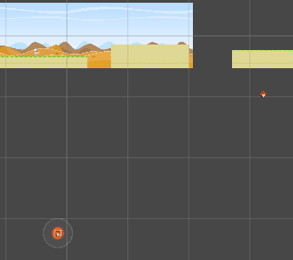</img>

- 이렇게 했더니 블록 저 아래로 몬스터가 떨어지고 있음!!
- 블록이 생성될 때 블록 하위에 몬스터를 랜덤 생성함 ⇒ 부모에 대한 상대좌표 때문에 블록 위에 생기지 않아서 떨어지게 된거임.
    - **절대좌표(World좌표/Global좌표)**
        - 개념: 게임 씬 전체의 고정된 원점 (0, 0, 0)을 기준점으로 계산하는 좌표
        - 특징: 부모 오브젝트가 누구든, 어디에 있든 상관없이 씬 안에서의 절대적인 위치
        - c# 접근 코드
            - 위치: `transform.position`
            - 회전: `transform.rotation` / `transform.eulerAngles`
        - 사용 예시
            - 씬 전체에 하나만 존재하는 생성 위치(스폰포인트)
            - 월드 맵 상의 절대적인 목표 지점 이동
            - 전체 씬 기준의 물리 계산 및 레이캐스트(Raycast)
    - **상대좌표(Local좌표/Parent좌표)**
        - 개념: 해당 오브젝트의 부모(Parent) 오브젝트의 위치/회전/크기를 기준점으로 (0, 0, 0)으로 삼는 좌표
        - 특징
            - 부모가 없는 최상위(Root) 오브젝트라면 절대 좌표와 상대좌표가 동일
            - 부모 오브젝트가 이동하거나 회전하면, 자식 오브젝트는 상대좌표 값을 유지한 채 부모와 함께 이동, 회전함
        - c# 접근 코드
            - 위치: `transform.localPosition`
            - 회전: `transform.localRotation` / `transform.localEulerAngles`
        - 사용 예시
            - 캐릭터의 손에 들려있는 무기
            - 자동차 바퀴
            - UI 요소의 레이아웃 구성

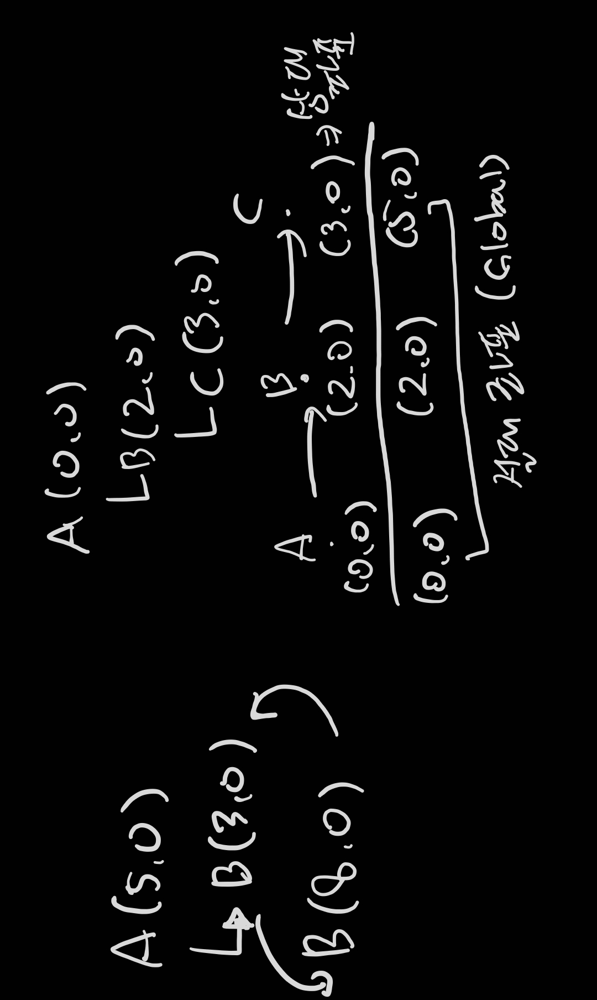</img>

- 몬스터의 y좌표는 블럭의 높이(크기의 y)로 정해주면 됨

```csharp
[Block]
private GameObject monsterPrefab;//몬스터 프리팹 가져올 변수
private int maxMonsterCount = 2;//랜덤으로 생성되는 최대 몬스터의 수

private void Start()
{
    if (monsterPrefab == null)
        return;

    int count = Random.Range(0, maxMonsterCount + 1);//생성되는 몬스터를 랜덤으로 발생

    for(int i = 0; i < count; i++)
    {
        GameObject monster = Instantiate<GameObject>(monsterPrefab, transform);//원본 몬스터를 복제해서 저장

        Vector3 position = monster.transform.localPosition;
        //transform.position : 절대 좌표 | transform.localPosition: 상대 좌표
        //블록 하위에 생성이 될거니까 상대 좌표로 위치 지정해줘야 함.
        position.y = spriteRenderer.size.y;//몬스터의 y좌표는 블록 사이즈의 y크기
        
        float x = spriteRenderer.size.x * 0.5f;//생성되는 x의 위치는 블록의 크기 반만큼의
        position.x = Random.Range(-x + 1, x - 1);//+, - 사이(모서리에 생기는 걸 1만큼 방지)

        monster.transform.localPosition = position;
    }
    //print(spriteRenderer.size);
}
```

⇒이렇게 해주면 위치는 잘 나오는데 블록이랑 몬스터의 상태가;;;

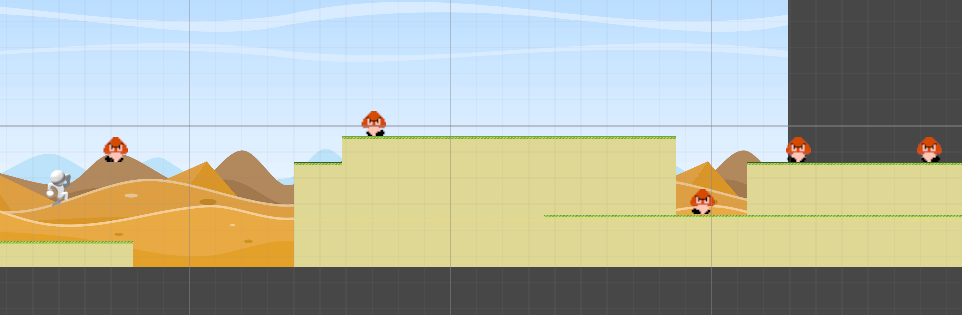</img>

⇒Creator는 블록이 충돌하면 블록을 생성, 근데 monster도 충돌체가 있어서 블록을 생성함

```csharp
[Creator]

private void OnTriggerEnter2D(collider2D collision)
{
//충돌체의 이름에 블록이라는 이름이 포함되어 있지 않으면 함수를 빠져 나가 블록 생성 x
	if (collision.gameObject.name.Contains("Block") == false)
	    return;
}
```

## [게임 오버 UI]

- 게임 오버하면 화면에 게임 오버 화면 띄우고 버튼 누르면 재실행- UI
    - UI → Canvas : 실행화면 전체에 매칭되는 사각형
    - 게임 속에서 붙어다니는 ui는 같은 캔버스지만 게임 오브젝트에 붙어있음
    - UI→ Panel : 여러개의 ui를 한번에 둘 수 있게 하는 거

```csharp
//체크박스에 게임 오브젝트가 비활성화된 상태면 find함수로 게임오브젝트를 못찾음
//panel_GameOver = GameObject.Find("Panel_GameOver");
GameObject canvas = GameObject.Find("Canvas");//Canvas는 활성화 되어 있으니까 Find로 찾기가능
Transform t = canvas.transform.Find("Panel_GameOver");//transform.find는 활성화 여부 관계없이 찾기 가능
//모든 게임 오브젝트는 transform을 가지고 있어 unity에서는 transform과 게임 오브젝트를 1:1로 인식
panel_GameOver = t.gameObject;//위에서 찾은 트랜스폼은 Panel_GameOver의 위치니까 여기에 저장

panel_GameOver.SetActive(false);//게임 오브젝트 비활성화(체크박스 해제)
```

- 재시작 버튼 만들기
    - on.Click() 같은  함수를 이벤트 함수라고 함. 이벤트 함수를 스크립트로 연결할 때는 public으로 선언
- coin 만들기
- Resources 폴더 : 동적으로 파일을 불러서 게임에 배치시킴. 어느 폴더에 위치하더라도 하나의 resource폴더로 인식

### **Invoke(” 함수명“);**

- 함수명이 문자열인 함수는 성능 저하의 이유로 사용하지 않음.(문자열과 함수명을 일일히 다 비교해야 하기 때문에 성능이 저하됨)
- 파라미터도 없기 때문에 사용하지 않음.(예시:  Invoke(”Rotate”);  public void Rotate() )
- 그래서 이걸 대신해서 사용하는 게 ⇒ CoRoutine
- 게임의 주 루틴 : AWAKE → START → UPDATE → FIXED UPDATE → LATE UPDATE → UPDATE → …
- CoRoutine은 주 루틴 외에 돌려주는 보조 루틴(무언 가를 실행하기 위해 대기)
- Coin에 대입하면 2초 대기 → Rotate call → 2초 대기 → Rotate call → …

```csharp
//일반 함수 선언
리턴타입 함수명 (파라미터)
{
		return;
}

//CoRoutine 함수
Inumerater 함수명 (파라미터)
{
		...
		yield return null; //한프레임만 대기하는 CoRoutine 함수
}
//여러 프레임을 대기하려면 반복문을 돌려주면 됨
```

- 일반 for문의 무한 대기 → unity 다운됨
- 코루틴함수는 무한 반복에 빠지더라도 메인 루틴이 처리하는 동안 대기하고 본인의 명령어를 처리함

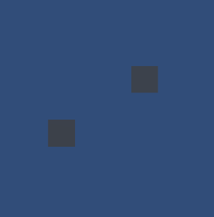</img>

- 리얼타임 : 에디터가 잠깐 멈추더라도 시간이 흐르기 때문에 시작시 차이가 남
델타타임 : 게임이 완전히 실행된 후에 흐르기 때문에 시작할 때 차이가 남

## [Coin 만들기]

- 코인 하나에 붙어서, 외부에서 `Rotate()`를 호출하면 애니메이터의 “Rotate” 트리거를 켜서 회전 애니메이션을 재생하는 스크립트

```csharp
[COIN]
using System.Collections;
using UnityEngine;

public class Coin : MonoBehaviour
{
    private Animator animator;

    private void Awake()
    {
        animator = GetComponent<Animator>();
    }

    private void Start()
    {
        //InvokeRepeating("Rotate", 0.0f, 2.0f);
        
        //그럼 랜덤으로 대기시킬수도 있찌 않을까? 2.0f초 +- 0.5f초 처럼 기준을 정하고 쁠마 얼마<-가 더 직관적임 
    }

    public void Rotate()
    {
        animator.SetTrigger("Rotate");
    }

    
}
```

|  | 수정 전 | 수정 후 |
| --- | --- | --- |
| 회전 시점을 정하는 쪽 | 코인 각자 (`InvokeRepeating`) | CoinBlock (코루틴) |
| 회전 간격 | 2초 고정 | 2초 ± 0.5초 랜덤 |
| Coin의 역할 | 타이머 + 애니메이션 | 애니메이션 재생만 |
- 코인이 각자 타이머를 돌리면 블록 안 코인들의 회전 박자를 맞추기 어렵고, 랜덤 간격을 주려면 코인마다 따로 계산해야 함.
- 타이밍은 블록이 정하고, 코인은 시키는 대로 돌기만 하는 구조로 나눔.

⇒한 블록의 코인들은 동시에 돌고, 블록끼리는 박자가 어긋나는 효과가 나옴.

### 각 함수 정리

- **Awake** : 자기 Animator를 캐싱. Rotate가 반복 호출되니까 매번 GetComponent 하지 않도록 미리 저장.
- **Start** : 지금은 비어 있음. 예전 InvokeRepeating 코드의 흔적만 남아 있음.
- **Rotate()** : `public`이라서 CoinBlock이 호출할 수 있음. `SetTrigger("Rotate")`는 한 번 켜지면 전환에 쓰이는 순간 자동으로 꺼지는 파라미터라서, "한 번 돌고 끝" 같은 일회성 동작에 맞음.

### 애니메이터 설정

- 파라미터: Trigger 타입 “Rotate”
- 상태: 기본(Idle) → Rotate 상태로 가는 전환, 조건은 Rotate 트리거
- Rotate 상태 → 기본으로 돌아오는 전환 (Has Exit Time 체크)

### 짚어볼 만한 부분

1. **문자열 트리거 → 해시값** : `"Rotate"`를 오타 내면 에러 없이 조용히 안 돌기만 함. 이렇게 해시로 바꾸면 성능도 조금 낫고 이름을 한 곳에서 관리할 수 있음

```csharp
private static readonly int RotateHash = Animator.StringToHash("Rotate");   
animator.SetTrigger(RotateHash);
```

## [CoinBlock 만들기]

- 코인을 블록으로 만들어서 공중에 띄우기
- 빈 오브젝트 하나를 "블록"으로 삼아 그 자식으로 코인을 rows × cols 격자 모양으로 생성하고, 블록 전체를 덮는 BoxCollider2D를 맞춘 뒤, 일정 간격마다 모든 코인을 동시에 회전시키는 스크립트

```jsx
[CoinBlock]
using System.Collections;
using UnityEngine;

public class CoinBlock : MonoBehaviour
{
    [SerializeField]
    private float rotateDelay = 2.0f;

    [SerializeField]
    private float rotateDeviation = 0.5f;

    [SerializeField]
    private Vector2 rowSize = new Vector2(1, 3);

    [SerializeField]
    private Vector2 colSize = new Vector2(5, 10);

    private GameObject coinPrefab;
    private GameObject[,] coins;
    
    private BoxCollider2D boxCollider2D;

    private int rows = 3;
    private int cols = 5;

    private void Awake()
    {
        coinPrefab = Resources.Load<GameObject>("Prefabs/Coin");//Resources.Load : 리소스 폴더에 있는 프리팹을 불러옴
        boxCollider2D = GetComponent<BoxCollider2D>();
    }

    private void Start()
    {
        rows = Random.Range((int)rowSize.x, (int)rowSize.y + 1);
        cols = Random.Range((int)colSize.x, (int)colSize.y + 1);

        coins = new GameObject[rows, cols];

        for(int y = 0; y < rows; y++)
        {
            for(int x = 0; x < cols; x++)
            {
                GameObject obj = Instantiate(coinPrefab, transform);//부모자식관계는 transform에서 맺는다

                int index = cols * y + x;
                obj.name = $"Coin_{index}";

                Vector2 position;
                position.x = x;
                position.y = y;

                obj.transform.localPosition = position;
                coins[y, x] = obj;
            }
        }

        boxCollider2D.size = new Vector2(cols, rows);
        Vector2 offset;
        offset.x = (cols - 1) * 0.5f;
        offset.y = (rows - 1) * 0.5f;
        boxCollider2D.offset = offset;

        StartCoroutine(Co_Rotate(rotateDelay, rotateDeviation));
    }

    private IEnumerator Co_Rotate(float delay, float deviation) //InvokeRepeating 대신에 코루틴 ㅅㅏ용!//랜덤값에서 기준값으로 +-하는 값을 deviation
    {
        while (true)
        {
            for (int y = 0; y < rows; y++)
            {
                for (int x = 0; x < cols; x++)
                {
                    Coin coin = coins[y,x].GetComponent<Coin>();
                    coin.Rotate();
                }
            }
            
            yield return new WaitForSeconds(delay + Random.Range(-deviation, deviation));
        }
    }
}
```

### 필드

| 필드 | 역할 |
| --- | --- |
| `rotateDelay` (2.0) | 회전 사이의 기본 대기 시간 |
| `rotateDeviation` (0.5) | 대기 시간에 더하거나 빼는 랜덤 폭 → 실제 간격은 1.5~2.5초 |
| `rowSize` (1, 3) | 행 개수의 (최소, 최대) |
| `colSize` (5, 10) | 열 개수의 (최소, 최대) |
| `coinPrefab` | Resources 폴더에서 불러온 코인 프리팹 |
| `coins` | 생성한 코인을 `[행, 열]`로 저장하는 2차원 배열 |
| `rows`, `cols` | 실제로 뽑힌 행·열 개수 (초기값 3, 5는 Start에서 덮어씌워짐) |

### Awake: 준비

- `Resources.Load<GameObject>("Prefabs/Coin")`: `Assets/Resources/Prefabs/Coin.prefab`을 코드로 불러옴. 인스펙터에서 프리팹을 일일이 연결하지 않아도 되는 게 장점. 경로에는 `Resources/`와 확장자를 쓰지 않음.
- 자기 자신의 `BoxCollider2D`를 캐싱. 그래서 CoinBlock 오브젝트에 BoxCollider2D가 반드시 붙어 있어야 함.

### Start: 격자 생성

#### 1. 크기 랜덤 결정

```csharp
rows = Random.Range((int)rowSize.x, (int)rowSize.y + 1);
```

- `Random.Range(int, int)`는 최댓값을 포함하지 않기 때문에 `+1`을 해야 최대값(3, 10)까지 나옴.
- 결과적으로 행은 1~3, 열은 5~10이 됨.

#### 2. 이중 for문으로 생성

- `Instantiate(coinPrefab, transform)`: 두 번째 인자로 부모를 넘겨서 생성과 동시에 블록의 자식이 됨. 그래서 블록을 움직이면 코인 전체가 같이 움직임.
- `index = cols * y + x`: 2차원 좌표를 1차원 번호로 바꾸는 공식. 예를 들어 cols=5일 때 (y=1, x=2)는 7번이에요. 하이어라키에서 `Coin_0, Coin_1...`로 보기 좋게 이름 붙이는 용도.
- `localPosition = (x, y)`: 부모 기준 좌표라서 블록의 왼쪽 아래 (0,0)부터 오른쪽·위로 1칸씩 배치됨. 즉 코인 간격이 1유닛.
- `coins[y, x] = obj`: 나중에 회전시킬 때 쓰려고 저장.

#### 3. 콜라이더(Collider) 맞추기

- 코인이 x = 0 ~ cols-1에 놓이니까, 그 가운데는 `(cols-1)/2`

```csharp
cols = 5 → 코인 x: 0 1 2 3 4 → 중심 2.0 = (5-1)*0.5
```

- `size = (cols, rows)`: 코인 하나가 1×1 칸을 차지한다고 보고 전체 크기를 잡음
- `offset = ((cols-1)/2, (rows-1)/2)`: 콜라이더 중심을 격자 중앙으로 이동
- 이 콜라이더는 블록 전체 영역을 나타내는 용도라서 CoinController에서 블록의 크기나 화면 밖 판정 같은데 쓰임.

#### 4. Co_Rotate: 주기적 회전

```csharp
while (true) 
{ 
		모든 코인 Rotate(); 
		yield return new WaitForSeconds(delay ± deviation); 
}
```

- 블록 안의 코인은 한꺼번에 회전하고, 대기 시간에만 랜덤을 섞음. 그래서 블록이 여러 개 있을 때 블록끼리 회전 타이밍이 어긋나서 덜 기계적으로 보임.
- 주석에 쓰신 대로 InvokeRepeating은 간격이 고정이라, 매번 다른 간격을 주려면 코루틴이 더 적합.
- 오브젝트가 비활성화되거나 파괴되면 코루틴도 멈춤.

### 짚어볼 만한 부분

1. **매 주기마다 GetComponent 호출** : 코인 30개면 2초마다 GetComponent를 30번 함. 생성할 때 `Coin[,]` 배열에 컴포넌트를 바로 저장해 두면 더 효율적.

```csharp
   coins[y, x] = obj.GetComponent<Coin>();   // coins를 Coin[,]으로 선언
```

1. **먹은 코인 처리** : 플레이어가 코인을 먹을 때 `Destroy`한다면 `coins[y,x]`가 파괴된 오브젝트를 가리키게 되어 `GetComponent`에서 에러가 남. 비활성화(`SetActive(false)`)로 처리하면 괜찮음. 이건 수정된 Coin 스크립트를 보면 확인할 수 있음.
2. **범위 타입** : 정수 범위라면 `Vector2Int`를 쓰면 `(int)` 캐스팅이 필요 없음. 지금 방식도 동작에는 문제 없음.
3. **간격 1유닛 고정** : 코인 간격을 바꾸고 싶으면 `spacing` 변수를 하나 두고 위치, size, offset에 같이 곱해주면 됨.

## [Coin MGR]

- CoinBlock 프리팹을 불러오고 Game 오브젝트의 상태를 확인하면서, 게임이 진행 중일 때 코인 블록을 계속 만들어 내기 위한 스크립트

```csharp
[COIN MGR]
using System.Collections;
using UnityEngine;

public class CoinManager : MonoBehaviour
{
    private GameObject coinBlockPrefab;
    private Game game;

    private void Awake()
    {
        coinBlockPrefab = Resources.Load<GameObject>("Prefabs/CoinBlock");
        GameObject obj = GameObject.Find("Game");
        game = obj.GetComponent<Game>();
    }

    private void Start()
    {
        
    }

    private IEnumerator Co_CreateCoinBlock()
    {
        while (true)
        {
            if(game.GameStart == false)
            {
                yield return null;
                continue;
            }

            if (game.IsGameOver)
                break;

            //이제 코인 생성해야 됨

        }
    }
}

```

### Awake: 준비

- `Resources.Load<GameObject>("Prefabs/CoinBlock")`: CoinBlock에서 코인을 불러온 것과 같은 방식으로, 이번엔 블록 프리팹을 불러옴.
- `GameObject.Find("Game")` → `GetComponent<Game>()`: 하이어라키에서 이름이 “Game”인 오브젝트를 찾아 게임 상태를 읽어 올 준비를 함. Find는 느리기 때문에 이렇게 Awake에서 한 번만 찾아 저장하는 게 정석. 이름이 바뀌면 null이 되니 주의해야 함.

### 흐름 제어

| 상황 | 동작 |
| --- | --- |
| 게임 시작 전 (`GameStart == false`) | `yield return null`로 한 프레임 쉬고 다시 확인 → 시작할 때까지 대기 |
| 게임 오버 (`IsGameOver`) | `break`로 루프 탈출 → 코루틴 종료, 더 이상 생성 안 함 |
| 진행 중 | 여기서 블록을 생성할 예정 |

[이제 할 일]

- 코인 블록 만들고 랜덤시간으로 랜덤하게 블록을 생성하기
- 코인블록도 흘러가게 만들기
- 코인블록이 끌어당기는 거리를 보여주는 기즈모 만들기

## [Coin 블록 흘러가게 만들기]

```csharp
using System.Collections;
using UnityEngine;

public class Coins : MonoBehaviour
{
    [SerializeField]
    private float rotateDelay = 2.0f;

    [SerializeField]
    private float rotateDeviation = 0.5f;

    [SerializeField]
    private Vector2 rowSize = new Vector2(1, 3);

    [SerializeField]
    private Vector2 colSize = new Vector2(5, 10);

    private GameObject coinPrefab;
    private GameObject[,] coins;

    private BoxCollider2D boxCollider;

    private int rows = 3;
    private int cols = 5;

    private Game game;

    private void Awake()
    {
        boxCollider = GetComponent<BoxCollider2D>();

        coinPrefab = Resources.Load<GameObject>("Prefabs/Coin");

        game = GameObject.Find("Game")?.GetComponent<Game>();
    }

    private void Start()
    {
        rows = Random.Range((int)rowSize.x, (int)rowSize.y + 1);
        cols = Random.Range((int)colSize.x, (int)colSize.y + 1);

        coins = new GameObject[rows, cols];
        for(int y = 0; y < rows; y++)
        {
            for (int x = 0; x < cols; x++)
            {
                GameObject obj = Instantiate(coinPrefab, transform);

                int index = y * cols + x;
                obj.name = $"Coin_{index}";

                Vector2 position;
                position.x = x;
                position.y = y;

                obj.transform.localPosition = position;
                coins[y, x] = obj;
            }
        }

        boxCollider.size = new Vector2(cols, rows);

        Vector2 offset;
        offset.x = (cols - 1) * 0.5f;
        offset.y = (rows - 1) * 0.5f;
        boxCollider.offset = offset;

        StartCoroutine(Co_Rotate(rotateDelay, rotateDeviation));
    }

    private void Update()
    {
        if (game.GameStart == false)
            return;

        if (game.IsGameOver)
            return;

        transform.Translate(-game.BlockSpeed * Time.deltaTime, 0.0f, 0.0f);
    }

    private IEnumerator Co_Rotate(float delay, float deviation)
    {
        while (true)
        {
            for (int y = 0; y < rows; y++)
            {
                for (int x = 0; x < cols; x++)
                {
                    Coin coin = coins[y, x].GetComponent<Coin>();
                    coin.Rotate();
                }
            }

            yield return new WaitForSeconds(delay + Random.Range(-deviation, +deviation));
        }
    }
}
```

| 구분 | 이전 (CoinBlock) | 지금 (Coins) |
| --- | --- | --- |
| 클래스 이름 | `CoinBlock` | `Coins` |
| 콜라이더 변수 | `boxCollider2D` | `boxCollider` (이름만 변경) |
| Game 참조 | 없음 | `game` 필드 추가, Awake에서 찾음 |
| Update | 없음 | 블록을 왼쪽으로 이동 (새로 추가) |
| index 계산 | `cols * y + x` | `y * cols + x` (순서만 바뀜, 결과 같음) |
| 랜덤 범위 | `Random.Range(-deviation, deviation)` | `+deviation` (표기만 다름, 결과 같음) |
| 격자 생성, 콜라이더, 회전 코루틴 |  | 동일 |

### Game 참조

```csharp
game = GameObject.Find("Game")?.GetComponent<Game>();
```

- CoinManager와 같은 방식으로 Game 오브젝트를 찾음.
- `?.`(null 조건 연산자) : Find 결과가 null이면 GetComponent를 호출하지 않고 바로 null을 넣음. “Game” 오브젝트가 없을 때 Awake에서 바로 에러가 나는 걸 막아줌.

### Update: 흘러가게 하기

```csharp
if (game.GameStart == false) return;   // 시작 전엔 멈춤
if (game.IsGameOver) return;           // 게임 오버면 멈춤
transform.Translate(-game.BlockSpeed * Time.deltaTime, 0.0f, 0.0f);
```

- 게임 진행 중일 때만 왼쪽(-x)으로 이동.
- 속도를 Game의 `BlockSpeed`에서 가져오는 게 핵심. 바닥 블록이나 장애물도 같은 값을 쓰고 있다면 코인이 땅과 정확히 같은 속도로 흘러가서 어긋나 보이지 않음. 나중에 난이도에 따라 속도를 올려도 한 곳만 바꾸면 전부 같이 빨라짐.
- `Time.deltaTime`을 곱해서 프레임 수와 상관없이 초당 일정한 거리를 이동.
- 부모인 블록만 움직이면 자식 코인 수십 개가 같이 이동하니까, 코인마다 Update를 돌리는 것보다 효율적.

## [Coin블록의 생성 간격과 높이 정하기]

```csharp
using System.Collections;
using UnityEngine;

public class CoinManager : MonoBehaviour
{
    [SerializeField]
    private float createTime = 4.0f;

    [SerializeField]
    private float createDeviation = 1.0f;

    [SerializeField]
    private Vector2 height = new Vector2(1, 3);

    private GameObject coinsPrefab;
    private Game game;

    private Transform creator;

    private void Awake()
    {
        coinsPrefab = Resources.Load<GameObject>("Prefabs/Coins");

        GameObject obj = GameObject.Find("Game");
        game = obj.GetComponent<Game>();

        creator = GameObject.Find("Creator")?.transform;
    }

    private void Start()
    {
        StartCoroutine(Co_CreateCoinBlock());
    }

    private IEnumerator Co_CreateCoinBlock()
    {
        while(true)
        {
            if(game.GameStart == false)
            {
                yield return null;
                continue;
            }

            if (game.IsGameOver)
                break;

            float time = createTime + Random.Range(-createDeviation, +createDeviation);
            yield return new WaitForSeconds(time);

            GameObject obj = Instantiate<GameObject>(coinsPrefab, transform);

            Vector2 position = creator.transform.position;
            position.x += obj.transform.localScale.x;
            position.y = Random.Range((int)height.x, (int)height.y + 1);
            obj.transform.localPosition = position;
        }
    }
}
```

| 구분 | 이전 | 지금 |
| --- | --- | --- |
| 프리팹 | `Prefabs/CoinBlock` | `Prefabs/Coins` |
| 생성 간격 | 없음 | `createTime` 4초 ± `createDeviation` 1초 → 3~5초 랜덤 |
| 생성 높이 | 없음 | `height` (1, 3) → 1~3 중 랜덤 |
| 생성 위치 기준 | 없음 | `Creator` 오브젝트의 Transform |
| Start | 비어 있음 | `StartCoroutine` 호출 → 코루틴이 실제로 실행됨 |
| 진행 중 루프 | yield 없음 (프리징 위험) | `WaitForSeconds`로 대기 → 무한 루프 해결 |
| 생성 코드 | 주석만 있음 | Instantiate + 위치 지정 구현 |

### 필드

- Coins에서 회전 간격에 썼던 **"기준값 ± 편차"** 패턴을 생성 간격에도 똑같이 적용
- `height`도 Coins의 `rowSize`처럼 Vector2를 (최소, 최대) 범위로 쓰고 있어요. 같은 패턴을 반복해서 쓰니까 코드가 읽기 쉬움.

### Awake

- `Creator`: 화면 오른쪽 밖에 놓아둔 빈 오브젝트로, **블록이 생겨나는 위치의 기준점** 역할

### 코루틴 흐름

```csharp
시작 전 → 한 프레임씩 대기
게임 오버 → 종료
진행 중 → 3~5초 대기 → 블록 생성 → 위치 지정 → 반복
```

- 대기를 생성보다 먼저 하기 때문에, 게임이 시작되자마자 블록이 튀어나오지 않고 몇 초 뒤에 첫 블록이 나옴.

### 위치 지정

- x : Creator 위치 + `localScale.x`
- y : 1, 2, 3 중 하나 (정수 Range라 `+1`)
- 블록의 피벗이 왼쪽 아래 코인이고 오른쪽으로 늘어나니까, 피벗을 화면 밖에 두면 블록 전체가 화면 밖에서 시작해 들어옴.

### 전체 구조 정리

```csharp
Game          ── GameStart / IsGameOver / BlockSpeed 제공
   ▲ 참조              ▲ 참조
CoinManager                     Coins
 · Creator 위치 기준             · 코인 rows × cols 배치
 · 3~5초 랜덤 간격 생성 ───────▶ · BoxCollider로 영역 표시
 · 높이 1~3 랜덤                 · BlockSpeed로 왼쪽 이동 (신규)
                                 · 회전 타이밍 2초 ± 0.5초
                                      │ Rotate() 호출
                                      ▼
                                 Coin
                                  · 회전 애니메이션
                                  · toTrace 반경 기즈모 (신규)
```

**이전 버전과 비교하면 :**

- **랜덤 생성** → CoinManager (구현 완료)
- **흘러가기** → Coins의 Update (구현 완료)
- **끌어당기는 거리 기즈모** → Coin (표시만 구현, 실제 자석 동작은 아직)
- **남은 일** → 화면 밖 블록 삭제, 코인 획득 처리, `toTrace`를 쓰는 자석 로직

[이제 할일]

- 플레이어 ~~ 코인이 일정 범위(toTrace)내에 들어오면 기즈모를 그려서 보여줌
- Lerp ⇒ Linear Interpolation : 두값을 섞을 때 사용
    - Easing의 종류
    - Linear : 선형
    - Interpolation : 연속적인 값을 만드는 것
    - UnityTween이라는 곳에 정의되어있음
- 플레이어의 일정 범위에 들어오면 코인을 파괴해서 먹는것처러 ㅁ보이게 만들었음
- 먹는 임팩트 에셋스토어에서 다운 받음

## [각 Coin이 당겨지는 거리 만들기]

```csharp
using System.Collections;
using UnityEngine;

#if UNITY_EDITOR
    using UnityEditor;
#endif

public class Coin : MonoBehaviour
{
    [SerializeField, Range(1, 10)]
    private float toTrace = 6.0f;

    private Animator animator;

    private void Awake()
    {
        animator = GetComponent<Animator>();
    }

    private void Start()
    {
        //InvokeRepeating("Rotate", 0.0f, 2.0f);
    }

    public void Rotate()
    {
        animator.SetTrigger("Rotate");
    }

#if UNITY_EDITOR
    private void OnDrawGizmosSelected()
    {
        //print(Selection.activeTransform.name);

        Gizmos.color = Color.green;
        foreach (GameObject obj in Selection.gameObjects)
            Gizmos.DrawWireSphere(obj.transform.position, toTrace);
    }
#endif
}

```

| 구분 | 이전 | 지금 |
| --- | --- | --- |
| 필드 | `animator`만 있음 | `toTrace` (끌어당기는 거리, 기본 6) 추가 |
| using | `System.Collections`, `UnityEngine` | `#if UNITY_EDITOR`로 `UnityEditor` 추가 |
| 기즈모 | 없음 | `OnDrawGizmosSelected`로 초록 원 표시 |
| Start 주석 | InvokeRepeating + "기준 ± 편차" 메모 | InvokeRepeating 주석만 남음 |
| Rotate() | 트리거 재생 | 변화 없음 |

### 추가된 부분

#### **`[SerializeField, Range(1, 10)] float toTrace`**

- 인스펙터에서 1~10 사이 슬라이더로 조절할 수 있음.
- 이름 그대로 "이 거리 안에 플레이어가 들어오면 따라간다(trace)"는 반경

#### **`#if UNITY_EDITOR ... #endif`**

- `UnityEditor` 네임스페이스는 빌드에 포함되지 않음**.** 그래서 이걸 감싸지 않고 `Selection`을 쓰면 에디터에선 잘 되다가 빌드할 때 에러가 남.
- using 부분과 함수 부분 두 곳 모두 감싸야 함. 지금 코드는 둘 다 감싸져 있어서 올바르게 되어 있음.
- 참고로 `Gizmos`는 `UnityEngine`에 속해서 그것만 쓴다면 `#if`가 꼭 필요하진 않음. 여기선 `Selection` 때문에 필요.

#### **`OnDrawGizmosSelected`**

- 오브젝트를 선택했을 때만 씬 뷰에 기즈모를 그림. (`OnDrawGizmos`는 항상 그림)
- 코인이 수십 개라 항상 그리면 화면이 원으로 뒤덮이니까, Selected 버전을 고른 건 좋은 선택.
- `DrawWireSphere(위치, 반지름)`: 속이 빈 구를 그립니다. 2D 씬 뷰에서는 원으로 보임.

## [Coin과 나 사이의 거리 선으로 그리기]

```csharp
using System.Collections;
using UnityEngine;

#if UNITY_EDITOR
    using UnityEditor;
#endif

public class Coin : MonoBehaviour
{
    [SerializeField, Range(1, 10)]
    private float toTrace = 6.0f;

    [SerializeField, Range(0.5f, 3)]
    private float toEat = 1.0f;

    private Animator animator;

    private Transform playerTransform;

    private void Awake()
    {
        animator = GetComponent<Animator>();

        GameObject obj = GameObject.FindWithTag("Player");
        playerTransform = obj.transform;
    }

    private void Start()
    {
        //InvokeRepeating("Rotate", 0.0f, 2.0f);
    }

    private void Update()
    {
        float distance = Vector2.Distance(transform.position, playerTransform.position);
        
        if (distance > toTrace)
            return;

        Debug.DrawLine(transform.position, playerTransform.position, Color.red);

        transform.SetParent(null);
        transform.position = Vector2.Lerp(transform.position, playerTransform.position, Time.deltaTime * 5.0f);

        if (distance > toEat)
            return;

        Destroy(gameObject);
    }

    public void Rotate()
    {
        animator.SetTrigger("Rotate");
    }

#if UNITY_EDITOR
    private void OnDrawGizmosSelected()
    {
        //print(Selection.activeTransform.name);

        Gizmos.color = Color.green;
        foreach (GameObject obj in Selection.gameObjects)
            Gizmos.DrawWireSphere(obj.transform.position, toTrace);
    }
#endif
}

```

| 구분 | 이전 | 지금 |
| --- | --- | --- |
| 필드 | `toTrace` | `toEat` (먹는 거리, 기본 1) 추가 |
| 플레이어 참조 | 없음 | `FindWithTag("Player")`로 Transform 저장 |
| Update | 없음 | 거리 측정 → 선 표시 → 끌려가기 → 먹기 (신규) |
| 기즈모 / Rotate |  | 변화 없음 |

### Update흐름

```csharp
플레이어와의 거리 측정
  ├─ toTrace(6)보다 멀면 → 아무것도 안 함
  └─ 안쪽이면
       · 코인 → 플레이어로 빨간 선 표시
       · 블록에서 떨어져 나옴 (SetParent(null))
       · 플레이어 쪽으로 이동 (Lerp)
       └─ toEat(1)보다 가까우면 → Destroy (먹음)
```

1. `Vector2.Distance` : 두 위치 사이의 직선 거리. 원 모양 범위 판정이라 OnDrawGizmosSelected에서 그린 원과 정확히 일치
2. **`Debug.DrawLine` :** 코인과 플레이어 사이의 선. 기즈모(`Gizmos`)와는 조금 다름.

|  | `Gizmos.DrawLine` | `Debug.DrawLine` |
| --- | --- | --- |
| 호출 위치 | `OnDrawGizmos` 계열 함수 안에서만 | 어디서나 (Update 등) |
| 표시 시점 | 에디터에서 항상 (선택 시) | 플레이 중 호출된 프레임에만 |
| 보이는 곳 | 씬 뷰 | 씬 뷰 (게임 뷰는 Gizmos 버튼 켜면) |
1. **`transform.SetParent(null)`**: 이게 이번 코드의 핵심 포인트. 코인은 블록의 자식이라 블록과 함께 왼쪽으로 흘러감. 부모를 끊지 않으면 블록 이동 + 플레이어 쪽 이동이 합쳐져서 제대로 끌려오지 않음. 부모에서 떼어 내 독립적으로 움직이게 한 거.
2. `Vector2.Lerp(현재, 목표, Time.deltaTime * 5)`: 매 프레임 남은 거리의 약 일정 비율만큼 다가감. 멀 땐 빠르게, 가까워질수록 천천히 다가가서 자석에 빨려 들어가는 느낌이 남.
3. `Destroy(gameObject)`: `toEat` 안에 들어오면 사라져서 먹은 것처럼 보임. 충돌이 아니라 거리로 판정하기 때문에 Player의 `OnTriggerEnter2D`는 이 기능에 쓰이지 않음.

### Lerp

- **Linear Interpolation (선형 보간)**, 두 값 a와 b 사이에서 t 비율만큼 떨어진 지점을 구하는 함수

```csharp
Lerp(a, b, t) = a + (b - a) * t
```

| t | 결과 |
| --- | --- |
| 0 | a (출발점) |
| 0.5 | a와 b의 정중앙 |
| 1 | b (도착점) |

```csharp
Mathf.Lerp(0, 10, 0.3f);                         // 3
Vector2.Lerp(new(0, 0), new(10, 20), 0.5f);      // (5, 10)
```

#### 방식 1: 출발점, 도착점 고정, t를 0 → 1로 증가(정석)

```csharp
Vector2 start = new(0, 0), end = new(10, 0);
float t = 0;

void Update()
{
    t += Time.deltaTime / 2.0f;              // 2초 동안 0 → 1
    transform.position = Vector2.Lerp(start, end, t);
}
```

- 일정한 속도로 이동하고, 정확히 2초 뒤에 도착합니다.
- 이름 그대로 "선형" 이동

#### 방식 2: 출발점 = 현쟁 위치, t는 작은 고정값

```csharp
transform.position = Vector2.Lerp(transform.position, playerTransform.position, Time.deltaTime * 5.0f);
```

- a가 매 프레임 자기 자신의 새 위치로 바뀜.
- 그래서 "매 프레임 남은 거리의 일정 비율만큼 다가가기"가 됨.
- 멀면 많이 움직이고, 가까우면 조금 움직임 → 처음엔 빠르고 점점 느려지는 감속 움직임

|  | `Lerp(현재, 목표, 비율)` | `MoveTowards(현재, 목표, 거리)` |
| --- | --- | --- |
| 세 번째 인자 | 남은 거리의 비율 | 이번 프레임에 이동할 거리 |
| 속도 | 멀면 빠르고 가까우면 느림 | 항상 일정 |
| 도착 | 이론상 도착 안 함 | 정확히 도착 (넘어가지 않음) |
| 느낌 | 부드럽게 빨려 들어감 | 기계적으로 다가옴 |

## [Particle]

- 플레이어에게 붙여서 프리팹 복사 후 먹으면 파티클 시스템 나오게 하기
    - particle system : 일정한 물리효과에 따라 파티클을 움직이는 거
    - Start Size : 시작 크기 (일반적으로 크기 조정할때 조정)
    - 스탑 액션에 디스트로이 붙여주기

## [점수판 UI 만들기]

- 점수 판 만들기 ui(게임 스크립트)

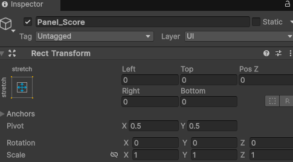</img>

- 패널을 스트레치로 하면 화면 크기에 맞춰서 가변적으로 맞춰줌
- stretch : 부모 오브젝트(또는 화면)의 크기 변화에 따라 UI의 크기가 자동으로 늘어나거나 줄어들도록 만드는 레이아웃 옵션
    - 앵커 옵션에 따라 값 이름이 달라짐
- UI 이미지는 밑으로 내리려면 -방향으로 움직여야됨
- text_Score에 스크립트를 붙여서 AddScore함수를 만들어서 점수를 올려주고 점수를 텍스트에 나타내도록 해줌
- player가 코인을 먹으면 score 함수를 불러서 점수를 올려줌

### Awake : 게이지 이미지 찾기

```csharp
private Image uiImageTimer;
...
GameObject obj = GameObject.Find("Image_Time");
uiImageTimer = obj.GetComponent<Image>();
```

- 이름이 “Image_Time”인 UI 오브젝트에서 Image 컴포넌트를 가져옴.
- `GameObject.Find`로 찾으니까 씬에서 켜져 있어야 함.

### Start : 게이지 초기화

```csharp
uiImageTimer.fillAmount = 0.0f;
```

- 시작할 때 게이지를 비워 둠

### Update: 게이지 갱신

```csharp
uiImageTimer.fillAmount = raiseTimer / raiseTime;
```

- `fillAmount`는 이미지가 얼마나 채워져 보일지를 0~1로 정하는 값
- `raiseTimer / raiseTime`은 "다음 속도 증가까지 얼마나 왔는지"의 비율이라, 게이지가 0에서 5초 동안 차오르다가 가득 차면 속도가 오르고 다시 0으로 돌아감.
- fillAmount가 동작하려면 인스펙터 설정이 필요함
    - Image 컴포넌트의 **Source Image**에 스프라이트가 있어야 함 (비어 있으면 Filled 옵션이 안 나옴)
    - **Image Type을 Filled**로 설정
    - **Fill Method**: Horizontal(가로 막대), Radial 360(원형 시계) 등 원하는 모양 선택

### UI와 연결된 속도 증가 로직

```csharp
raiseTimer += Time.deltaTime;
if (raiseTimer >= raiseTime)          // 5초마다
{
    raiseTimer = 0.0f;
    blockSpeed += blockSpeed * raiseRatio;   // 현재 속도의 20%씩 증가
}
```

- 게임 진행 중에만 동작. 게임 오버가 되면 Update가 멈추니 게이지도 그 자리에서 멈춤.
- *현재 속도의 20%**를 더하니까 복리처럼 늘어남. 15 → 18 → 21.6 → 25.9 → 31.1 → ... 30초면 약 45가 돼요.
- `[Range(5, 30)]`은 인스펙터 슬라이더 범위만 제한하고 코드에서 늘어나는 값은 막지 않아서 30을 넘어감. 너무 빨라지면 `Mathf.Min(blockSpeed, 최대값)`으로 상한을 두면 됨.
- Coins, CoinManager가 `BlockSpeed`를 읽고 `MonsterSpeed`도 blockSpeed를 기준으로 계산하니까, 한 곳만 바꿔도 코인·몬스터·블록이 같이 빨라짐. 앞에서 말한 "속도를 Game에서 공유하는 구조"의 장점이 여기서 드러남.

## [Score 스크립트]

- 점수판 텍스트 오브젝트에 붙어서, 시작할 때 “Score : 0"을 표시하고 `AddScore()`가 불릴 때마다 점수를 1 올리고 글씨를 갱신하는 스크립트

```csharp
using TMPro;
using UnityEngine;

public class Score : MonoBehaviour
{
    private int score;

    private TextMeshProUGUI tmp;

    private void Awake()
    {
        tmp = GetComponent<TextMeshProUGUI>();

        tmp.text = $"Score : 0";
    }

    public void AddScore()
    {
        score++;

        tmp.text = $"Score : {score}";
    }
}
```

#### **`using TMPro;`**

- TextMeshPro를 쓰기 위한 네임스페이스. Game에서 Image를 쓰려고 `UnityEngine.UI`를 추가한 것과 같은 이유.

#### **`TextMeshProUGUI`**

- TextMeshPro에는 두 종류가 있어서 헷갈리기 쉬움.

| 클래스 | 어디에 쓰나 | 만드는 메뉴 |
| --- | --- | --- |
| `TextMeshProUGUI` | Canvas 안의 UI 텍스트 | UI → Text - TextMeshPro |
| `TextMeshPro` | 월드 공간의 3D 텍스트 | 3D Object → Text - TextMeshPro |
- 점수판은 Canvas 안에 있으니 `TextMeshProUGUI`가 맞음. 클래스를 잘못 고르면 GetComponent가 null을 돌려줌.

#### **Awake**

- `GetComponent`로 찾으니까, 이 스크립트는 텍스트 오브젝트에 직접 붙어 있어야 함.
- 시작하자마자 “Score : 0"으로 초기화해서, 씬에 써둔 임시 글자(예: “New Text”)가 보이지 않게 함.

#### AddScore()

- `public`이라 다른 스크립트에서 호출할 수 있음.
- 점수가 바뀔 때만 텍스트를 갱신. Update에서 매 프레임 `tmp.text`를 넣는 것보다 효율적. 텍스트를 바꾸면 글자 메시를 다시 만들기 때문에 이 방식이 좋음.

## [Coin을 먹으면 Score 증가]

| 구분 | 이전 | 지금 |
| --- | --- | --- |
| 필드 |  | `particlePrefab`(먹을 때 이펙트), `score`(점수판) 추가 |
| Awake | 플레이어만 찾음 | 플레이어 없으면 중단, 이펙트 프리팹 로드, `Text_Score`에서 Score 찾기 |
| Update 시작 | 바로 거리 계산 | `playerTransform == null`이면 중단 |
| 먹을 때 | Destroy만 | 점수 +1 → 이펙트 생성 → Destroy |

### 점수 연결

```csharp
obj = GameObject.Find("Text_Score");
score = obj.GetComponent<Score>();
...
score.AddScore();
```

- 이름으로 점수판 텍스트를 찾아서 Score 컴포넌트를 저장해 두고, 먹을 때 호출.
- Destroy는 프레임 끝에 처리 되고 다음 프레임부터 Update가 안불리니까 코인 하나당 정확히 1점만 올라감

### 이펙트 생성

```csharp
particlePrefab = Resources.Load<GameObject>("Effects/Impact");
...
Instantiate<GameObject>(particlePrefab, playerTransform);
```

- `Resources/Effects/Impact` 프리팹을 플레이어의 자식으로 생성
- 위치는 코인이 아니라 플레이어 쪽
- 자식이라 플레이어가 점프 중이어도 이펙트가 플레이어를 따라다녀서 "먹었다"는 느낌이 플레이어 몸에서 남.

## [시간이 지나면 블록 속도 증가]

- hp바 같은 프로그레스 바를 플레이어 머리에 붙여줌(모든 ui는 canvas로부터 시작함)
    - 일정 시간이 지나면 점점 차올라서 다 차오르면 블록 스피드를 높여줌(짱구같당)
    - 얘는 게임 공간에 존재할 거기 떄문에 render 모드를 world space
    - 얘의 시간은 game에서 관리

```csharp
[SerializeField, Range(1, 10)]
private float raiseTime = 5.0f; //다음 단계로 넘어가는 제한 시간

[SerializeField, Range(0.1f, 1.0f)]
private float raiseRatio = 0.2f; //속도가 얼마나 증가하는지 비율

private float raiseTimer;//UI Image의 시간을 넣을 변수
private Image uiImage_Timer;

private void Awake()
{
    GameObject obj = GameObject.Find("Image_Timer");
    uiImage_Timer = obj.GetComponent<Image>();
    
}

private void Start()
{
    uiImage_Timer.fillAmount = 0.0f;
}

private void Update()
{
    if (bGameStart == false)
        return;
    if (bGameOver)
        return;

    raiseTimer += Time.deltaTime;
    if(raiseTimer >= raiseTime)
    {
        raiseTimer = 0.0f;
        blockSpeed += blockSpeed * raiseRatio;
    }
    uiImage_Timer.fillAmount = raiseTimer / raiseTime;
}
```

### 변수 설명

#### `raiseTime` (5초) : 속도 증가 주기

```csharp
[SerializeField, Range(1, 10)]
private float raiseTime = 5.0f;
```

- 속도가 한 단계 오르기까지 걸리는 시간.(=게이지가 0에서 가득 찰 때까지 걸리는 시간)
- 인스펙터에서 1~10초 사이로 조절
- 값을 줄이면 속도가 자주 오르고 게이지도 빨리 차서 게임이 금방 어려워짐

#### `raiseRatio` (0.2) : 속도 증가 비율

```csharp
[SerializeField, Range(0.1f, 1.0f)]
private float raiseRatio = 0.2f;
```

- 한 번 오를 때 현재 속도의 몇 %를 더할 지.(20% 증가)

```csharp
blockSpeed += blockSpeed * raiseRatio;   // blockSpeed × 1.2
```

- 처음 속도가 아니라 현재 속도를 기준으로 더하기 때문에 복리처럼 늘어남.
- 처음 속도 기준으로 일정하게 늘리고 싶다면 시작 속도를 따로 저장해서 `blockSpeed += StartSpeed * raiseRation;` 로 쓰면 일정하게 늘어남.

#### `raiseTimer` : 지난 증가 이후 흐른 시간

```csharp
private float raiseTimer;
```

- 마지막으로 속도가 오른 뒤 지난 시간.
- 이 값 자체가 UI에 들어가는 게 아니라, raiseTime으로 나눈 비율이 게이지에 들어감.
- `SerializeField`가 없어서 인스펙터에 안 보이는 내부 계산용 변수
- 매 프레임 `Time.deltaTime` 만큼 증가 → `raiseTime`에 도달하면 0으로 초기화

#### `uiImage_Timer` : 게이지 이미지

```csharp
private Image uiImage_Timer;
```

- 화면에 차오르는 게이지 Image 컴포넌트.
- `using UnityEngine.UI;` 가 있어야 사용 가능.

## [점프 버퍼링]

- 점프버퍼링 : 착지하기 아주 살짝 전에 미리 누른 점프 입력을 기억해 두었다가, 착지하자마자 실행해 주는 기능
    - 상황 : 플레이어가 바닥에 닿기 아주 직전(예: 0.1초 전)에 점프 키를 살짝 일찍 누름.
        - 버퍼링이 없을 때 :  캐릭터가 아직 공중에 있거나 바닥에 닿지 않았다는 이유로 점프 키를 무시. 플레이어는 "왜 점프가 안 씹히지?" 하고 답답함을 느낌.
        - 점프 버퍼링이 있을 때 : "아, 바닥에 닿기 직전에 점프를 누르고 싶었구나!" 하고 그 입력(명령)을 메모리에 잠깐 저장(기억). 그리고 캐릭터가 바닥에 착지하는 순간, 저장해 둔 점프를 곧바로 실행
    - 왜 필요한가?
        - 인간의 타이밍 한계 : 플랫포머 게임에서 연속으로 점프를 할 때, 정확히 바닥에 발이 닿는 '0초'의 순간에 키를 누르기는 거의 불가능
        - 프레임 단위의 엄격함 : 유니티 게임은 보통 초당 60프레임으로 돌아감. 바닥에 닿는 단 1~2프레임(약 0.03초)을 놓치면 점프가 입력되지 않는데, 이는 플레이어에게 엄청난 스트레스를 줌.
        - 조작감(Game Feel) 향상 : 점프 버퍼링을 넣으면 타이밍이 몇 프레임 정도 빗나가더라도 게임이 알아서 찰나의 오차를 보정해 줌. 덕분에 게임이 "말랑말랑하고 내 뜻대로 부드럽게 잘 움직인다"는 느낌을 받게됨.
- 담당 변수 : `bufferTimer` - 착지 직전에 누른 점프를 기억했다가 착지하면 실행

```csharp
if (Input.GetKeyDown(KeyCode.Space))
    bufferTimer = maxBufferTime;          // 누르면 0.2초 충전
else
{
    bufferTimer -= Time.deltaTime;        // 안 누르면 계속 감소
    if (bufferTimer < 0) bufferTimer = 0; // 0 아래로 안 내려감
}
```

- 점프 입력의 유효 기간. 스페이스를 누른 순간 바로 점프할 수 없더라고 0.2초 안에 점프 가능한 상태가 되면 그때 점프

```csharp
[예시]
누름      → buffer 0.2, jumpCount 2 → 점프 불가 (횟수 소진)
0.1초 뒤  → 착지: jumpCount 0, buffer 0.1 남음 → 바로 점프!
```

- 버퍼가 없으면 이 입력은 그냥 버려져서 플레이어 입장에선 엥? 눌렀는데 점프 왜 안됨? 이 됨
- `StartJump()`에서 `bufferTimer = 0` 으로 비우는 것도 중요함. 안비우면 한 번 누른 입력으로 남은 시간 동안 점프가 또 실행될 수 있음!

## [땅에서 떨어질 때 점프 되는 거 막기]

- 담당 변수 : `jumpCount = maxJumpCount` - 코요테 시간이 지나면 공중 점프를 전부 막음

```csharp
if (coyoteTimer <= 0 && jumpCount == 0)
    jumpCount = maxJumpCount;
```

- 공중에 있는데 코요테 시간이 끝났고, 한 번도 점프하지 않았다면 → 점프 안 하고 걸어서 떨어졌고, 유예 시간도 놓쳤다. ⇒ 이때 `jumpCount`를 최대치로 채워서 2단 점프까지 전부 막음.
- `jumpCount == 0` 조건 덕분에 점프해서 공중에 뜬 경우(jumpCount ≥1)엔 이 코드가 동작하지 않아서 2단 점프는 정상적으로 할 수 있음.

## [코요테 점프]

- 담당 변수 : `coyoteTimer` - 땅에서 떨어진 직후 잠깐은 땅 위로 쳐서 점프 허용

```csharp
if (bLanded == false)
    coyoteTimer -= Time.deltaTime;   // 공중이면 감소
else
    coyoteTimer = maxCoyoteTime;     // 땅이면 0.1초로 계속 충전
```

- 땅 끝을 살짝 지나서 눌러도 땅에서 누른 것처럼 점프를  허용.
- 사람 반응이 늦어서 생기는 억울한 낙사를 줄여줌.
- 땅에서는 계속 0.1초로 충전돼 있다가 걸어서 떨어지는 순간부터 줄어들기 시작함.
- `StartJump()`에서 `coyoteTimer = 0` 으로 만드는 건 점프로 땅을 떠난 경우엔 코요테를 쓰지 못하게 하기 위해서. 안그러면 점프 직후 0.1초 안에 한 번 더 눌렀을 때 코요테 점프로 처리될 수 있음.

부모에 속해있는 게임 오브젝트는 부모의 트랜스폼으로 파인드를 함
ㄴ대신 textMeshPro를 자식으로 가지고 있는 게임오브젝트만 찾아도 됨

## 최종 점프 조건

Update_JumpStart()

{

1. IsGameOver ⇒ X //게임 오버면 안 됨
2. GameStart ⇒ O //게임이 시작된 상태여야 함.
3. bLanded == false
    
    coyoteTimer -= deltaTime
    
    coyoteTimer ≤ 0 && jumpCount ==0? //공중에서 한 번도 안 뛰었다. → 점프가 아니라 땅에서 떨어진 상황
    
    jumpCount ←maxJumpCount //점프 횟수를 꽉 채워서 공중 점프를 막음
    
    bLanded == true → coyoteTimer = maxCoyoteTime
    
4. Space Input ⇒ bufferTime maxBufferTime //스페이스를 누르면 버퍼 충전
    
    ㄴx⇒bufferTime- -; //안 누르면 감소
    
5. jumpCount < maxJumpCount //점프 횟수가 남아 있어야 함
6. bufferTime > 0 //최근에 스페이스를 눌렀어야 함
7. coyoteTimer > 0 || jumpCount > 0 // 땅(코요테 포함) or 이미 뛴 공중

} 

1, 2, 5, 6, 7을 모두 만족하면 점프(3, 4번은 값을 변경하는 단계)

- 3번 : `jumpCount`를 바꿔서 결국 5번 조건에 영향을 줌.(`jumpCount`가 `max`가 되니 5번에서 걸림)
    
    bLanded = false //3번에서 검사. 언제 false가 되느냐?
    1. OnCollsionExit() : 걸어서 땅에서 떨어질 때
    2. StartJump() : 점프할 때
    
- 4번 : `bufferTime`을 바꿔서 6번 조건에 영향을 줌.
- 3, 4번이 먼저 값을 준비하고, 1, 2, 5, 6이 그 값으로 판정하는 구조.

## [몬스터 수정]

- 몬스터 속도 수정하고 블록 안에서 왕복하게 만들기
- 몬스터를 블록의 자식으로 두고, 블록 중심을 기준으로 `-blockBound ~ +blockBound` 범위 안에서 `localPosition`으로 좌우를 오가게 하는 코드

### 두 가지 이동 모드

- `game.RigidSpeed` 값에 따라 움직이는 방식이 달라짐.

|  | `RigidSpeed == true` | `RigidSpeed == false` (왕복 모드) |
| --- | --- | --- |
| 움직이는 방법 | Rigidbody 속도 (`linearVelocityX`) | `transform.Translate` |
| 이동 | 월드 기준 왼쪽으로 직진 | 블록 안에서 좌우 왕복 |
| Rigidbody | Dynamic 그대로 | Kinematic으로 변경 |
| Start | 바로 return | 범위·방향 계산 |

### Start : 왕복 준비

#### 1. Kinematic으로 바꾸기

```csharp
rigidbody2D.bodyType = RigidbodyType2D.Kinematic;
```

- Dynamic 상태에서 Translate로 위치를 옮기면 물리 엔진(중력, 충돌로 밀림)과 내가 옮긴 위치가 싸움.
- Kinematic은 물리가 이 오브젝트를 움직이지 않고, 코드로만 움직인다는 의미

#### 2. 이동 범위 계산

```csharp
SpriteRenderer parent = transform.parent.GetComponent<SpriteRenderer>();
blockBound = (parent.size.x * 0.5f) - game.MonsterMoveMargin;
```

- 블록 피벗이 가운데라고 하면 아래처럼 됨

```csharp
블록 폭 = 10, 여백 = 1
|-------------- 10 --------------|
|  1  |                    |  1  |
     -4 ←─── 몬스터 이동 ───→ +4
               ↑
           블록 중심 (0)

blockBound = 10 × 0.5 - 1 = 4
```

- `parent.size.x` : 부모 블록 스프라이트의 가로 길이. SpriteRenderer의 Draw Mode가 Sliced나 Tiled일 때 인스펙터의 사이즈 값.
- * 0.5f : 중심에서 한쪽 끝까지의 거리
- `- MonsterMoveMargin` : Game에서 가져온 양쪽 여백. 몬스터가 블록 끝에 딱 붙어서 걸어 다니면 반쯤 허공에 떠 보이거나 블록 사이 틈으로 떨어질 것 같은 느낌이 나기 때문에 끝에서 조금 안쪽으로 범위를 줄임.
- 몬스터 위치를 `localPosition`(블록 기준 좌표)으로 다루니까, 블록이 어디에 있는 블록 중심 = 0 기준으로 계산 가능.

#### 3. 처음 방향 랜덤

```csharp
direction = Random.Range(0.0f, 1.0f) >= 0.5f ? 1.0f : -1.0f;
```

- 50% 확률로 오른쪽(1) 또는 왼쪽(-1). 몬스터마다 출발 방향이 달라서 여러 블록의 몬스터가 똑같이 움직이지 않음.
- `Random.value ≥ 0.5f` 로 줄여 쓸 수도 있음.

### Update : 왕복 로직

```csharp
Vector2 position = transform.localPosition;

if (position.x >= blockBound)          // 오른쪽 끝에 닿으면
{
    direction = -1.0f;                 // 왼쪽으로 방향 전환
    position.x = blockBound;           // 끝을 넘은 만큼 되돌리기
}
else if (position.x <= blockBound)     // ⚠ 왼쪽 끝 판정 (버그)
{
    direction = 1.0f;
    position.x = -blockBound;
}

transform.Translate(direction * game.MonsterSpeed * Time.deltaTime, 0.0f, 0.0f);
```

- 의도한 흐름
    1. 현재 블록 기준 위치를 읽음
    2. 오른쪽 끝(+bound)을 넘었으면 → 방향 -1, 위치를 끝에 맞춤
    3. 왼쪽 끝(-bound)을 넘었으면 → 방향 +1, 위치를 끝에 맞춤
    4. 방향 x 속도 x 시간만큼 이동