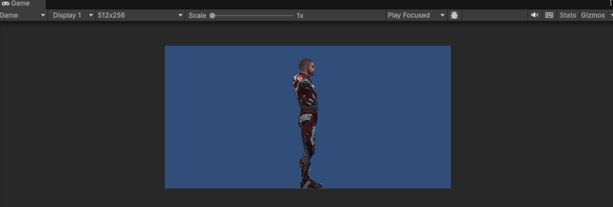
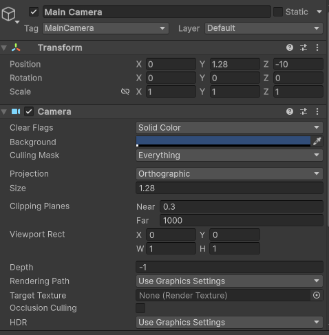
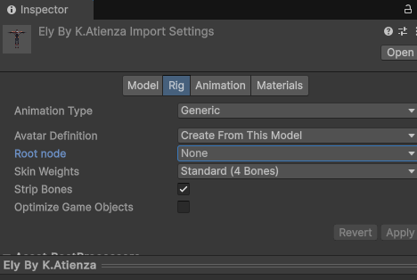
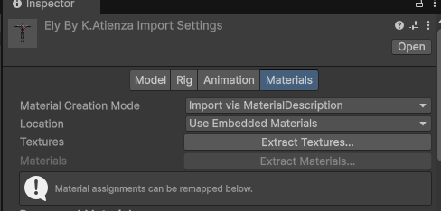
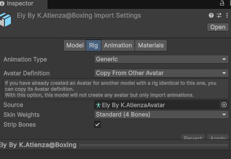
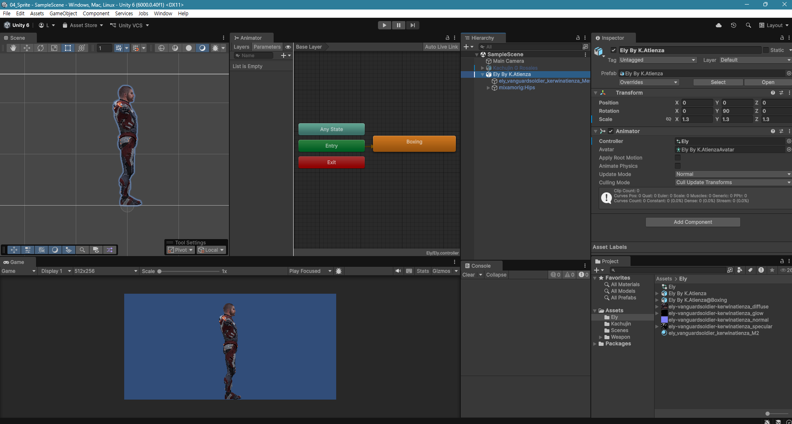
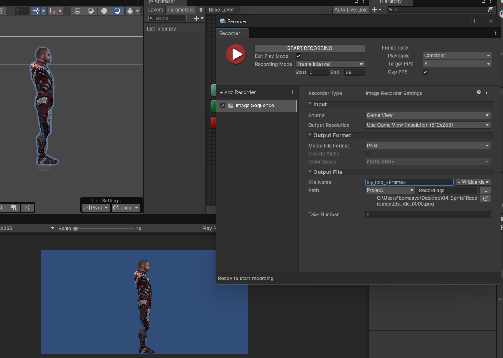
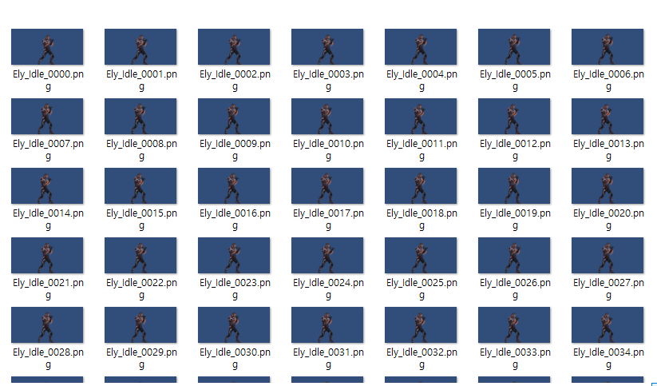

# [U04_Sprite](../UnityStudy_List.md)

- mixamo에서 캐릭터와 애니메이션을 다운로드 받기
    - 애니메이션 : FBX for Unity(.fbx), without skin 설정
    - 캐릭터 : FBX for Unity(.fbx), T 포즈 설정

## [카메라 설정]

- 게임 뷰 해상도를 512x256으로 설정

</img>

- 카메라의 크기 결정
    - 해상도의 y가 256이고 Pixel Per Unit(PPU)가 100.
    - 0, 0, 0이 카메라 센터에 있으니 2로 나누고(128) ppu로 나눠주면 1.28
    - 카메라의 사이즈를 1.28로 설정

</img>

## [캐릭터 추가]

- mixamo에서 다운로드 받은 캐릭터를 Asset 폴더에 추가
- 캐릭터 Inspector에서 설정이 필요함
    - Rig에서 Avatar Definition : Create From This Model

</img>

- 캐릭터 파일도 extract를 해줘야 함
    - Textures랑 Materials를 눌러서 파일을 뽑아줌.

</img>

- 캐릭터를 Hierarchy에 올리면 어둡게 나오는데 Material을 Unlit-Texture로 변경해주면 됨.
- 그리고 옆 모습으로 찍어야 되니까 Rotate를 y축으로 90도 돌려줌

## [애니메이션 추가]

- 애니메이터 컨트롤러(Animator Controller) 만들어서 캐릭터에 붙여줌.
- 애니메이션을 Asset에 추가하고 Inspector로 설정을 바꿔줘야 함.
    - Rig - Avatar Definition : Copy From Other Avatar
    - Source : 캐릭터 아바타(Ely)

</img>

</img>

- 이렇게 Set as Layer Default State로 설정 후 레코딩 하면 프레임 별로 사진 찍혀서 저장됨

</img>

</img>